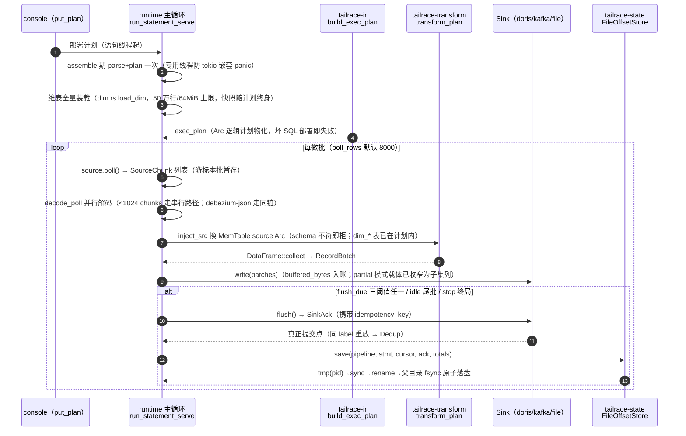
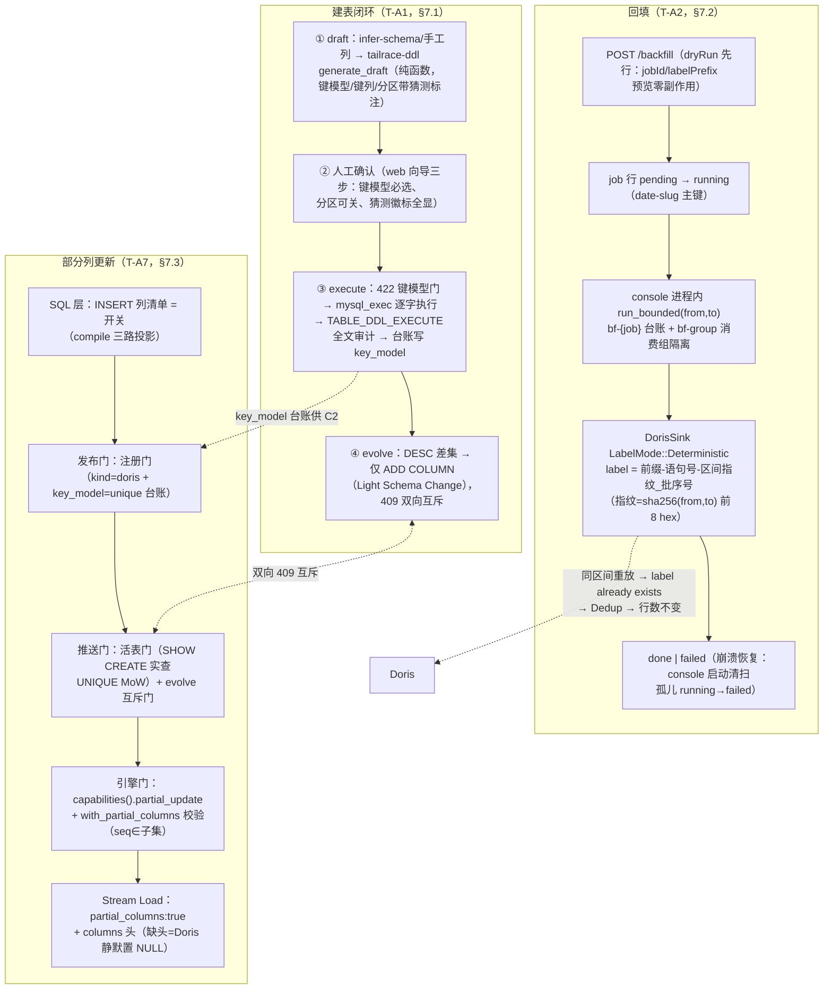
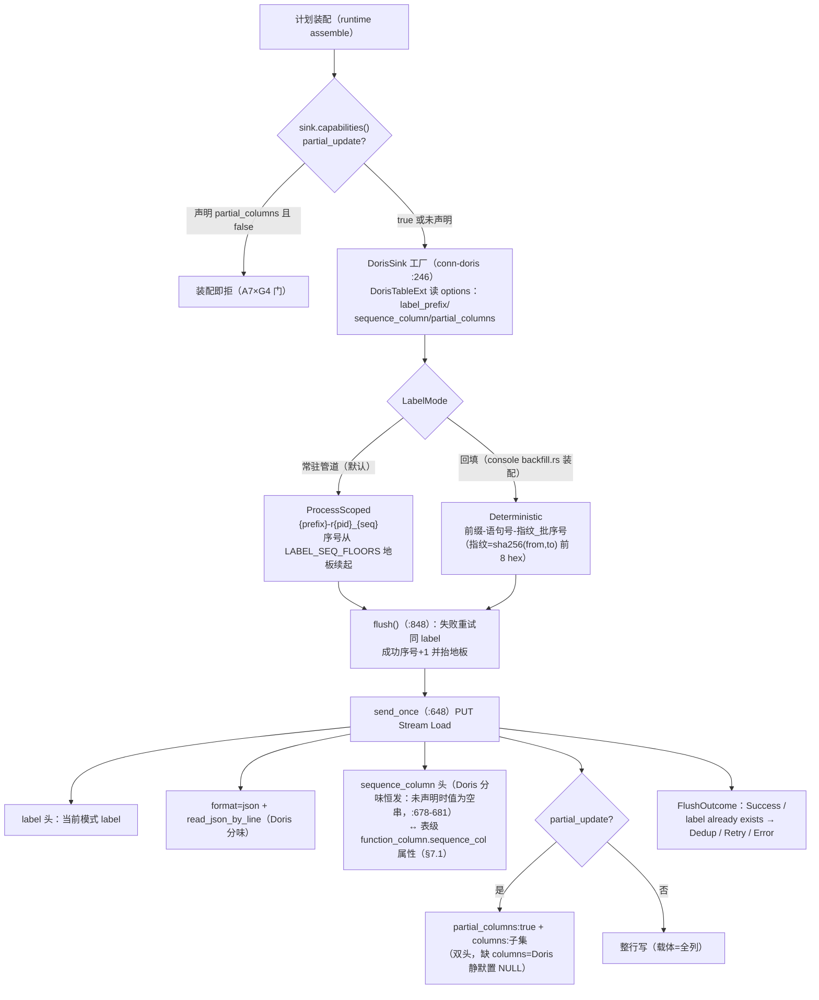
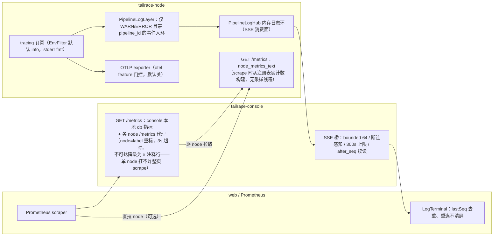
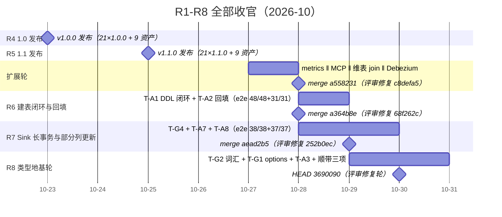
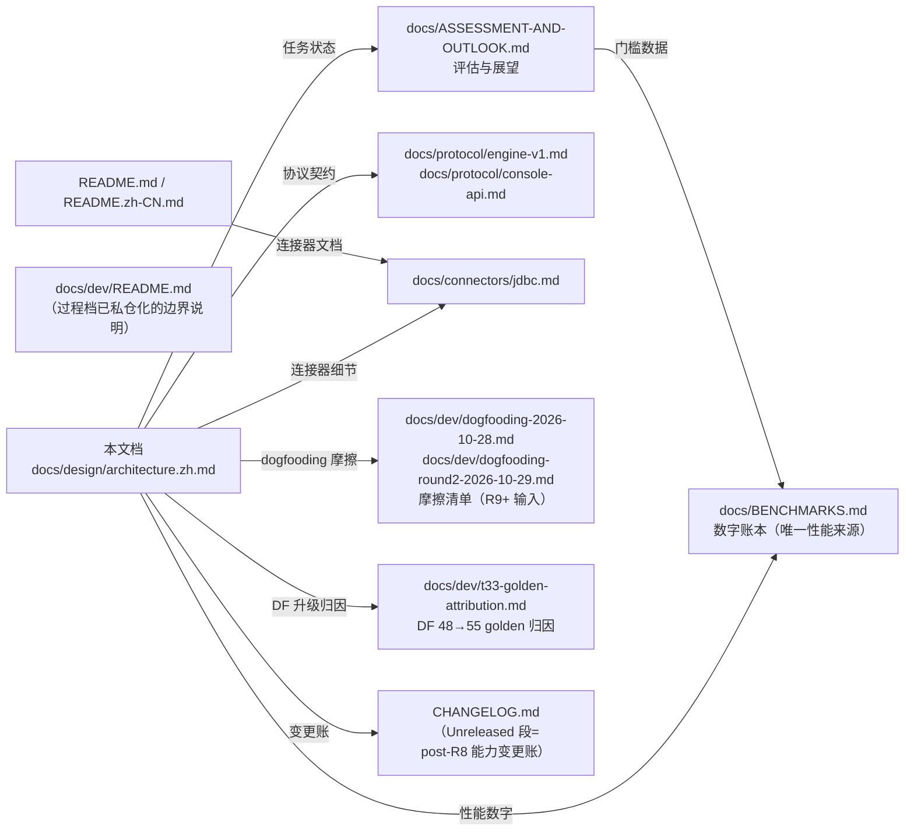

# tailrace 架构设计（post-R8 版）

> 读者：新贡献者与评审者。本文档描述**已落地**的系统形态：基线 = v1.1.0（tag，2026-10-25）**加上其后四轮开发**（扩展轮 feature/mcp-dim-join、R6 feature/ddl-backfill、R7 feature/sink-capabilities、R8 feature/type-foundation，均经评审合并或待合并至工作线），落稿工作树 HEAD `3690090`（分支 `feature/docs-v1.2`，自 feature/type-foundation 同点拉出），不是愿景稿。
> 版本诚实声明：上述四轮能力**尚未随任何 tag 发布**——crates.io 21 包与二进制 release 现值仍为 1.1.0，main 工作线能力超前于已发布版，差异即本文所述十二项能力面（变更账见 CHANGELOG.md Unreleased 段）。
> 三条引用纪律：性能数字一律引 `docs/BENCHMARKS.md` 现值（带行号锚点）；代码锚点 `路径:行号` 可直接点开核对（本文全部行号为 2026-10-30 落稿会话实测）；内部过程档已私仓化，本文只引用公开仓内文件。

## 目录

1. 项目定位与北极星
2. 总体架构
3. 数据面：SQL 管道与执行
4. 游标与容错语义
5. 连接器体系
6. 管理面 console
7. Doris 深度工程化：建表闭环·确定性回填·部分列更新
8. Web 控制台
9. 可观测性
10. 性能账本摘要
11. 工程与质量
12. 路线图现状
13. 附录

## 一、项目定位与北极星

**v1.0：一条 SQL、两个二进制、零 JVM 的数据接入引擎，管理台内置，Doris/StarRocks 写入语义按档位交付（1.0=label 幂等档；事务接口 exactly-once 与 group commit 吞吐档=v1.x，触发条件见 T18 纪要）。**（ASSESSMENT-AND-OUTLOOK.md §一，北极星原文）**v1.0.0（2026-10-23）与 v1.1.0（2026-10-25）均已发布**：crates.io 21 包 lockstep 发到 1.1.0、GitHub Release 各 9 资产（8 tarball + checksums.txt）。

三条差异化支柱（ASSESSMENT-AND-OUTLOOK.md §一；兑现列为 post-R8 工作线实况）：

| 支柱 | 承诺 | post-R8 兑现 |
|---|---|---|
| 单二进制轻量边缘 | 2-4GB 内存盒子可跑引擎+管理台，无 JVM/Temporal/多容器编排 | 裁剪档 node **55,788,080 B（−9.4%）**（BENCHMARKS.md:365）；file→doris 裁剪档 e2e 30/30（:368） |
| SQL-first + DataFusion | 管道即一条 `INSERT INTO 库.表 SELECT …`，不学私有 DSL | parser→IR→transform 全链落地（§三），SQL 计划每语句物化一次（T7 内存治理）；DataFusion 55.2.0（§10.3）；post-R8 起 SQL 语义面扩为「INSERT 列清单=部分列更新开关」+「`${ds:dim.…}` 维表引用」（§三/§七），仍是标准 SQL 无私有 DSL |
| Doris/StarRocks 深度工程化 | 写入语义谱系：label 幂等 → 事务接口 → group commit | label 幂等档已落地（同 label 重放 `FlushOutcome::Dedup`，conn-doris/src/lib.rs:362-368）；post-R8 新增**确定性回填 label**（`LabelMode::Deterministic`，conn-doris/src/lib.rs:187-213，§7.2）与**UNIQUE KEY 部分列更新**（`with_partial_columns`，conn-doris/src/lib.rs:574，§7.3）；建表闭环（§7.1）；事务接口/group commit 维持 v1.x 触发器制（T36 谱系裁决，结论留档于提交 d43fbdc） |

两条红线（ASSESSMENT-AND-OUTLOOK.md §四）：**不拼连接器数量；不做真正流式 join/水位线/状态后端**——post-R8 的维表 join 是**广播 join**（装配期全量装载静态快照，无 watermark/无状态后端/运行期不刷新，runtime/src/dim.rs:1-22 模块文档明示"Broadcast join, NOT a streaming join"），在红线之内而非之外。

轮次结构（提交史实况）：R2 性能与基准（T1-T11 全 ✅）→ R3 亮点特性（T12-T18 必做全 ✅ + T20）→ R4 1.0 发布（2026-10-23 收官）→ R5 1.1 发布（2026-10-25 收官）→ **扩展轮**（T-A6 metrics ‖ T-E4 MCP ‖ T-D1 维表 join ‖ Debezium 解码，merge a558231）→ **R6 建表闭环与回填**（T-A1+T-A2，merge a364b8e）→ **R7 Sink 长事务与部分列更新**（T-G4+T-A7+T-A8，merge aead2b5）→ **R8 类型地基轮**（T-G1+T-G2+T-A3+顺带三项，HEAD 3690090）。详见 §十二。

## 二、总体架构

一句话：Vue SPA 构建产物内嵌进 console 二进制；console 经 `/v1` 协议驱动 node（常驻管道），并自持 DDL 执行/回填/MCP 三条控制面链路；node 内 runtime 主循环驱动 source→decode→transform（含维表快照注入）→sink；游标台账本地原子落盘；Kafka/Doris/StarRocks/MySQL/PostgreSQL 为外部系统，SQLite 为 console 元数据库。

下图给出组件分层与数据流方向（实线=数据/调用主链，虚线=可选门控路径；行数为 2026-10-30 本档落稿会话实测）：

```mermaid
flowchart TB
  subgraph WEB["web/ — Vue 3 控制台 SPA（构建产物 rust-embed 内嵌，web/src 全部 .vue/.ts 共 11254 行：pages 含 parts 8140 + 其余 3114）"]
    PAGES["9 条路由页面 + parts/ 子组件<br/>（TableDdlWizard 建表向导 763 行 / BackfillPanel 回填面板 523 行）"]
    APIW["api 层 7 模块：auth/http/sse/pipelines/nodes/datasources/artifacts"]
  end
  subgraph CONSOLE["tailrace-console（:8080）"]
    ROUTER["axum build_router：45 会话路由 + 2 m2m + /mcp + /metrics + openapi/swagger + SPA fallback"]
    AUTHC["console-auth：argon2id 登录 / 会话 / 锁定 / m2m token"]
    STOREC["console-store：SQLite data/console.db（15 表 4 迁移，WAL）"]
    PROXY["console-proxy：NodeEndpoint /v1 类型化封装 + TCP 连通探测"]
    DEPLOY["deploy.rs：SSH 部署链（russh 公钥认证，八步状态机 + 失败回滚，§6.5）"]
    MCP["mcp.rs：MCP Server（JSON-RPC /mcp，14 工具，写双门禁+审计，§6.7）"]
    DDLCP["api/datasources.rs DDL 三端点 + tailrace-ddl 纯函数生成器（§7.1）"]
    BF["backfill.rs：回填执行器（run_bounded + Deterministic label，§7.2）"]
    METR["metrics.rs：console /metrics（本地 db 指标 + 各 node /metrics 代理聚合，§9）"]
  end
  subgraph NODE["tailrace-node（:18100）"]
    APIE["tailrace-api：/v1 + auth + heartbeat + /metrics"]
    RT["tailrace-runtime：管道主循环 / 注册表 / DLQ / 维表装载 dim.rs / run_bounded"]
    IR["tailrace-ir：计划物化 + Cursor + SourceChunk + ColumnType 十六型词汇"]
    TF["tailrace-transform：DataFusion 55.2.0 执行（物化计划 + dim_* MemTable）"]
    DC["tailrace-decode：json / ogg / csv / parquet / debezium-json"]
    ST["tailrace-state：FileOffsetStore 游标台账（bf- 命名空间隔离）"]
    DDLX["（tailrace-ddl 不入 node —— 控制面专用纯函数 crate）"]
  end
  subgraph EXT["外部系统"]
    KAFKA["Kafka 3.9（含 Debezium CDC 主题）"]
    DORIS["Doris FE/BE 2.1.7（FE MySQL 协议承载 DDL/DESC/SHOW ALTER）"]
    SR["StarRocks（allin1 档）"]
    DB["MySQL 8 / PostgreSQL 15（keyset 增量批源 + 维表全量装载源）"]
    PROM["Prometheus scraper"]
    MCPCL["MCP 客户端（Claude/IDE 等）"]
    SSHD["SSH 目标机（部署 LAN，releases/current/prev 布局）"]
  end
  PAGES -->|"/api 会话（cookie/Bearer）"| ROUTER
  ROUTER --- AUTHC --- STOREC
  ROUTER --- STOREC
  MCPCL -->|"POST /mcp（免会话，限流 100 rps）"| MCP
  PROM -->|"GET /metrics（开放）"| METR
  APIE -->|"register / heartbeat（m2m token；node 经 --control-plane 主动 POST，heartbeat.rs:719/:740）"| ROUTER
  PROXY -->|"/v1（Bearer/X-Node-Token 五级链）"| APIE
  DEPLOY -.->|"SSH 22（TAILRACE_SSH_KEY 公钥）"| SSHD
  DDLCP -->|"mysql_exec DDL/DESC/SHOW ALTER（FE 9030）"| DORIS
  BF -->|"Stream Load（Deterministic label）"| DORIS
  SSHD -.->|"nohup 拉起 node --control-plane 回连"| ROUTER
  APIE --- RT
  RT --- IR
  RT --- TF
  RT --- DC
  RT --- ST
  RT -->|"source / sink"| KAFKA
  RT -->|"Stream Load（label 幂等 / partial_columns / sequence_col 头）"| DORIS
  RT -->|"Stream Load（SinkFlavor 分味）"| SR
  RT -->|"keyset 增量批源 / 维表全量装载"| DB
  PROM -->|"GET /metrics（node 侧同开放）"| APIE
```

### 2.1 引擎 crate 全景（engine/crates/，17 个；行数为 2026-10-30 本档落稿会话实测，含测试括注 src 非测试行）

| crate | 职责 | 行数（含测试括注 src） |
|---|---|---|
| tailrace-runtime | 管道执行主循环 / 注册表 / 重启 / DLQ / 管道日志 / 维表装载 / 有界回填 | 6510（src 3065） |
| tailrace-api | axum REST：console→node 唯一入口（/v1+auth+heartbeat+/metrics）；错误信封带 8 规范码 `code`（lib.rs:20-35） | 2861（src 1888） |
| tailrace-conn-doris | Doris/StarRocks Stream Load sink（同 crate feature 分味）：label 幂等/`LabelMode`、部分列更新、sequence_col 头 | 1970（src 917） |
| tailrace-conn-jdbc | MySQL/PostgreSQL keyset 增量批源 + 维表全量装载路径 | 1454（src 859） |
| tailrace-conn-kafka | Kafka source/sink（BaseConsumer/BaseProducer 同步数据面） | 1146（src 576） |
| tailrace-metadata | discover/infer-schema 元数据客户端 + `mysql_exec`/`doris_show_create`/`doris_alter_column_jobs` 控制面查询（sql.rs:246/:648 域） | 1594（src 1053） |
| tailrace-decode | ColBatch + 5 Decoder（json/ogg/csv/parquet/**debezium-json**） | 2170（src 1169） |
| tailrace-catalog | CatalogProvider + TableObject（5 通用字段+options 化）+ option_keys 键名正典 + `ColumnType` re-export | 1754（src 1067） |
| tailrace-ddl | **R6 新增**：Doris/StarRocks CREATE TABLE 草稿生成器（纯函数，零 IO/tokio；console 专用，node 不链接） | 1273（src 515） |
| tailrace-conn-file | file source/sink（jsonl/parquet）+ bench | 937（src 550） |
| tailrace-parser | SQL 编译（仅 INSERT + `${ds:…}` 表引用 + `${ds:dim.…}` 维表引用 + INSERT 列清单）+ 校验诊断 | 1014（src 520） |
| tailrace-ir | PipelineIr / build_exec_plan / Cursor / SourceChunk / **ColumnType 十六型词汇**（column_type.rs:31） | 1264（src 721） |
| tailrace-transform | DataFusion 55.2.0 执行层（thread_local session + 物化计划 + dim_* MemTable 注册） | 814（src 313） |
| tailrace-state | OffsetStore trait + FileOffsetStore（JSON 台账，bf- 命名空间） | 480（src 326） |
| tailrace-connector | Source/Sink trait（含 G4 长事务钩子 + SinkCapabilities）+ 显式 `ConnectorRegistry` | 422（src 377） |
| tailrace-conn-mqtt | **1 行占位**（T18⑥ 裁决：v1.x + 12 个月触发器） | 1 |
| tailrace-conn-s3 | **1 行占位**（T18⑦a 裁决：v1.x；CDC 走 debezium-json 已落地） | 1 |

DataFusion 依赖面：根 Cargo.toml `datafusion = "55.2.0"` / `datafusion-proto = "55.2.0"`（Cargo.toml:99-100，T33 七版本直跳），随动 arrow/parquet 59.3.1、sqlparser 0.62.0；MSRV 不变（55.2.0 声明 rust-version 1.94 ≤ 工作区 1.95）。

### 2.2 管理面 crate（console/crates/，4 个；行数为 2026-10-30 实测）

| crate | 职责 |
|---|---|
| console-auth | 认证平面：argon2id、暴力锁定、会话 token（cookie/bearer）、m2m bootstrap/per-node token（console-auth/src/lib.rs:1-28） |
| console-store | SQLite 元数据库：WAL + busy_timeout + foreign_keys + synchronous=NORMAL（T8）；rusqlite_migration **4 迁移**自动前滚（00_init 14 表 → 01 `table_object.sequence_column` → 02 `backfill_job` 表 → 03 `table_object.key_model`，migrations/ 目录）；启动 purge 过期会话与指标 + **孤儿回填 job 清扫**（main.rs:115-127，§7.2）；T35 起节点行携 SSH 托管与部署状态列 |
| console-proxy | console→engine HTTP 层：`NodeEndpoint` 类型化 /v1 封装 + `probe_datasource` TCP 探测（3s 超时 / ≤8 端点）（console-proxy/src/lib.rs:1-11、probe.rs:25-40） |
| tailrace-console | lib+bin 装配：build_router、7 个 api 域、compile.rs（内嵌 parser 本地编译）、openapi.rs、spa.rs、state.rs + **mcp.rs（1311 行）/ backfill.rs（383 行）/ metrics.rs（273 行）/ deploy.rs（1104 行）**（tailrace-console/src/lib.rs:5-11） |

## 三、数据面：SQL 管道与执行

管道即一条 SQL：`INSERT INTO ${ds:sink}[(列清单)] SELECT … FROM ${ds:source} [JOIN ${ds:dim.库.表} 别名 ON …]`（仅支持 INSERT；表引用用 `${ds:a.b}` 占位；**列清单=部分列更新开关**（T-A7，parser `insert_column_list`，lib.rs:281）；**`${ds:dim.}` 前缀=维表引用**（T-D1，lib.rs:322-347））。主链自部署到 flush 提交的全过程如下（serve 模式）：

### 3.1 主链函数锚点

| 环节 | 锚点 | 说明 |
|---|---|---|
| 编译 | `engine/crates/tailrace-parser/src/lib.rs:57`（`compile`） | 仅 INSERT、`${ds:a.b}` 表引用；`:281` `insert_column_list` 把 INSERT 列清单解析为 `partial_columns`（`:98` 装配进 StatementSpec）——**零新 DSL，开关即 SQL 本身** |
| 维表引用改写 | 同文件 `:303`（`rewrite_query`） | JOIN 里的 `${ds:dim.datasource.table}` 改写为静态 `dim_<alias>` MemTable 名并收集 `DimJoin`（`:347`）；非 dim 的 JOIN 引用与 `${ds:dim.…}` 出现在 FROM 位都拒绝；**RIGHT/FULL/CROSS JOIN 拒绝**（`:358-359` 诊断 + `:424-430` join_type 归类——静态快照下 RIGHT/FULL 每微批重发未命中维表行、CROSS 按批笛卡尔放大） |
| 校验 | 同文件 `:132`（`validate`） | source kind 白名单 `kafka\|file\|jdbc`；sink `kafka\|file\|doris\|starrocks`；dim 引用须 kind=dim 表对象（`:179-195`） |
| kind 归一 | `engine/crates/tailrace-catalog/src/lib.rs` | `JDBC_TABLE`→doris、`starrocks` canonical；PlanCatalog 表元数据随 plan 推送 |
| 计划物化 | `engine/crates/tailrace-ir/src/lib.rs:45`（`build_exec_plan`） | 组装期 parse+plan 一次（T7）；`:89` `plan_to_b64` proto 序列化；`:102` `b64_to_plan` **仍 gated**（CustomScan qualifier 边界——DF55 下未变，JSON 载体为正典；T33 复核：proto 序列化 golden 跨 48→55 **零字节 diff**，归因见 docs/dev/t33-golden-attribution.md） |
| 组装 | `engine/crates/tailrace-runtime/src/lib.rs:508`（`PipelineRunner::assemble`） | `:537-547` **partial 能力门**：声明了 partial_columns 的 sink 若 `capabilities().partial_update=false` 装配即拒（A7×G4，§7.3）；`:559-585` **维表装载**（dim::load_dim 全量拉取+上限检查）；`:516` 调 build_exec_plan 存 `exec_plan: Arc<LogicalPlan>` |
| 执行 | `engine/crates/tailrace-transform/src/lib.rs:226`（`transform_plan`） | 每微批仅 `inject_src()`（:132）换 source Arc + collect；thread_local SESSION（:88）+ GreedyMemoryPool 默认 256MiB（:53 域） |
| 解码派发 | `engine/crates/tailrace-runtime/src/lib.rs:1526`（`build_decoder`） | format→Decoder 五臂：ogg/None、json/jsonl、csv、parquet、**debezium-json（:1532）**；未知 format 显式报错不折叠 |
| 列类型映射 | 同文件 `:1522`（`arrow_type`，文档注释 :1515-1521） | 委托 `tailrace_catalog::arrow_type_or_utf8`（G2 词汇入口，§3.3） |
| Sink 契约 | `engine/crates/tailrace-connector/src/sink.rs:83`（`Sink` trait） | write/flush 两点 + G4 长事务钩子（:107-121）+ 能力声明（:126，§5.4）；flush=真正提交点，SinkAck 携 idempotency_key（:6-10） |
| 主循环 | `engine/crates/tailrace-runtime/src/lib.rs:819`（`run_statement_serve`） | standalone `run_statement()`（:1088）、有界回填 `run_statement_bounded()`（:1335）三态同构（§4.2） |

### 3.2 三项热路径机制（R2 交付，锚点为 post-R8 现值）

- **T5 分区并行 a（并行 decode）**：`decode_poll()`（runtime/src/lib.rs:346）把同 poll 的 chunks 连续切片分组，scoped 线程并行解码到各自 ColBatch（`PARALLEL_DECODE_MIN_CHUNKS=512`，:296；<1024 chunks 串行，:302），`concat_batches` 按 chunk 序合并=字节级等价（等价性测试钉住）；worker panic 即 bail，游标不跨。验收：kafka(P=6)→file 21396→24658 rows/s（**+15.2%**，BENCHMARKS.md:115）。
- **T6 攒批三阈值**：`RunOptions::flush_due()`（runtime/src/lib.rs:106）单一谓词——行/时间/字节任一满足即 flush，默认 10k 行 / 10s / 8MiB（:91 域），参数语义对齐 Doris Flink connector 的 `sink.buffer-flush.max-rows/max-bytes/interval`；三类 sink 的 `buffered_bytes()` 均为真实测量（file=arrow 内存、doris=carrier 字节、kafka=投递回调在途账）。批分布见 BENCHMARKS.md:310-313。
- **T7 内存治理（计划物化）**：session batch_size 固定为 poll_rows（组装一次定型）；SQL 每微批不再 parse+plan。验收：transform 微基准 identity **+58%** / filter **+20%** / groupby **+30%**（BENCHMARKS.md:110-112）。

### 3.3 列类型词汇：十六型（G2/R8）

`TableObject.columns` 的类型串是一份 **16 词 wire 契约**（`engine/crates/tailrace-ir/src/column_type.rs:30` `ColumnType` 枚举逐词对应）：4 个 legacy 词字节兼容（`utf8`/`int64`/`float64`/`bool`）+ 12 个新词（`string`/`int8`/`int16`/`int32`/`float32`/`decimal(p,s)`/`timestamp(unit)`/`date`/`binary`/`list<float32>`/`variant`/`null`）。参数化词带结构参数（`Decimal{precision,scale}`、`Timestamp(TimeUnit)`、`ListFloat32{dim}`），parse→Display 往返即正典拼写（`parse` :84 严格小写、未知即错）。

- **正典落点在 tailrace-ir**（wire 契约 crate），tailrace-catalog re-export 为稳定公共路径 `tailrace_catalog::ColumnType`（catalog/src/lib.rs:27）——反向放置会成环（catalog 已依赖 ir），这是 R8 实施时记录在案的必要偏差。
- **arrow 映射**：`ColumnType::to_arrow()`（column_type.rs:89）；两个 legacy `arrow_type` 调用点（runtime 装配、dim 装载）走 `arrow_type_or_utf8`（:164）——**迁移窗**（`UNKNOWN_TYPE_UTF8_MIGRATION_WINDOW=true`，:158）：未知词 warn（列名+已知词汇表）后折叠 Utf8，与 pre-G2 行为逐字节同；下个 minor 版本翻 false 变硬错（一个 minor 版本的迁移窗语义，warn 日志捕获测试在树）。
- **DDL 侧映射**：`tailrace-ddl::doris_type`（ddl/src/lib.rs:385-420）映射 13 个标量词；`list<float32>`/`variant`/`null` 留待 live 探针后开放（R7 实证教训：写断言前先探真库）。
- **infer-schema 收窄**：A3 起 Doris DESC 回读的 `text` 映射 `string`（2.1.7 实测 DESC 把 STRING 列打回 `text`，metadata/src/infer.rs:13-14）、`datetime`/`date` 带/不带参数落 `timestamp(us)`/`date`（infer.rs:8-13）；kafka 采样推断接受 debezium-json 格式（infer.rs:142）。

### 3.4 解码格式族：五 Decoder 与 Debezium CDC 窄口

decode crate 五个 Decoder（lib.rs:776 JsonDecoder / :834 OggDecoder / :950 **DebeziumJsonDecoder** / :1055 CsvDecoder / :1134 ParquetDecoder），runtime `build_decoder`（:1525-1534）按表对象 format 派发。**debezium-json 是 CDC 的廉价路径**（T18⑦a 评估落地）：消费 Kafka 上的 Debezium CDC 事件，`after.*` 即行数据，语义边界（decode/src/lib.rs:940-1053）：

| 事件形态 | 处置 | 锚点 |
|---|---|---|
| 删除（op=d）/ 墓碑（null 载荷、空 buffer）/ 退化 wrapper | **Skip**（v1 丢弃删除——目标表键模型去重叙事下，删除需显式投影，留待后续） | walk 内三处 Skip 分支 |
| `schema`+`payload` 双键 wrapper | 解包取 payload（裸信封两者皆不带） | |
| c/r/u 事件缺 `after` 键 / after 非对象 | **Bad**（走 BadRowPolicy：真事件必带 after，缺键=错投递的生产者，必须可见而非静默消失） | |
| i64 溢出数值 | 解码为 null（Json/Ogg 同族行为） | |

metadata 侧同步：engine 元数据客户端的 format 白名单接受 `debezium-json`（metadata/src/lib.rs:163-165），infer-schema 走 `after.*` 推断（infer.rs:109-142、:387-412 测试域）。Debezium v1 信封不携 op_type 键，Pushdown 下推对其不生效（与 OGG 的差异，模块文档注明）。

### 3.5 维表广播 join（T-D1/扩展轮）

**广播 join，不是流式 join**（红线内实现）：维表在**管道装配期**（编译时）经 JDBC 全量装载为静态 `dim_<别名>` MemTable 注册进语句计划——无 watermark、无状态后端、运行期不刷新；快照随计划终身，重启重装（runtime/src/dim.rs:1-22 模块文档）。

三道装配期护栏（fail-fast，绝不 OOM）：

| 护栏 | 默认 | 锚点 |
|---|---|---|
| 行数上限 | 500,000 行（`RunOptions::dim_max_rows` / plan tuning `dimMaxRows`） | dim.rs:36、runtime/lib.rs:77 |
| 内存上限 | 64 MiB（按解码后 Arrow 数据实测，`get_array_memory_size`） | dim.rs:39、runtime/lib.rs:81 |
| **唯一键必检** | 维表必须声明 `sequence_column`（PK/单列 UNIQUE），复用 JDBC 源 keyset 唯一性探针——无唯一键的维表**拒绝编译**（笛卡尔放大护栏） | dim.rs:85-91、装载路径 :112-115 |

装载路径（dim.rs:72 `load_dim`）：kind=dim 表对象改写 kind=jdbc 桥接连接器注册表（:103-111，未编译 JDBC feature 的二进制在此失败）→ `SELECT * FROM t ORDER BY key ASC LIMIT page`（每页 10k 行，:43）逐页 drain、页间查上限 → 声明 schema 逐行 JsonDecoder 解码（坏行拒载，:129-136）→ concat 为单一快照批。SQL 面：`${ds:dim.datasource.table}` 引用只允许出现在 JOIN 位（FROM 位拒绝，parser lib.rs:322-326），JOIN 类型限 INNER/LEFT（RIGHT/FULL/CROSS 拒绝，:358-359）。回填执行器不支持带 dim 的语句（BACKFILL_DIM_UNSUPPORTED，§7.2）。

## 四、游标与容错语义

**核心承诺：at-least-once，游标只在 flush 成功后整图提交。**

### 4.1 Cursor 四型与 SourceChunk

`engine/crates/tailrace-ir/src/cursor_sourcechunk_impl.rs:4`：

| Cursor 型 | 载荷 | 适用 |
|---|---|---|
| `Kafka` | topic + group + `offsets: BTreeMap<i32,i64>`（分区→next offset） | kafka 源 |
| `File` | path + byte_pos | file 源 |
| `JdbcKey` | key + value | jdbc keyset 批源（游标列须 PK/单列 UNIQUE，fail-fast 探针把关） |
| `None` | — | 无位点语义的源 |

`SourceChunk`（:54）：`raw: Vec<u8>` + `partition: Option<i32>` + `next_offset: Option<i64>`（kafka/plain 两构造）。

### 4.2 flush 点整图提交（at-least-once 锚）

三种语句体同构（serve / standalone / **有界回填 bounded**），全部先 `sink.flush()?` 再 `state.lock()…save(…)`：

| flush 点 | serve 锚点 | standalone 锚点 | bounded 锚点 |
|---|---|---|---|
| idle 尾批 | lib.rs:920-929 | lib.rs:1122-1131 | —（bounded 无 idle） |
| 三阈值触发 | lib.rs:1010-1034 | lib.rs:1206-1230 | lib.rs:1381-1390 |
| 终局 | lib.rs:1049-1068 | lib.rs:1244-1263 | lib.rs:1473-1505 |

**锁中毒防御（T39 ④）**：全部 `state.lock()` 站点统一 `unwrap_or_else(|e| e.into_inner())`（lib.rs:1082 域注释 + 各调用点）——兄弟语句线程 panic 不再把毒锁级联进游标提交路径。

**回填的台账隔离（T-A2 验收锚）**：`backfill_state_dir()`（lib.rs:1560-1568）把回填游标落进 `bf-{jobId}` 独立命名空间——回填无论成败**永不读写主管道台账**（§7.2）。

台账耐久性（tailrace-state/src/lib.rs:1-14）：tmp(pid)→sync_data→rename→父目录 fsync；损坏文件 `.corrupt` 隔离 + `.bak` 回退，仍不可读则 **fail closed**。

### 4.3 语句生命周期与 NO_PROGRESS 判决

语句生命周期（RUNNING/PAUSED/RETRY/FAILED/STOPPED 状态机、指纹判进、poll 指数退避 1s→300s）自 v1.1.0 未变，锚点现值：`NO_PROGRESS_LIMIT=3` 写死（registry.rs:30）、`cursor_progress()`（registry.rs:57）、判决比对（registry.rs:459 域）。回填语句体走同一重启契约的有界变体（`run_bounded` 入口 lib.rs:773：drain statements 后每语句一线程 `run_statement_bounded`（:1335），`to` 对齐粒度=一 poll，跨界 poll 整批处理）。

### 4.4 DLQ / BadRowPolicy

坏行在**整 poll decode 完成、游标跨批之前**统一处理（`handle_bad_rows()`，engine/crates/tailrace-runtime/src/lib.rs:218）——debezium-json 的 Bad 行（缺 after 键的信封）同样走此链：

| 策略 | 定义锚点 | 行为 |
|---|---|---|
| Dlq（默认） | engine/crates/tailrace-runtime/src/dlq.rs:40、:86 | 落 `state_dir/bad_rows/p{p}-s{s}.jsonl`，记录含 tsMs/pipeline/statement/**poll 时游标**/rawB64（手工恢复锚） |
| Fail | dlq.rs:40、runtime/src/lib.rs 语句体 bail | 即停（毒数据停管道而非丢弃） |
| Skip | dlq.rs:40 | 仅计数 |

## 五、连接器体系

**注册模型**：显式 `register()` 调用（node `build_registry()`，engine/bin/tailrace-node/src/main.rs:25-51）——≤10 个连接器保持一眼可读，不引入 inventory/linkme 类注册宏。未知 kind 报「源类型未支持：{kind}（本二进制未编译该连接器 feature）」（tailrace-connector/src/registry.rs:122）——裁剪是注册表级语义，不只是字节（负向探针见 BENCHMARKS.md:530）。

**feature 门控**（node Cargo.toml）：default=connector-kafka/file/doris；`connector-jdbc`、`connector-mqtt`、`connector-s3` 为门控 feature（jdbc 已真实现；mqtt/s3 仍占位）；`otel` 与 `jemalloc` 默认关。T16 后 node 的三个默认 connector-* feature 透传 runtime 同名 feature；`connector-jdbc` 仅在 node 侧（runtime Cargo.toml 无同名 feature），`run`/`serve` 两子命令均经 node `build_registry()` 装配（main.rs:71/:148），故两子命令注册面一致。

### 5.1 现状矩阵（五个真连接器：kafka/file/doris/starrocks/jdbc；mqtt/s3 占位）

| kind | 方向 | 注册点 | 能力要点 | 状态 |
|---|---|---|---|---|
| kafka | source+sink | conn-kafka lib.rs:46 | BaseConsumer 手管位点（assign-only 恢复）；30s 动态分区发现（lib.rs:224-239、:780 域）；半批 seek 回滚；sink JSON-lines 载体 + 真实在途 buffered_bytes（T6）；**debezium-json CDC 消费**（§3.4） | ✅ |
| file | source+sink | conn-file lib.rs:19 | jsonl/parquet；buffered_bytes=arrow 内存估；R6 修复 cwd 错位（引用按登记目录绝对化） | ✅ |
| doris | sink | conn-doris lib.rs:246 | Stream Load BE 直连，JSON-lines 载体；**`LabelMode` 双模**（ProcessScoped 默认=进程内唯一；Deterministic=回填确定性，§7.2）+ `LABEL_SEQ_FLOORS` 同进程重建防撞（lib.rs:219-243）；`sequence_column` 头（send_once :677-683，乱序去重基）；**部分列更新**（`with_partial_columns` :574 + `partial_columns`/`columns` 双头 :699-700，§7.3）；`SinkCapabilities{idempotent_label:true,…}`（:826-830）；重试退避 2s→8s→30s | ✅ |
| starrocks | sink | conn-doris lib.rs:246（feature 默认开） | `SinkFlavor`（:142）同工厂按 kind 分味：8030 端口 / 无 read_json_by_line / **无 sequence_column 头** / FE 307 redirect 跟随；**partial_columns 显式拒绝**（工厂 :339-346——StarRocks 部分列更新是另一套主键+`partial_update` 头契约，未接线）；console 一等 datasource 类型（v1.1.0 起） | ✅ |
| jdbc | source | conn-jdbc lib.rs:73 域 | sqlx 双方言（MySQL/PostgreSQL）；keyset `WHERE col>? LIMIT n` 增量；游标列唯一性 fail-fast 探针；**维表全量装载路径**（§3.5） | ✅ |
| mqtt | — | 不注册（占位） | 1 行 crate | 占位（T18⑥） |
| s3 | — | 不注册（占位） | 1 行 crate；CDC 需求已由 debezium-json 覆盖 | 占位（T18⑦a） |

配套：`tailrace-metadata`（discover/infer-schema + 控制面查询族——`mysql_exec` sql.rs:246 顺序执行带逐条计时、`doris_show_create`、`doris_alter_column_jobs`，§7 的执行底座）。已知边界：doris 型 discover 的 9030 文本协议未在真 Doris FE 实测（docs/connectors/jdbc.md §七）。

### 5.2 动态分区发现（自 v0.1.0 已在，T15 补三层测试）

每 30s `fetch_metadata`（5s 超时）差异对比（conn-kafka/src/lib.rs:224 起）；新分区按语句起始位入 offsets map；assign 模式显式 TPL 重建 + paused 重暂停。发现延迟实测 subscribe 26.8s / assign 30.7s（BENCHMARKS.md:370）。已知单向限制（只增不减）排 v1.x。

### 5.3 表对象目录与 options 化（G1/R8）

`TableObject`（catalog/src/lib.rs:80）收敛为「**5 个通用字段 + options 映射**」：datasource / name / kind / format / columns 保持类型化，其余连接器专属配置全部进 `options: TableOptions`（BTreeMap<String, Value>，:107）。

- **键名正典 `option_keys`**（:35-57）：`bootstrap`（kafka broker/file 目录/jdbc URL）/ `stream_load_url` / `auth_env` / `label_prefix` / `sequence_column`（一键三义：dim=全量装载分页键、jdbc=增量游标列、doris=UNIQUE KEY 乱序去重基）/ `partial_columns`——**拼写单点**，三处消费方不会漂移。
- **typed accessor**：语义归各连接器的 `*TableExt`——`KafkaTableExt`（conn-kafka :31）、`DorisTableExt`（conn-doris :256，含 `sequence_column()` :292 / `partial_columns()` :295）、`JdbcTableExt`（conn-jdbc :80）、`FileTableExt`（conn-file :49）。
- **单一构造点**：`TableObject::new`（catalog :115）+ `with_*` builders——原 17+ 处 struct literal 收敛为一（grep "TableObject {" 只剩工厂体与定义）。
- **serde 迁移窗**：序列化对 6 个 legacy 键**双写**（options + 旧顶层拼写，`option_keys::LEGACY` :54-61），读取时 legacy 拼写折叠进 options（`fold_legacy` :257-262，显式 options 键优先）——一个 minor 版本窗口后收窄为 options 单轨；跨窗口行为由「旧字段名+新词汇」交叉测试钉住（commit 3690090）。

### 5.4 Sink 长事务钩子与能力声明（G4/R7）

`Sink` trait（connector/src/sink.rs:83）新增两组默认成员：

- **长事务钩子** `prepare/commit/abort`（:107-121）——默认全 no-op：flush 仍是唯一提交点，存量 sink 零改动行为不变。真具备暂存能力的 sink（Doris 2PC stream load、湖格式提交，T36③ 谱系）落地时覆写并声明 `transactional`，引擎只在能力声明为真时驱动钩子。
- **`SinkCapabilities`**（:18-43）：静态能力面 `idempotent_label / transactional / overwrite / partial_update / partition_aware`。**旗标是真分支点而非装饰**：runtime 装配对「声明 partial_columns 但 `partial_update=false` 的 sink」直接拒绝（runtime/lib.rs:537-547）——file/kafka 写子集行会被静默当成整行写。现值：doris `idempotent_label=true`（conn-doris :826-830，partial_update 随实例翻转），其余 sink 全默认 false（契约锁定 tests/contract/tests/sink_capabilities.rs，5 测试）。

## 六、管理面 console

### 6.1 API 面（tailrace-console/src/lib.rs:34-203）

| 域 | 路由数 | 内容 |
|---|---|---|
| 开放 | 5 | `/healthz`、**`GET /metrics`**（metrics.rs:40，Prometheus 惯例无会话，§9）、`POST /api/auth/login`(:190)、swagger-ui + openapi.json(:199)、SPA fallback(:201) |
| 会话域（require_session；上传限 512MB） | **45** 路径模式 / **54** 方法处理器 | auth 2；datasources **13 路径 / 17 处理器**（含 datasource-types 1；CRUD/test/discover/infer-schema/登记 + `{id}/tables/{db}/{table}/ddl/{draft,execute,evolve}` 三端点 :86-95 + `PUT /api/datasources/tables/{id}` 键模型登记（T-A7 门禁基，lib.rs:57-60——与 DELETE 同路径、不在 `{id}/tables` 嵌套下）;`GET /api/datasources/tables` 行携 `columnsJson`（datasources.rs:338-347，§6.6））；nodes admin **12 路径 / 13 处理器**（deploy/action/deploy-log 真实现，§6.5）；artifacts **2 路径 / 3 处理器**；pipelines **16 路径 / 19 处理器**（CRUD/compile/templates/publish/deploy/pause/resume/stop/recover/stats/offsets/logs(SSE)/metrics-trend + **`POST {id}/backfill` / `GET {id}/backfill/jobs`** :151-158，§7.2）——两口径均为 2026-10-30 实测（路径=`.route(` 调用数，处理器=`get/post/put/delete(api::…)` 数） |
| m2m 免会话 | 2 | `POST /api/nodes/register`、`POST /api/nodes/heartbeat` |
| MCP 免会话 | 1 | `POST /mcp`（mcp::router :175-180，§6.7） |

openapi（utoipa 6）：**58 path 条目 + 86 DTO** 全登记（openapi.rs:43-150 paths 清单与全仓 `derive(ToSchema)` 互证——DDL 8 个、backfill 6 个、`PartialUpdatePipeline` 等新 DTO 入册），`$ref` 走查测试在树（openapi.rs:165 `every_schema_ref_resolves`）。

### 6.2 认证链路

浏览器登录（argon2id / 5 连败锁 60s / `tr_s_` 会话双通道）、node 注册轮换（bootstrap 准入 → `tr_b_` per-node token）、心跳收编、计划下发四链自 v1.1.0 未变。锚点：argon2id（console-store/src/password.rs）、会话 TTL 86400s（console-auth/src/session.rs）、bootstrap 仅首注（console-auth/src/bootstrap.rs）、数据源凭据 AES-256-GCM（console-store/src/secretbox.rs）。MCP 是**独立于该链路的免会话面**（§6.7），写操作靠进程开关+confirm 双门。

### 6.3 SQLite 元数据（15 表 / 4 迁移）

`console-store/migrations/`：`00_init.sql` 14 表（user/session/datasource/datasource_credential/table_object/node/artifact/deploy_log/node_event/pipeline/pipeline_version/pipeline_metrics/node_metrics/audit_log）→ `01_table_sequence_column.sql`（table_object 加 `sequence_column`，:7）→ `02_backfill_job.sql`（**backfill_job 表**，:10-24：date-slug TEXT 主键 / pipeline_id / statement_index / from_json / to_json / state `pending|running|done|failed` / rows_written / error / finished_at）→ `03_table_key_model.sql`（table_object 加 `key_model`，:10——T-A7 注册门禁的台账基）。pragmas 与 OFFLINE 判定沿旧（WAL + busy_timeout + foreign_keys + synchronous=NORMAL；90s 读时计算）。

**数据源类型注册表**（`GET /api/datasource-types`，datasources.rs:213 静态注册）：kafka / doris / starrocks / file / mysql / postgresql；`table_kind_for` 派生表对象 kind（:204——doris 与 starrocks 各自独立 kind，折叠会让引擎把 Doris 专属头发给 StarRocks FE）；cursor_semantics 派生 kafka→KAFKA_OFFSET、file→FILE_POINTER、jdbc→JDBC_KEY、doris/starrocks→NONE。

### 6.4 /v1 引擎协议（docs/protocol/engine-v1.md ↔ 代码一致）

| 面 | 内容 | 锚点 |
|---|---|---|
| 路由 | POST /v1/compile；GET /v1/pipelines；PUT /v1/pipelines/{id}/plan；GET stats/logs/offsets；POST {action}；/healthz 与 **/metrics** 唯二开放 | tailrace-api/src/lib.rs:121 域、:400-406 |
| 鉴权 | 整面 Bearer/X-Node-Token，缺/错 401 统一错误信封（8 规范码）；token 五级优先链 | auth.rs:143-174 |
| 轮换 | register 回声轮换 current，启动凭据终生为辅助集 | auth.rs:17-18 |
| 心跳 | 事件环 64、默认 30s、身份三层、回声收编 | heartbeat.rs:1-19 |
| 契约测试 | v1_protocol 4 + executor_loop 3 + **sink_capabilities 5** | tests/contract/tests/（12 项） |

### 6.5 SSH 部署链（T35，v1.1.0）

八步状态机 `PENDING→PREFLIGHT→UPLOAD→UNPACK→CONFIGURE→START→HEALTH_WAIT→REGISTER→REGISTERED`（console/src/deploy.rs:424 `run_deploy_chain`；编排入口 `POST /api/nodes/deploy`）自 v1.1.0 未变：russh 纯 Rust 传输仅公钥认证（`TAILRACE_SSH_KEY`，deploy.rs:37-39）、host key 首连即信、远端 releases/current/prev 布局、任一步失败回滚（prev→current 恢复+旧二进制重启+健康再确认）、REGISTER 核对 engine_version（:351 `wait_registered`）；进程动作 start/stop/restart/rollback/uninstall 同步、upgrade 异步走全链；`migrate`/`ticket` 留 501。测试：状态机单测 + docker 目标机 e2e（live-gate `#[ignore]` 形态）。

### 6.6 i18n message_key 通道与 columnsJson DTO

- **engine 侧**：`tailrace-api` 错误响应携 `code` 字段（8 个规范码常量单点，engine/crates/tailrace-api/src/lib.rs:20-35）。
- **console 侧**：zh 单轨字典 `api/messages.rs`——现值 **77 key**（2026-10-30 实测；T34 交付时 36，T35 +3，**R6 DDL 三端点 +14 站点**、R7/R8 partial/backfill/词汇门禁再增），信封 `{"error":{code,message,message_key[,refs]}}`；字典完整性由源码扫描测试钉住、ApiError 字面量站点清单制钉住（豁免可查不可悄悄扩大）。
- **columnsJson**：`GET /api/datasources/tables` 行 DTO 携 `[name,type]` 对（手工登记或 infer-schema 产出）——web SQL 编辑器 `db.table.` 列补全由它喂数（datasources.rs:338-347）；**类型串即 §3.3 十六型词汇**，A3 起 web 向导下拉同源。

### 6.7 MCP Server（T-E4/扩展轮，R8 扩至 14 工具）

`POST /mcp`（console/src/mcp.rs:175-180 挂载）：JSON-RPC 2.0、Streamable HTTP 请求/响应形态（无服务端→客户端 SSE 流；单消息单 POST，batch 拒收——MCP 2025-06-18 移除）；`initialize` 发 `Mcp-Session-Id`，后续调用归因到 `clientInfo.name`（回退 `X-MCP-Client`/`User-Agent`）。协议版本 2025-06-18（旧版 2025-03-26/2024-11-05 回显，mcp.rs:59-60 `PROTOCOL_VERSION`/`SUPPORTED_PROTOCOL_VERSIONS`）。

**十四工具表**（`TOOLS` :90-105，§7.5 十 + R8 四；≤16 预算内）：

| 工具 | 读写 | 映射（method, path） |
|---|---|---|
| list_datasources / list_pipelines / get_pipeline / get_pipeline_stats / get_pipeline_logs | 读 | 对应 GET 端点 |
| compile_sql | 读 | POST /api/pipelines/compile |
| create_pipeline / deploy_pipeline / pause_resume_pipeline（action 选择） | **写** | 对应写端点 |
| trigger_backfill | **写** | POST /api/pipelines/{id}/backfill，**dryRun 默认 TRUE**（MCP 调用者零副作用预览，mcp.rs:36 模块文档 / :865 入参 schema `"default": true` / :575-590 handler 取参） |
| ddl_draft | 读 | POST …/ddl/draft（纯文本组合，无副作用） |
| ddl_execute / ddl_evolve | **写** | POST …/ddl/execute、/ddl/evolve（真跑 DDL） |
| backfill_status | 读 | GET /api/pipelines/{id}/backfill/jobs |

- **写双门禁**（六个写工具）：进程级开关（`--mcp-allow-write` / `MCP_ALLOW_WRITE=1`，`McpState::from_env` :136）**且**调用参数 `"confirm": true`——只过一门即 `WRITE_DISABLED`(-32001)。
- **审计全覆盖**：每次调用（成功/失败/被拒）落 `audit_log` 为 `MCP_TOOL_CALL`、`actor = mcp:<client>`；未到达工具层的尝试（UNKNOWN_TOOL / INVALID_PARAMS）也审计；过门禁的写调用另产生 REST handler 自身的域审计行（PIPELINE_CREATE 等）同一 actor。
- **描述 OpenAPI 同源**（R8）：每工具描述由 `(method, path)` 从 OpenAPI 文档生成（`openapi_tool_description` :748，`tool_route` :708）——utoipa 注解单源服务 swagger-ui 与 MCP 两面，无第二份手写描述可漂移；单测钉住每个工具的路由在文档中可解析。
- 每工具是 REST handler 的**进程内薄适配**（同 DTO、同错误信封、零 HTTP 跳）；`/mcp` 免会话按 MCP 惯例，仅有全局固定窗限流 100 rps（`RATE_LIMIT_PER_SEC` :68，超限 -32002/429）。

## 七、Doris 深度工程化：建表闭环·确定性回填·部分列更新

本章三项能力（R6 的 T-A1/T-A2、R7 的 T-A7）共享一个设计立场：**把 Doris 的键模型/标签语义做成控制面可声明的契约**，而不是让管道在 3am 用 stream load 报错来发现。控制面数据流全景：

### 7.1 建表闭环（T-A1/R6）

**分工**：`tailrace-ddl` crate 只组合文本（schema+hints 进，draft DDL+标注出；零 IO/tokio/集群探测——纯度让 9 组快照测试有意义，ddl/src/lib.rs:1-35）；console 持有推断、BE 数探测、人工确认步；执行走 `tailrace-metadata::mysql_exec`（sql.rs:246：单连接顺序执行，首错中止带 1-based 位置与服务器原文，MySQL DDL 自动提交无回滚——错误即部分态如实上抛）。

四步闭环（端点 `POST /api/datasources/{id}/tables/{db}/{table}/ddl/{draft,execute,evolve}`，datasources.rs:1896/:2013/:2172）：

1. **draft**（①+②）：`generate_draft`（ddl/src/lib.rs:169）产 `DraftDdl`（:143——完整 DDL 文本、键模型+推荐理由、键列+猜测徽标、分区候选+跳过原因 notes）。规则面：CDC 证据（声明 sequence_column 或含 op_type 列）推荐 UNIQUE KEY（:199-212）；键列 id/`*_id` 启发式猜测（未确认即标注）；分区候选**只给实测可建形态**（R6 评审教训：VARCHAR 分区列/UNIQUE 非键列在真 Doris 必败——int64 候选带 yyyyMMdd 整数区间 caveat，时间类型 A3 起直取 RANGE 键，:231-266）；`doris_type`（:385）映射 13 标量词、未映射显式报错不折叠（:184-192）；属性序固定保快照稳定：MoW → sequence_col → 动态分区 → replication（:311 域）。
2. **人工确认**（web 向导，§8）：键模型三选一必选、分区可确认可关（`KeyHints.partition=Some(false)` 即无子句无属性）、猜测徽标全显。
3. **execute**（③）：**422 三门先于任何连接**——keyModel 缺失/未知（KEY_MODEL_REQUIRED）、ddl 缺失（DDL_REQUIRED）、回显文本的键子句与确认模型不符（KEY_MODEL_MISMATCH——过期草稿/错配客户端不许审计谎言，datasources.rs:2038-2085）；过门后 `mysql_exec` 逐字执行（不改写、无 allowlist——确认的文本即门），成败均审计 `TABLE_DDL_EXECUTE`（:2096/:2120：全文+耗时 / Doris 原文），成功后台账补写 key_model。
4. **evolve**（④）：DESC 差集**仅执行 ADD COLUMN**（Light Schema Change；改类型/删列只报告不执行）；与 partial 双向互斥（:1559-1566 PARTIAL_UPDATE_NOTICE：该表有已部署 partial 管道 → 409 PARTIAL_UPDATE_ACTIVE；反之 partial 部署查 SHOW ALTER TABLE COLUMN 未完结 → 409 SCHEMA_CHANGE_IN_PROGRESS）；审计 `TABLE_DDL_EVOLVE`（:2286/:2312）。

**sequence_col 属性（R8 顺带，dogfooding #3 清偿）**：UNIQUE KEY + 声明 sequence_column 时，生成器附表级属性 `"function_column.sequence_col" = "<列>"`（ddl/src/lib.rs:316-331）——没有它 Doris 静默忽略引擎的 `sequence_column` stream load 头（Status Success 但低序写覆盖高序行，2.1.7/3.1.4 双栈 live 探针实证）；列本身保持普通声明列，DUPLICATE KEY 下只留 notes 提示无去重语义（:227-232）。

### 7.2 回填与确定性 label（T-A2/R6）

**问题（finding F1）**：常驻管道的 label 是进程作用域（`{prefix}-r{pid}_{seq}`）——重启重放拿新 label，Doris 不去重，靠表键模型吸收，这对常驻管道成立；但**回填**要求同一区间跨进程映射同一 label，否则重放双提交。

**解法三件**：

- **`LabelMode::Deterministic`**（conn-doris/src/lib.rs:187-213）：label = `{prefix}-{statement_index}-{fingerprint}_{seq}`，fingerprint = `range_fingerprint(from,to)` = **sha256(from,to) 前 8 hex**；`_` 批序号是 label 公式的必要扩展（一区间一 label 会让区间第二次 flush Dedup 静默丢数据；重放的第 k 批仍得序号 k——此模式豁免序号地板）。幂等窗口 = Doris label 保留期（默认 3 天），更旧重放回落表键模型（随回填 API 文档化）。
- **`ProcessScoped` 的地板修复**（同进程 stop→deploy 重建场景，R6 计划外真 bug）：`LABEL_SEQ_FLOORS`（:219-243）进程级记录每前缀已成功 flush 的最高序号，新实例从地板续起——否则新实例 `_0` 复用旧 label → Dedup 静默丢批而台账推进。
- **执行面**：console 进程内 `PipelineRunner::run_bounded(from,to)`（runtime/lib.rs:773）——控制面自持已发布 spec/plan 表解析/密封凭据，是对「console 经 /v1 驱动 node」的一次性例外（常驻管道路径不动，backfill.rs:1-16 架构注记）。游标落 `bf-{jobId}` 命名空间（`backfill_state_dir` :1566）、消费组 `bf-{job}.s{n}`（backfill.rs:58）——**回填永不触碰常驻消费组与主管道台账**；Deterministic 前缀**不含 jobId**（`tr-p{id}-s{n}-bf`，:50）——同区间新 job 复现同 label 才收敛。

**job 面与崩溃恢复**：`POST /api/pipelines/{id}/backfill`（pipelines.rs:2331）——`dryRun:true` 零副作用预览（jobId/estimatedRows=null 诚实降级/labelPrefix）；`false` 建 pending job 行（02_backfill_job.sql：date-slug 主键命名台账目录/审计/label）。语句约束：doris/starrocks 汇（BACKFILL_SINK_UNSUPPORTED :2255）、**不支持带 dim 的语句**（:2196——广播快照对有界重放的语义未定义，先拒）、partial 声明重过门（:2260 域）。状态机 pending→running→done|failed 为**比较交换更新**（终态不可变，console-store/src/backfill.rs:1-5）；**崩溃恢复**：console 启动期把上一进程遗留的 pending/running 孤儿 job 标 failed（main.rs:115-127 `fail_orphaned_backfill_jobs`）——jobs 列表永不显示幻影 running。验收：DUPLICATE KEY 表同区间重放两次行数不变（e2e 31/31，§11）。

### 7.3 部分列更新（T-A7/R7）

**开关即 SQL**：`INSERT INTO t(k, a, b) SELECT …` 的列清单从「被静默忽略」重定义为部分列更新声明（parser `insert_column_list` lib.rs:281 → `StatementSpec.partial_columns`）——零新 DSL；裸 INSERT（无列清单）=整行写，行为不变。语义：Doris UNIQUE KEY merge-on-write 行合并——未列出列**保留旧值**，载体收窄为子集列（SELECT 须恰好投影子集、按声明序）。

**四道门（fail-fast 层层前移）**：

| 门 | 层 | 内容 | 锚点 |
|---|---|---|---|
| 注册门 | 发布 | sink kind=doris（starrocks 拒）+ 台账 `key_model=unique` + 声明列都在登记列内 | `partial_declarations_gate`（pipelines.rs:359，诊断生成 :289）；**发布后每次 plan 推送（deploy/recover）与回填 accept 重跑**——存量快照防「升级前无门、升级后首推静默入 partial」语义反转（R7 评审 MEDIUM 修复） |
| 活表门 | 推送 | 台账说 unique 还不够：`SHOW CREATE TABLE` 实查活表须为 UNIQUE MoW（表可能被带外重建）；FE 查询失败 fail-closed 502（部署要答案不要猜） | `live_key_model_gate`（pipelines.rs:452，R8 顺带交付；MoW/MoR/fail-closed 三态由 MockFe 讲 MySQL 线协议测试锁定） |
| evolve 互斥门 | 推送 | 声明 partial 的 sink 若有未完结 ADD COLUMN job → 409 SCHEMA_CHANGE_IN_PROGRESS（Doris 会拒 partial 载入，先拒推送） | `schema_change_gate`（pipelines.rs:622，查 `doris_alter_column_jobs`） |
| 引擎门 | 装配 | sink `capabilities().partial_update`（§5.4）+ `with_partial_columns` 校验：子集非空/无重复/都在声明列内/**sequence 列必须在子集**（服务端接受缺 seq 的 partial 但行失去自有序证据，引擎侧从严——探针实证后立的规则） | conn-doris/src/lib.rs:574-605、runtime/lib.rs:537-547 |

**wire 形态（columns 头必带）**：`send_once` 在 partial 模式加 `partial_columns: true` **加** `columns: 子集`双头（conn-doris/src/lib.rs:695-703）——live 探针证伪「JSON 键即子集」假设：format=json 无 columns 头时 Doris 把写入集解析为全表列，缺键置 NULL 且 Status Success（R7 活探针实证；mock 契约钉住错误形状并通过的第三例——探针先行已固化为 e2e 工序）。验收：partial 只写 2 列、其余 3 列逐行保留旧值、行数不增；非 UNIQUE 双层拒绝；sequence 定序（e2e compose 38/38 + 外部 37/37，§11）。

**写路径全景图**（DorisSink 三类声明如何落到同一条 Stream Load）：

## 八、Web 控制台

### 8.1 页面矩阵（路由 9 条未变，web/src/router/index.ts:12-30；2026-10-30 实测 pages 含 parts 8140 行（页面 5936 + parts 2204）+ pages 之外（api/components/layouts/router/stores/theme 等）3114 行，合计 11254）

| 路由 | 行数 | 职责 |
|---|---|---|
| /login | 244 | 独立布局登录页 |
| /overview | 616 | 总览 |
| /datasources、/datasources/:id | 604 / 501 | 数据源管理 + discover/infer-schema 动线 + **建表向导入口** |
| /nodes | 1053 | 引擎节点 + SSH 部署动线 |
| /pipelines、/pipelines/edit | 394 / 968 | 管道列表 / 编排 |
| /pipelines/:id/publish、/pipelines/:id/monitor | 450 / 758 | 发布 / 监控（SSE 日志）+ **回填面板** |

**R6 起新增 parts 子组件**：`datasources/parts/TableDdlWizard.vue`（**763 行**，建表三步向导：键模型必选单选/键列高亮/猜测徽标/分区确认开关/evolve 冲突 409 refs 呈现/类型下拉=R8 十六型词汇）；`pipelines/parts/BackfillPanel.vue`（**523 行**，回填面板：dryRun 预览/job 列表轮询/labelPrefix 展示）。全局守卫、sanitizeRedirect、侧边栏四项沿旧。

### 8.2 SqlMonaco：CodeMirror6 现状

CM6 自 v1.0.0 落地（编辑器异步 chunk gzip 883.22 kB → 138,962 B，−84.3%）；能力面：SQL 关键字补全 + FROM 别名感知 + `库名.` 表补全 + compile diagnostics；列补全链端到端（console columnsJson → SQLNamespace children 槽 → `db.table.` 成员补全，SqlMonaco.vue，现 348 行）——**类型词即十六型词汇**，与向导下拉同源（R8 A3）。

### 8.3 构建口径

vite ^8.3.4（rolldown 内核）+ vue-tsc；`/api` 代理 → localhost:8080；`scripts/build.sh`：pnpm build → cargo build --release --locked 双 bin → package.sh。Makefile 六目标沿旧。

## 九、可观测性

通道自 v1.1.0 的三条（emit 结构化事件→SSE / tracing 工程日志 / OTLP 可选外送）之上，post-R8 新增第四条：**Prometheus /metrics**（T-A6/扩展轮）。

**/metrics（T-A6，手写 text format，零依赖）**：指标注册表是 `Mutex<HashMap>` 的 gauge/counter 存储（`MetricsRegistry`，engine/crates/tailrace-api/src/metrics.rs:60；类型冲突拒绝而非双 TYPE 行，:55-58 域）；node 侧 `/metrics` **在 scrape 时**从活注册表计数现建现渲（无全局态、无采样线程、无过期问题——flush 循环仍是唯一写点，:235 `node_metrics_text`；开放无 token，Prometheus 惯例，api/lib.rs:400-406）。

**9 指标面**（metrics.rs:9-32 模块文档逐条）：

| 指标 | 型/标签 | 口径注记 |
|---|---|---|
| `tailrace_pipeline_lag_seconds` | gauge（pipeline/statement） | v1 基=last_data_ms（最近含数 flush 墙钟），非事件时间 |
| `tailrace_pipeline_rows_total` | counter（+result=ok\|dlq） | ok=flushed 行，dlq=解码坏行 |
| `tailrace_pipeline_bytes_total` | — | **已声明未喂数**：sink 只报在途 buffered_bytes，累计字节待 ack 口径 |
| `tailrace_flush_total` | counter（+result=success） | Dedup/Retry 拆分随 Deterministic label 落地面预留 |
| `tailrace_flush_duration_seconds` | gauge | §7.4 直方图简化为 gauge+counter |
| `tailrace_dlq_rows_total` | counter | 隔离坏行 |
| `tailrace_pipeline_state` | gauge | ControlFlags u8：0=RUNNING 1=PAUSED 2=STOPPED 3=FAILED |
| `tailrace_node_heartbeat_age_seconds` | gauge（node_id） | scrape 时从心跳便签计算 age |
| `tailrace_console_db_write_seconds` | gauge（op） | **console 侧渲染**（见下） |

console 侧 `console/src/metrics.rs` **刻意不共享** engine 模块（console 不长出对 engine 节点 crate 的依赖——重叠仅几十行）：本地 `tailrace_console_db_write_seconds{op}`（SQLite 写路径时延，取自 `with_tx` 收敛点统计，直方图简化为 gauge）+ 逐 node `/metrics` 代理聚合（重标 `node="<name>"` 防同名 series 相撞、去重 TYPE/HELP 声明——单 family 单声明是 Prometheus 文本解析器接受的形态，metrics.rs:1-19）。

SSE 断线重连不重放（after_seq）、OTLP 门控（默认关）沿旧。

## 十、性能账本摘要

**机器口径**：R2 数字采自 Intel i7-9750H / 32GB（BENCHMARKS.md:9-20）；R3 起第二机 Apple M4 / 16GB（:347-357）——**跨机器不可比**；宏基准默认 debug 档，优化对比一律同机同日复测。R2/R3/R5 三档数字（T3 零拷贝、T5/T6/T7、T20 jemalloc、T16 裁剪、T32 sink 宏基准、T33 DF55 首档——file→doris 大批 33852 rows/s 与 file→file 锚点 +0.8%、sink 零可测开销等）见 BENCHMARKS.md §四/§六与本文 v1.1.0 版叙述，锚点未变。**扩展轮至 R8 为功能轮，无新基准档**；既有性能面（热路径三机制、DF55 树）未被本轮改动触及，行数守恒类验收由各轮 e2e 承担（§11）。

## 十一、工程与质量

### 11.1 测试层（现值为 2026-10-30 本档落稿会话核对的结构盘点；全量实跑数以 CI/门禁为准）

| 层 | 内容 | 现值 |
|---|---|---|
| L0 静态门 | fmt/clippy `-D warnings`/deny 四门 | CI rust job（§11.2）；R8 收口期新 RUSTSEC 已清偿（libz-sys 1.1.29→1.1.31 等，commit 3f4c7d8） |
| L1 单元+契约 | `cargo test --workspace`；契约套件 tests/contract | 契约 **12**：executor_loop 3 + v1_protocol 4 + **sink_capabilities 5**（G4 新增：三 sink 能力断言+钩子 no-op 默认） |
| L2 冒烟 | file→file 全链真进程 | smoke 三档沿旧（25/44/30 步） |
| L3 docker 链路 | compose 栈 + chaos | 沿旧；**SSH 部署 e2e 未入 CI**（登记后续项） |
| L3.5 控制面 e2e | scripts/e2e/ 五脚本（live-gate，对真 Doris 2.1.7/3.1.4） | **ddl_create 48/48**（含分区全程例、evolve 重启不断、改类型 409）+ **backfill_replay 31/31**（同区间重放行数不变）+ **partial_update 38/38（compose）+37/37（外部栈）** + **type_precision**（decimal(18,2) 精度守恒、sequence_col 定序对照失效形态——探针先行双版本）+ starrocks.sh |
| L4 基准 | 微基准+宏基准 | BENCHMARKS.md（§十） |
| dogfooding | scripts/dogfood/ round1+round2 | 全链自用（新类型+MCP 14 工具），摩擦清单入 docs/dev/dogfooding*.md |

### 11.2 CI 与 release

CI 8 job 沿 v1.1.0（rust / msrv / no-default-features / slim-features / macos / web / chaos / smoke；`.github/workflows/ci.yml`）。release：4 目标矩阵 → 8 tarball + checksums；crates.io 21 包 lockstep 现值 1.1.0（§〇 版本诚实声明——post-R8 能力未发包）。

### 11.3 工程治理（post-R8 新面）

- **`forbid(unsafe_code)` 全 workspace**（Cargo.toml [workspace.lints.rust] `unsafe_code = "forbid"`，:56；成员经 `[lints] workspace = true` 继承）——G4 波交付时 grep 证实零 `unsafe` 词（含注释），栅栏为未来而设。
- **debug=line-tables-only**：`[profile.dev.package."*"]`（依赖 thin 化，保 workspace crate 全调试信息）+ `[profile.test]`（测试扇出 thin 化）——R6 磁盘三连事故（链接期 ENOSPC，dev/test 双指纹 ~30+GiB）的机器门修复，单套产物收敛 16GiB 级；backtrace 保留 file:line，需要全变量信息时 `CARGO_PROFILE_TEST_DEBUG=2` 局部覆盖（Cargo.toml 注释原文）。
- **deny 卫生**：`yanked="deny"` 等（deny.toml）；R8 收口期新 advisory 顺带清偿为流程惯例（3f4c7d8）。

## 十二、路线图现状

时间线（仅标有档案日期的里程碑；v0.1.0 取 2026-10-16 首次公开口径）：

### 12.1 完成实况（v1.1.0 后四轮）

- **扩展轮（merge a558231）**：T-A6 `/metrics`（bbe8aee，9 指标手写 text format，node+console）；Debezium 解码（7390396+c3a4f04+de7198d——真墓碑跳过/wrapper 解包/缺 after 走 Bad，方案 A 派发臂+元数据注册）；T-E4 MCP Server（be60911，初版 10 工具 6R+4W 写门禁+审计）；T-D1 维表广播 join（7882722，全量装载+双上限+唯一键必检）；评审修复（c8defa5——console push_plan 补 dim refs 传冠 HIGH、拒 RIGHT/FULL/CROSS MEDIUM、MCP 早拒审计、sequence_column 管道打通+dim_join_flow e2e）。
- **R6（merge a364b8e，e2e ddl_create 48/48 + backfill_replay 31/31）**：T-A1 建表闭环（tailrace-ddl 生成器 9 组快照 + mysql_exec + 三端点 + 422 键模型门 + 全文审计 + web 三步向导）；T-A2 回填（label_mode + run_bounded + bf- 台账隔离 + job 表 + dryRun + 崩溃恢复）；评审修复（68f262c——分区候选可执行性重构为实测可建形态、file 源 cwd 错位、LABEL_SEQ_FLOORS 同进程重建防撞=计划外真 bug）。
- **R7（merge aead2b5，e2e partial 38/38+37/37、dogfooding round1 22/22）**：T-G4 Sink 长事务钩子+SinkCapabilities（6f95d79）；T-A7 部分列更新引擎（8245b9c）+控制面（85525f8——开关=INSERT 列清单、evolve 互斥真双向、key_model 台账迁移 03）+ columns 头必带修复（5471782，活探针证伪注释假设）；T-A8 dogfooding 第一轮（51acaff，8 条摩擦入档）；评审修复（252b0ec——存量快照语义反转 MEDIUM：push_plan/backfill 补 partial 重门）。
- **R8（HEAD 3690090，e2e type_precision + dogfooding round2）**：T-G2 十六型词汇（3af832d——正典落 ir+catalog re-export 的必要偏差、两处 arrow_type 迁移、迁移窗）；T-G1 TableObject options 化（1dc63f6——17 构造点→1 工厂、serde 双写双读、typed accessor、option_keys 正典）；T-A3 类型面变现（2a86534——ddl 13 词映射、infer-schema 收 debezium-json+text→string 收窄、web 下拉）；顺带三项（24b936b——sequence_col 属性 probe2 对照实证、活表 key_model 门、MCP 10→14）；评审修复（3690090——交叉窗口测试+warn 日志捕获+catalog format 注释去漂移）；deny 清偿（3f4c7d8）。

### 12.2 未清债务（按域，2026-10-30 盘点）

1. **T33 L3 `smoke.sh --full` 未跑**（DF55 树 Doris 全链；磁盘红线拦截，随 1.1.0 显式裁决延后）：引擎覆盖以 L1 契约+宏基准行数守恒为限；R6-R8 各轮的 Doris 全链验收由控制面 e2e（§11.1 L3.5）在真 2.1.7/3.1.4 栈承担。
2. **分区发现单向**：死分区项永不清理——v1.x。
3. **T21/T37 fuzz**：挂起（选做不占关键路径）。
4. **jdbc 流式批源动线缺 console 侧 e2e**：原「`build_plan_table` 的 mysql/pg 源 connJson 键位问题」已由扩展轮 T-D1 清偿（pipelines.rs:1497-1498 对 dim/jdbc kind 由 connJson `jdbcUrl` 去 `jdbc:` 前缀填 plan `bootstrap`、`sequence_column` 由登记键列下发；维表动线有 console e2e 钉住）——剩余缺口仅 jdbc 流式批源无 console 侧 e2e 覆盖（docs/connectors/jdbc.md §七）。
5. **SSH 部署 e2e 未入 CI**：host.docker.internal 回连 + 制品版本 fixture 两处适配未在 Linux docker 主机验证。
6. **`tailrace_pipeline_bytes_total` 未喂数**（§9）：待 sink ack 携带字节计数。
7. **G2 迁移窗**：未知类型词 warn+折叠 Utf8 的窗口在下个 minor 版本翻硬错（column_type.rs:158 常量翻转即全链生效）。
8. **variant 与 `list<float32>` 的 DDL 与直写**：词汇已落（§3.3），Doris 侧映射与 e2e 留待后续轮（A4/A5 方向）；`estimatedRows` 诚实降级为 null（回填 dryRun）。
9. 开放问题沿旧：OTLP 默认开未决；proto plan 解码 gated 维持（CustomScan qualifier 边界）；`migrate` 留 501（nodes_admin.rs:1193）；`ticket` 端点尚未开路由（凭据加密静态半边已落地，票据链为 v1.x 结构性修复，console-api.md「已知差异」）。

## 十三、附录

### 13.1 端口与本地环境配方（docker-compose.yml）

| 服务 | 端口（宿主默认） | 说明 |
|---|---|---|
| console | 8080 | Web/API/MCP/metrics；dev 模式 vite :5173 带 /api 代理 |
| node | 18100（示例 --addr） | /v1 + /metrics；可按节点自定 |
| compose kafka | `${TAILRACE_KAFKA_PORT:-9092}`→容器 9094 | 双监听器（宿主 EXTERNAL 通告映射端口） |
| compose Doris | FE http 38030 / FE MySQL 39030 / BE http 38040 | 避让本机常驻栈；DDL/DESC/SHOW ALTER 控制面查询走 FE MySQL 口 |
| compose StarRocks（--profile starrocks） | feproxy 48080 / FE MySQL 49030 | allin1 单容器 |
| otel（--profile otel） | otel-collector | 默认栈不含 |

### 13.2 术语表

| 术语 | 含义 |
|---|---|
| 微批（micro-batch） | 一次 poll 拉取的批，默认 `poll_rows`=8000 行 |
| flush 点 | 真正提交点：`sink.flush()` 成功后游标才整图提交（at-least-once 锚） |
| 台账（offset ledger） | FileOffsetStore 落盘的游标+totals JSON（tmp→rename→fsync 原子写） |
| 指纹（cursor fingerprint） | 游标折叠 u64，重启循环据此判「有无进步」（NO_PROGRESS 判据） |
| SinkAck / idempotency_key | flush 成功回执；Doris/StarRocks 下为 Stream Load label（重放→Dedup） |
| SinkFlavor | conn-doris 内 Doris/StarRocks 同工厂按 kind 分味的差异枚举 |
| **LabelMode** | Doris sink 标签幂等模式（conn-doris/src/lib.rs:187）：`ProcessScoped`（默认，进程内唯一+序号地板）↔ `Deterministic`（回填，sha256 区间指纹跨进程稳定） |
| **partial_columns** | 部分列更新：INSERT 列清单即开关（T-A7）；UNIQUE KEY MoW 行合并，未列列保旧值，须带 columns 头 |
| **维表广播 join** | `${ds:dim.…}` 引用在装配期全量装载为静态 MemTable 的 join（50 万行/64MiB 上限、唯一键必检、拒 RIGHT/FULL/CROSS）——非流式 join |
| **MCP** | Model Context Protocol 服务面（console `POST /mcp`，JSON-RPC，14 工具，写双门禁+全量审计） |
| **建表闭环** | draft（纯函数生成+猜测标注）→ 人工确认 → execute（422 键模型门+全文审计）→ evolve（仅 ADD COLUMN）四步 |
| **确定性回填** | `run_bounded` 有界重放 + `LabelMode::Deterministic` + `bf-` 台账/消费组隔离：同区间跨进程重放收敛零新行 |
| **十六型词汇** | TableObject.columns 的 16 词类型契约（tailrace-ir ColumnType；4 legacy 字节兼容 + 12 新词，参数化 parse） |
| **options 化** | TableObject 5 通用字段 + options 映射（键名正典 option_keys，typed accessor 在各连接器 *TableExt） |
| **sequence_column** | 一键三义（dim 分页键 / jdbc 游标列 / doris 乱序去重基）；UNIQUE 表配 `function_column.sequence_col` 表级属性方生效 |
| DLQ / BadRowPolicy | 坏行处置（Dlq 落盘 / Fail 停管道 / Skip 计数），游标跨批前统一处理 |
| serve / standalone / bounded | serve=console 下发常驻；standalone=本地 run 单次；bounded=回填有界重放（三态 flush 点同构） |
| live-gate | 无外部栈时测试跳过的门控惯例——`#[ignore]` + CI `--include-ignored`，跳过计数可见 |
| 八步部署链 | console 经 SSH 驱动节点部署的状态机（PENDING→…→REGISTERED，任一步失败回滚） |
| message_key | 错误信封的可选键：zh 字典键随 wire 携带，为翻译轨预留 |

### 13.3 文档间引用图

> 维护约定：本文档随能力落地更新（v1.0.0 与 v1.1.0 随发布对齐；post-R8 版随四轮合并线对齐，2026-10-30）；性能/状态数字改动只改来源文件（BENCHMARKS/ASSESSMENT），本文档同步锚点即可。轮次任务卡与评审过程档属私仓（docs/dev/README.md），公开仓文档以提交史（`git log v1.1.0..HEAD`）为过程事实来源。
