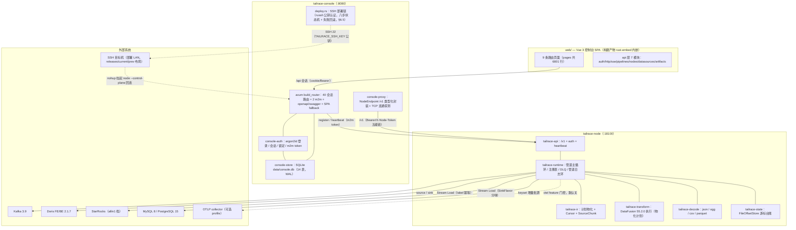
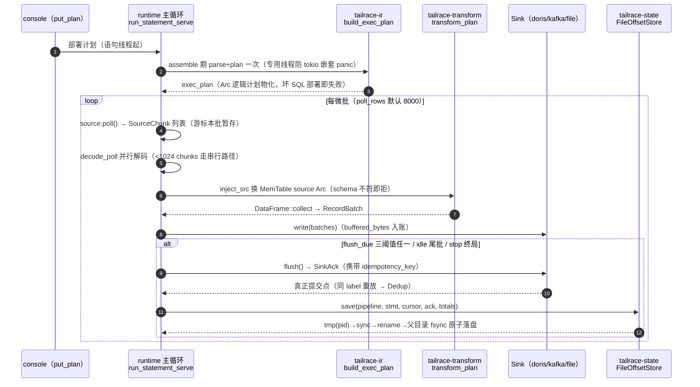
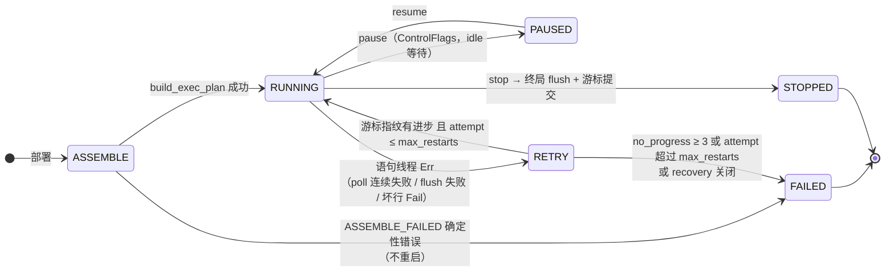
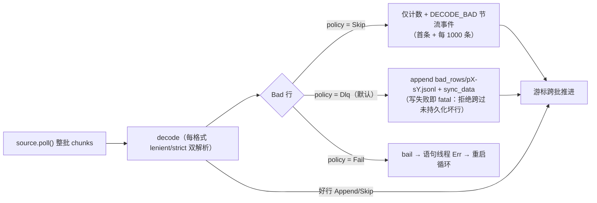
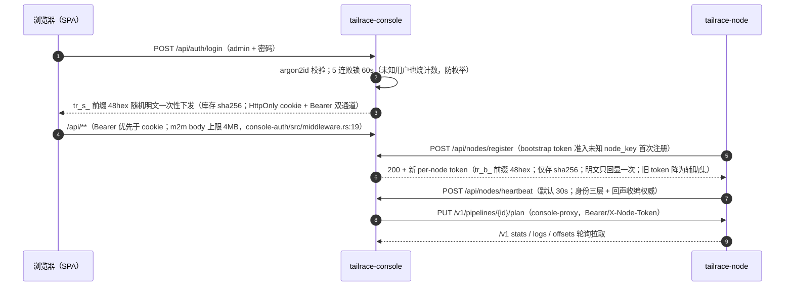
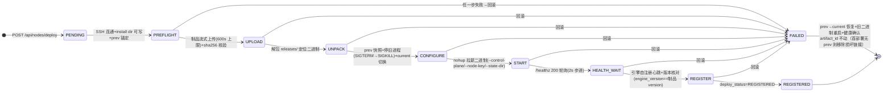
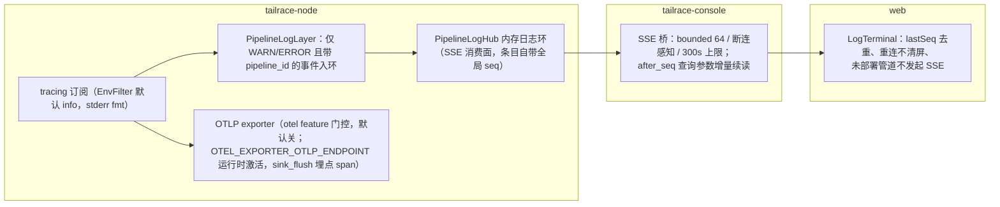
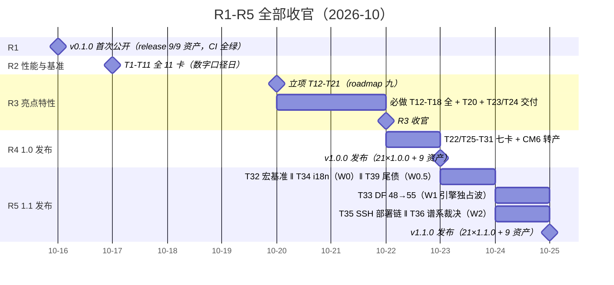
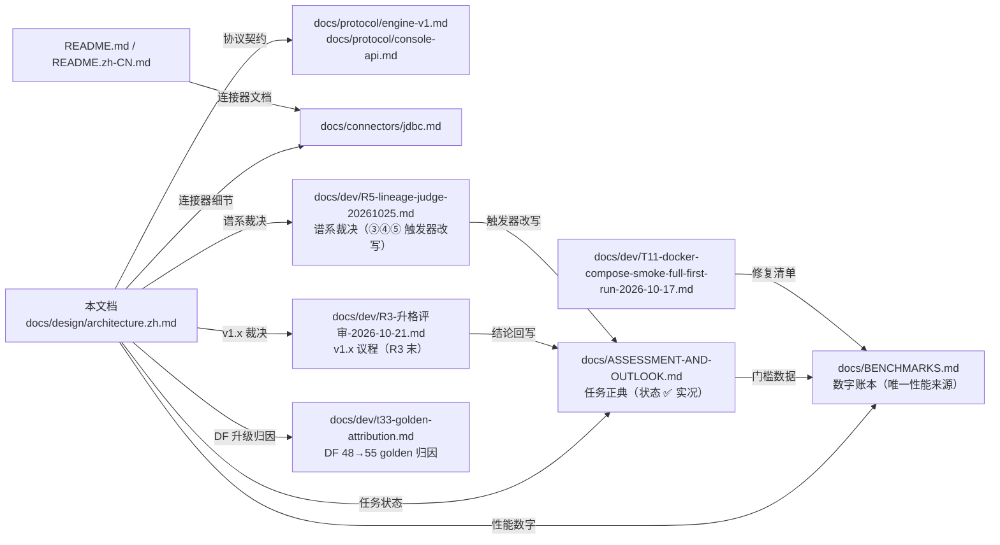

# tailrace 架构设计（v1.1.0 基线版）

> 读者：新贡献者与评审者。本文档描述**已落地**的系统形态（v1.1.0 基线，tag `v1.1.0`，2026-10-25；工作树 HEAD `b19661b`），不是愿景稿。
> 三条引用纪律：性能数字一律引 `docs/BENCHMARKS.md` 现值（带行号锚点）；任务状态一律引 `docs/ASSESSMENT-AND-OUTLOOK.md` ✅ 实况；代码锚点 `路径:行号` 可直接点开核对。
> 定位：R4 计划中「设计文档以脱敏干净版重新入仓」（ASSESSMENT-AND-OUTLOOK.md §五）的落点即本目录，并经 T29 入 mdBook 文档站（book.toml + docs/book/，SUMMARY 9 章，5 篇 `{{#include}}` 全文引入正典——本档与 docs/ASSESSMENT-AND-OUTLOOK.md 各占其一）；2026-10-11 内部设计档为本文档前身，差异见 §十一。

## 目录

1. 项目定位与北极星
2. 总体架构
3. 数据面：SQL 管道与执行
4. 游标与容错语义
5. 连接器体系
6. 管理面 console
7. Web 控制台
8. 可观测性
9. 性能账本摘要
10. 工程与质量
11. 路线图现状
12. 附录

## 一、项目定位与北极星

**v1.0：一条 SQL、两个二进制、零 JVM 的数据接入引擎，管理台内置，Doris/StarRocks 写入语义按档位交付（1.0=label 幂等档；事务接口 exactly-once 与 group commit 吞吐档=v1.x，触发条件见 T18 纪要）。**（ASSESSMENT-AND-OUTLOOK.md §一，北极星原文）**v1.0.0（2026-10-23）与 v1.1.0（2026-10-25）均已发布**：crates.io 21 包 lockstep 发到 1.1.0（本档落稿会话 API 逐包复核 21/21）、GitHub Release 各 9 资产（8 tarball + checksums.txt）。

三条差异化支柱（ASSESSMENT-AND-OUTLOOK.md §一）：

| 支柱 | 承诺 | v1.1.0 兑现 |
|---|---|---|
| 单二进制轻量边缘 | 2-4GB 内存盒子可跑引擎+管理台，无 JVM/Temporal/多容器编排 | 裁剪档 node **55,788,080 B（−9.4%）**（BENCHMARKS.md:365）；file→doris 裁剪档 e2e 30/30（:368） |
| SQL-first + DataFusion | 管道即一条 `INSERT INTO 库.表 SELECT …`，不学私有 DSL | parser→IR→transform 全链落地（§三），SQL 计划每语句物化一次（T7 内存治理）；DataFusion 已随 T33 升 **55.2.0**（七版本直跳，§9.3） |
| Doris/StarRocks 深度工程化 | 写入语义谱系：label 幂等 → 事务接口 → group commit | label 幂等档已落地（同 label 重放 `FlushOutcome::Dedup`，conn-doris/src/lib.rs:198-205）；sink 吞吐基线已由 T32 补齐（§9.3）；事务接口/group commit 经 T36 谱系裁决**维持 v1.x/R6**（触发器改写，docs/dev/R5-lineage-judge-20261025.md） |

两条红线（ASSESSMENT-AND-OUTLOOK.md §四）：**不拼连接器数量；不做真正流式 join/水位线/状态后端。**

轮次结构（roadmap.md:19）：R2 性能与基准（T1-T11 全 ✅，:49-150）→ R3 亮点特性（必做 T12-T18 全 ✅ + 选做 T20 ✅，:209-279）→ R4 1.0 发布（**已收官，2026-10-23**）→ R5 1.1 发布（**已收官，2026-10-25**）。详见 §十一。

## 二、总体架构

一句话：Vue SPA 构建产物内嵌进 console 二进制；console 经 `/v1` 协议驱动 node；node 内 runtime 主循环驱动 source→decode→transform→sink；游标台账本地原子落盘；Kafka/Doris/StarRocks/MySQL/PostgreSQL 为外部系统，SQLite 为 console 元数据库。

下图给出组件分层与数据流方向（实线=数据/调用主链，虚线=可选门控路径）：

### 2.1 引擎 crate 全景（engine/crates/，16 个；行数为 2026-10-26 本档落稿会话实测）

| crate | 职责 | 行数（含测试括注 src） |
|---|---|---|
| tailrace-runtime | 管道执行主循环 / 注册表 / 重启 / DLQ / 管道日志 | 4699（src 3207） |
| tailrace-api | axum REST：console→node 唯一入口（/v1+auth+heartbeat）；T34 起错误信封带 8 规范码 `code`（lib.rs:18-35） | 2248 |
| tailrace-conn-doris | Doris/StarRocks Stream Load sink（同 crate feature 分味） | 1173 |
| tailrace-conn-kafka | Kafka source/sink（BaseConsumer/BaseProducer 同步数据面） | 1118 |
| tailrace-conn-jdbc | MySQL/PostgreSQL keyset 增量批源（T13 新增） | 1434（src 982） |
| tailrace-decode | ColBatch + 4 Decoder（json/ogg/csv/parquet） | 1168（src 1026） |
| tailrace-metadata | discover/infer-schema 元数据客户端（T14 新增） | 1185（src 892） |
| tailrace-catalog | CatalogProvider：FileCatalog/PlanCatalog/ControlPlane | 834 |
| tailrace-conn-file | file source/sink（jsonl/parquet）+ bench | 818（src 722） |
| tailrace-parser | SQL 编译（仅 INSERT + `${ds:…}` 表引用）+ 校验诊断 | 587 |
| tailrace-transform | DataFusion 55.2.0 执行层（thread_local session + 物化计划） | 559（src 467） |
| tailrace-ir | PipelineIr / build_exec_plan / Cursor / SourceChunk | 482 |
| tailrace-state | OffsetStore trait + FileOffsetStore（JSON 台账） | 480 |
| tailrace-connector | Source/Sink trait + 显式 `ConnectorRegistry`（source.rs / sink.rs / registry.rs；各连接器 crate 以 `register()` 入表，无注册宏，§五） | 374 |
| tailrace-conn-mqtt | **1 行占位**（T18⑥ 裁决：v1.x + 12 个月触发器） | 1 |
| tailrace-conn-s3 | **1 行占位**（T18⑦a 裁决：v1.x） | 1 |

DataFusion 依赖面：根 Cargo.toml `datafusion = "55.2.0"` / `datafusion-proto = "55.2.0"`（Cargo.toml:66-67，T33 七版本直跳），随动 arrow/parquet 59.3.1、sqlparser 0.62.0、prost 0.14.4；MSRV 不变（55.2.0 声明 rust-version 1.94 ≤ 工作区 1.95）。

### 2.2 管理面 crate（console/crates/，4 个）

| crate | 职责 |
|---|---|
| console-auth | 认证平面：argon2id、暴力锁定、会话 token（cookie/bearer）、m2m bootstrap/per-node token（console-auth/src/lib.rs:1-28） |
| console-store | SQLite 元数据库：WAL + busy_timeout + foreign_keys + synchronous=NORMAL（T8，pragma_update）；rusqlite_migration 单迁移自动前滚；启动 purge 过期会话与指标（console-store/src/lib.rs:1-9、:51-56、:70-77、:108）；T35 起节点行携 SSH 托管与部署状态列（00_init.sql:58-64：host/ssh_port/ssh_user、deploy_status、register_mode） |
| console-proxy | console→engine HTTP 层：`NodeEndpoint` 类型化 /v1 封装 + `probe_datasource` TCP 探测（3s 超时 / ≤8 端点）（console-proxy/src/lib.rs:1-11、probe.rs:25-40） |
| tailrace-console | lib+bin 装配：build_router、7 个 api 域、compile.rs（内嵌 parser 本地编译）、openapi.rs、spa.rs、state.rs；T34/T35 新增 api/messages.rs（zh 单轨文案字典 + message_key 信封，§6.6）与 deploy.rs（SSH 部署链八步状态机 1104 行，§6.5）（tailrace-console/src/lib.rs:1-5） |

## 三、数据面：SQL 管道与执行

管道即一条 SQL：`INSERT INTO ${ds:sink} SELECT … FROM ${ds:source}`（仅支持 INSERT；表引用用 `${ds:a.b}` 占位）。主链自部署到 flush 提交的全过程如下（serve 模式）：

### 3.1 主链函数锚点

| 环节 | 锚点 | 说明 |
|---|---|---|
| 编译 | `engine/crates/tailrace-parser/src/lib.rs:53`（`compile`） | 仅 INSERT、`${ds:a.b}` 表引用 |
| 校验 | 同文件 `:120`（`validate`） | source kind 白名单 `kafka\|file\|jdbc`（:124）；sink `kafka\|file\|doris\|starrocks`（:147）；JDBC（源）/JDBC_TABLE（Doris 汇）交叉误用各有定向诊断（:134-135、:155-156，T23 low#2 清偿） |
| kind 归一 | `engine/crates/tailrace-catalog/src/lib.rs` | `JDBC_TABLE`→doris、`starrocks` canonical；PlanCatalog 表元数据随 plan 推送 |
| 计划物化 | `engine/crates/tailrace-ir/src/lib.rs:43`（`build_exec_plan`） | 组装期 parse+plan 一次（T7）；`:84` `plan_to_b64` proto 序列化；`:97` `b64_to_plan` **仍 gated**（CustomScan qualifier 边界——DF55 下未变，JSON 载体为正典；T33 复核：proto 序列化 golden 跨 48→55 **零字节 diff**，仅解码边界未解，归因见 docs/dev/t33-golden-attribution.md） |
| 组装 | `engine/crates/tailrace-runtime/src/lib.rs:482`（`PipelineRunner::assemble`） | `:516` 调 build_exec_plan 存 `exec_plan: Arc<LogicalPlan>`（字段 :114） |
| 执行 | `engine/crates/tailrace-transform/src/lib.rs:153`（`transform_plan`） | 每微批仅 `inject_src()`（:110）换 source Arc + collect；thread_local SESSION（:66）+ GreedyMemoryPool 默认 256MiB（:35、:75） |
| Sink 契约 | `engine/crates/tailrace-connector/src/sink.rs:14`（`Sink` trait） | write/flush 两点；`buffered_bytes()`（:24）为字节阈值输入；flush=真正提交点，SinkAck 携 idempotency_key（:6-10） |
| 主循环 | `engine/crates/tailrace-runtime/src/lib.rs:666`（`run_statement_serve`） | standalone `run_statement()`（:932）同构 |

### 3.2 三项热路径机制（R2 交付）

- **T5 分区并行 a（并行 decode）**：`decode_poll()`（runtime/src/lib.rs:320）把同 poll 的 chunks 连续切片分组，scoped 线程并行解码到各自 ColBatch（`PARALLEL_DECODE_MIN_CHUNKS=512`，:270；<1024 chunks 串行，:276），`concat_batches` 按 chunk 序合并（:456-462）=字节级等价（等价性测试钉住）；worker panic 即 bail，游标不跨（:433-435）。验收：kafka(P=6)→file 21396→24658 rows/s（**+15.2%**，BENCHMARKS.md:115）。
- **T6 攒批三阈值**：`RunOptions::flush_due()`（runtime/src/lib.rs:94）单一谓词——行/时间/字节任一满足即 flush，默认 10k 行 / 10s / 8MiB（:74-85），参数语义对齐 Doris Flink connector 的 `sink.buffer-flush.max-rows/max-bytes/interval`；三类 sink 的 `buffered_bytes()` 均为真实测量（file=arrow 内存、doris=carrier 字节、kafka=投递回调在途账）。批分布见 BENCHMARKS.md:310-313。
- **T7 内存治理（计划物化）**：session batch_size 固定为 poll_rows（组装一次定型，runtime/src/lib.rs:686-691）；SQL 每微批不再 parse+plan。验收：transform 微基准 identity **+58%** / filter **+20%** / groupby **+30%**（BENCHMARKS.md:110-112）。DataFusion 侧两条已登记边界经 T33 在 55.2.0 上复核（BENCHMARKS.md:729-733）：memory pool「部分算子不强制」**维持**（datafusion-execution 55.2.0 `src/runtime_env.rs:429` 注记逐字仍在）；`output_batches` 指标缺失**已解除**（入 BaselineMetrics 标准指标，全算子自带）。

## 四、游标与容错语义

**核心承诺：at-least-once，游标只在 flush 成功后整图提交。**

### 4.1 Cursor 四型与 SourceChunk

`engine/crates/tailrace-ir/src/cursor_sourcechunk_impl.rs:4`：

| Cursor 型 | 载荷 | 适用 |
|---|---|---|
| `Kafka` | topic + group + `offsets: BTreeMap<i32,i64>`（分区→next offset） | kafka 源 |
| `File` | path + byte_pos | file 源 |
| `JdbcKey` | key + value（T13 新增第三型） | jdbc keyset 批源（游标列须 PK/单列 UNIQUE，fail-fast 探针把关） |
| `None` | — | 无位点语义的源 |

`SourceChunk`（:25）：`raw: Vec<u8>` + `partition: Option<i32>` + `next_offset: Option<i64>`（kafka/plain 两构造）。

### 4.2 flush 点整图提交（at-least-once 锚）

serve 主循环（runtime/src/lib.rs:666）共三处 flush 点，全部先 `sink.flush()?` 再 `state.lock()…save(…)`；其中 idle 尾批与三阈值两处的 save 携 `Some(&ack.idempotency_key)`，stop 终局因无新 ack 语义传 `None`（serve 与 standalone 终局同）：

| flush 点 | serve 锚点 | standalone 同构锚点 |
|---|---|---|
| idle 尾批 | lib.rs:767-781 | lib.rs:966-980 |
| 三阈值触发 | lib.rs:856-885 | lib.rs:1049-1072 |
| stop 终局 | lib.rs:894-918 | lib.rs:1086-1104 |

**锁中毒防御（T39 ④，v1.1.0）**：runtime 语句体内 8 处 `state.lock()`（serve/standalone 各 1 处入口 resume load + 3 处 flush 点 save；CHANGELOG.md:100-104 所记 8 处即此口径）+ assemble 期 load 1 处（lib.rs:521-523），共 9 处自 v1.1.0 起统一 `unwrap_or_else(|e| e.into_inner())`（lib.rs:925-926 文档注释 + 各调用点；注册表侧同款）——兄弟语句线程 panic 不再把毒锁级联进游标提交路径，锁内状态仍一致可继续。

台账耐久性（tailrace-state/src/lib.rs:1-14）：tmp(pid)→sync_data→rename→父目录 fsync；损坏文件 `.corrupt` 隔离 + `.bak` 回退，仍不可读则 **fail closed**（拒绝带着未知位点继续）。

### 4.3 语句生命周期与 NO_PROGRESS 判决

下图是单条语句自部署起的生命周期（含重启循环与终态；NO_PROGRESS_LIMIT 写死 3 次不配置化——防毒数据死循环后门，registry.rs:28-30）：

- **指纹**：`cursor_progress()`（registry.rs:57）把每语句游标折叠为 u64——Kafka 逐分区 fold（部分分区推进=进步，:64-68）；JdbcKey fold key+value（:72-77；R3-W1 修复 488efcc：常量会让 3 次瞬断误判毒数据）。
- **判决**：每次重启循环比对指纹（registry.rs:446-461）；判死即 `thread_flags.fail()`（STATE_FAILED=3，:99/:130）+ STATEMENT_FAILED 事件，快照/心跳如实带 FAILED（治僵尸 RUNNING）。
- **poll 退避**：指数 1s→…→300s 封顶（runtime/lib.rs:724），连续 ≥10 次（≈5min）才 Err 交重启循环（:747-748）；任何 poll Ok（含空批）复位（:753）。

### 4.4 DLQ / BadRowPolicy

坏行在**整 poll decode 完成、游标跨批之前**统一处理（`handle_bad_rows()`，engine/crates/tailrace-runtime/src/lib.rs:192）——保证台账位点永远对应「已处置完坏行」的边界：

| 策略 | 定义锚点 | 行为 |
|---|---|---|
| Dlq（默认） | engine/crates/tailrace-runtime/src/dlq.rs:40、:86 | 落 `state_dir/bad_rows/p{p}-s{s}.jsonl`，记录含 tsMs/pipeline/statement/**poll 时游标**/rawB64（:25-36，手工恢复锚） |
| Fail | engine/crates/tailrace-runtime/src/dlq.rs:40、engine/crates/tailrace-runtime/src/lib.rs:208 | 即 bail（毒数据停管道而非丢弃） |
| Skip | engine/crates/tailrace-runtime/src/dlq.rs:40 | 仅计数 |

## 五、连接器体系

**注册模型**：显式 `register()` 调用（node `build_registry()`，engine/bin/tailrace-node/src/main.rs:22-40）——≤10 个连接器保持一眼可读，不引入 inventory/linkme 类注册宏（main.rs:22-24 注释）。未知 kind 报「源类型未支持：{kind}（本二进制未编译该连接器 feature）」（tailrace-connector/src/registry.rs:131）——裁剪是注册表级语义，不只是字节（负向探针见 BENCHMARKS.md:530）。

**feature 门控**（node Cargo.toml:15-35）：default=connector-kafka/file/doris；`connector-jdbc`、`connector-mqtt`、`connector-s3` 为门控 feature（jdbc 已真实现；mqtt/s3 仍占位）；`otel`（T2）与 `jemalloc`（T20）默认关。注意 `connector-jdbc` **仅 node bin 注册**，runtime 无此 feature（runtime/Cargo.toml:17-20 default=kafka/file/doris）。T16 后 node 的 connector-* 均透传 runtime 同名 feature（两张注册表同源，run/serve 一致）。

### 5.1 现状矩阵（五个真连接器：kafka/file/doris/starrocks/jdbc；mqtt/s3 占位）

| kind | 方向 | 注册点 | 能力要点 | 状态 |
|---|---|---|---|---|
| kafka | source+sink | conn-kafka lib.rs:29-31 | BaseConsumer 手管位点（assign-only 恢复 :180-192）；30s 动态分区发现（§5.2）；半批 seek 回滚（:296-309）；sink JSON-lines 载体 + 真实在途 buffered_bytes（:499，T6） | ✅ |
| file | source+sink | conn-file lib.rs:20-21 | jsonl/parquet；buffered_bytes=arrow 内存估（:338-345） | ✅ |
| doris | sink | conn-doris lib.rs:151 | Stream Load BE 直连，**JSON-lines 载体**（T11：CSV 载体在 be-2.1.7 实测毁毒行）；label 幂等（进程 run 前缀 :296）；`FlushOutcome::{Success,Dedup}`（:198-205）；重试退避 2s→8s→30s；T32 宏基准：大批下 sink 零可测开销（§9.3） | ✅ |
| starrocks | sink | conn-doris lib.rs:153（feature 默认开） | T12 完整化：`SinkFlavor`（:142）同工厂按 kind 分味；差异=8030 端口 / 无 read_json_by_line / 无 sequence_column / FE 307 redirect 跟随；ack kind=STARROCKS_STREAM_LOAD（:350）；**v1.1.0 起 console 有一等 datasource 类型**（T39 ⑥，§6.1）——connJson 复用 doris 形态（jdbcUrl+streamLoadUrl 必填、fenodes 可选），probe/discover/infer-schema 走 FE MySQL 协议共用，表对象独立 kind=starrocks（cursor NONE），引擎按该 kind 选 StarRocks 载体，不再需要 `node run` 旁路 | ✅ |
| jdbc | source | conn-jdbc lib.rs:73 | T13 新增：sqlx 子 crate 双方言（MySQL/PostgreSQL）；keyset `WHERE col>? LIMIT n` 增量；游标列唯一性 fail-fast 探针（:360-397，R3-W1 medium②）；游标仅在整批转换后推进；testcontainers mysql:8/postgres:15 双方言测试（tests/jdbc_sources.rs） | ✅ |
| mqtt | — | 不注册（占位） | 1 行 crate | 占位（T18⑥：v1.x + 12 个月触发器，否则从 P2 移除） |
| s3 | — | 不注册（占位） | 1 行 crate | 占位（T18⑦a：v1.x；CDC 走 debezium JSON 廉价路径评估） |

配套：T14 新增 `tailrace-metadata`（discover/infer-schema）——rdkafka fetch_metadata 采样 / Doris 9030 文本协议 SHOW/DESC / PG information_schema / decode 链同款类型推断（metadata/src/lib.rs:84、:143）。已知边界：doris 型 discover 的 9030 文本协议未在真 Doris FE 实测（docs/connectors/jdbc.md §七:120-121）。

### 5.2 动态分区发现（自 v0.1.0 已在，T15 补三层测试）

每 30s `fetch_metadata`（5s 超时）差异对比（conn-kafka/src/lib.rs:209 起）；新分区按语句起始位（earliest=0 / latest=高水位，失败 fallback 0）入 offsets map；assign 模式显式 TPL 重建 + paused 重暂停。发现延迟口径 ≤~35s，实测 subscribe 26.8s / assign 30.7s（BENCHMARKS.md:370）。已知单向限制（只增不减，分区消失后死项不清理）排 v1.x（roadmap.md:388）。

## 六、管理面 console

### 6.1 API 面（tailrace-console/src/lib.rs:29-162）

| 域 | 路由数 | 内容 |
|---|---|---|
| 开放 | 4 | `/healthz`(:152)、`POST /api/auth/login`(:153)、swagger-ui + openapi.json(:158)、SPA fallback(:160) |
| 会话域（require_session :128-130；上传限 512MB :133） | 40 模式 | auth 2（:31-32）；datasources 10（:34-72；含 T14 的 `{id}/discover`、`{id}/infer-schema` 与登记端点——**`GET /api/datasources/tables` 行携 `columnsJson`**（T39 ⑤，DTO 锚 datasources.rs:298-314，§6.6 末））；nodes admin 12（:74-94；**T35 后 deploy/action 为真实现**：`POST /api/nodes/deploy`(:77) + `{id}/action`(:85) + `{id}/deploy-log`(:87-90)——八步链与进程动作见 §6.5；仅 `{id}/migrate`(:86) 留 501（P2），nodes_admin.rs:1179-1193）；artifacts 2（:96-100）；pipelines 14（CRUD/compile/templates/publish/deploy/pause/resume/stop/recover/stats/offsets/logs(SSE)/metrics-trend，:102-126） |
| m2m 免会话 | 2 | `POST /api/nodes/register`(:139)、`POST /api/nodes/heartbeat`(:145) |

openapi（utoipa 6）：52 path 条目 + **70 DTO** 全登记（openapi.rs:37-137；paths() 引用 52、schemas() 70，与全仓 `derive(ToSchema)` 70 互证——T35 部署链 DTO 入册后由 66 增至 70），`$ref` 走查测试在树（openapi.rs:142 `every_schema_ref_resolves`，2026-10-26 本档会话随全 workspace 套件实跑绿）。

### 6.2 认证链路

下图覆盖浏览器登录、node 注册轮换、心跳与计划下发四条链：

要点：argon2id（console-store/src/password.rs:14-33）；会话 TTL 86400s（console-auth/src/session.rs:12）；全局 bootstrap token 仅准入**首次** register，已注册节点持全局 token 一律 401（console-auth/src/bootstrap.rs:58-64）；bootstrap 来源 `TAILRACE_BOOTSTRAP_TOKEN` 或启动生成打印一次（main.rs:126-132），首启 admin 密码一次性打印（:115-116）；数据源凭据 AES-256-GCM 密文存储，master key 解析 fail-closed 拒启动（console-store/src/secretbox.rs:1-9、main.rs:100-101）。

### 6.3 SQLite 元数据（14 表）

`console-store/migrations/00_init.sql` 单迁移：user(:3)、session(:12)、datasource(:20)、datasource_credential(:30)、table_object(:36)、node(:52)、artifact(:70)、deploy_log(:81)、node_event(:92)、pipeline(:104)、pipeline_version(:121)、pipeline_metrics(:133)、node_metrics(:139)、audit_log(:147)，另 5 索引。pragmas：WAL + busy_timeout + foreign_keys + synchronous=NORMAL（T8，事务化后 4 并发×500 事件批最差 31.7ms，roadmap.md:120）。node 的 OFFLINE 判定为 90s 读时计算，无后台回写（console-api.md:62）。T35 起节点表携部署链列：host/ssh_port/ssh_user、install_dir、**deploy_status**（八步链终态 REGISTERED|FAILED|UNINSTALLED）、**register_mode**（manual|deployed|self）（00_init.sql:58-64）；`deploy_log` 表即八步链逐步落盘面（§6.5）。

**数据源类型注册表**（`GET /api/datasource-types`，datasources.rs:34-180 静态注册）：kafka / doris / **starrocks**（T39 ⑥：connJson 复用 doris 形态 jdbcUrl+streamLoadUrl 必填、fenodes 可选，FE MySQL 协议共用 probe/discover/infer-schema）/ file / mysql / postgresql；`table_kind_for` 派生表对象 kind（mysql/postgresql→jdbc；**doris 与 starrocks 各自独立 kind**——折叠会让引擎把 Doris 专属头发给 StarRocks FE，datasources.rs:195-206）；cursor_semantics 派生 kafka→KAFKA_OFFSET、file→FILE_POINTER、jdbc→JDBC_KEY、doris/starrocks→NONE。

### 6.4 /v1 引擎协议（docs/protocol/engine-v1.md ↔ 代码一致）

| 面 | 内容 | 锚点 |
|---|---|---|
| 路由 | POST /v1/compile；GET /v1/pipelines；PUT /v1/pipelines/{id}/plan；GET stats/logs/offsets；POST {action}；/healthz 唯一开放 | tailrace-api/src/lib.rs:121-361 |
| 鉴权 | 整面 Bearer/X-Node-Token，缺/错 401 统一错误信封（v1.1.0 起携规范 `code`，§6.6）；token 五级优先链（--api-token > env > 领养 node_token > --bootstrap-token > 自生成） | auth.rs:1-16、:143-174 |
| 轮换 | register 回声轮换 current，启动凭据终生为辅助集 | auth.rs:17-18、:27 |
| 心跳 | 事件环 64、默认 30s、身份三层（旗标>identity.json>自生成）、回声收编 | heartbeat.rs:1-19 |
| 契约测试 | v1_protocol 4 + executor_loop 3 | tests/contract/（manifest 显式 connector-file，Cargo.toml:24，6f855f7） |

### 6.5 SSH 部署链（T35，v1.1.0；T19 承接）

console 对 SSH 托管节点的**八步部署状态机**：`PENDING→PREFLIGHT→UPLOAD→UNPACK→CONFIGURE→START→HEALTH_WAIT→REGISTER→REGISTERED`（console/src/deploy.rs:1-24 模块文档、`:424` `run_deploy_chain`；编排入口 `POST /api/nodes/deploy`，nodes_admin.rs:885）。选型 russh 纯 Rust 传输（ring 后端，workspace dep；aws-lc-sys C 工具链与 deny 许可面被排除）——**仅公钥认证**，部署私钥来自 console 环境变量 `TAILRACE_SSH_KEY`（口令 `TAILRACE_SSH_KEY_PASSPHRASE`，deploy.rs:37-39），凭据绝不随请求体走；host key 首连即信（部署 LAN 定位，钉住 known_hosts 排 v1.x，deploy.rs:64-76）。

远端布局（POSIX sh、busybox 可用，deploy.rs:16-24）：`<install_dir>/releases/<version>/`（解包制品）+ `current -> releases/<version>`（软链切换）+ `prev -> releases/<old>`（回滚锚，CONFIGURE 步快照）+ `incoming-<sha8>.tar.gz`（暂存上传，UNPACK 后删除）+ `engine.pid/engine.log/state/`。

要点：

- **两种触发模式**（nodes_admin.rs:885-983）：`hosts[]` 批量新机接入（控制面预建 node 行 register_mode=deployed + 生成 per-node token，token 明文仅回显一次）或 `nodeId` 重部署既有 SSH 托管节点；后台任务推进，进度落 `deploy_log` 表，`GET /api/nodes/{id}/deploy-log` 查询（失败自动追加 ROLLBACK 行）。
- **失败回滚=验收重心**：任一步失败→prev→current 软链恢复→旧二进制重启→健康再确认→deploy_status=FAILED、artifact_id 不动；REGISTER 步另核对 engine_version 与制品 version 相符（deploy.rs:351 `wait_registered`）。
- **进程动作**（`POST /api/nodes/{id}/action`，nodes_admin.rs:1060-1177）：start/stop/restart/rollback/uninstall 同步执行（rollback=current⇄prev 对调+重启+健康确认）；`upgrade` 异步走完整八步链（需 artifactId，202 Accepted）；非 SSH 托管节点 400、SSH 侧失败 502 `SSH_FAILED`。
- **留 501**：`{id}/migrate`（P2 三步编排，nodes_admin.rs:1179-1193）与 `ticket`（票据链）。
- **测试**：状态机单测 `tests/nodes_deploy_unit.rs`（4 passed）+ docker 目标机 e2e `tests/nodes_deploy_docker_e2e.rs`（容器当远端节点、真 tailrace-node linux 进程、live-gate `#[ignore]` 形态；2026-10-25 于 1.1.0 bump 树实跑 1 passed/49.13s——八步 trail 全 OK 至 REGISTERED + 中途失败 HEALTH_WAIT FAIL→回滚复原 1.0.0 双场景，roadmap.md:350）。**接入 CI chaos job 为登记后续项**（测试经 host.docker.internal 回连 + 制品版本钉 v1.0.0 fixture 两处适配未在 Linux docker 主机验证前不入 ci.yml，roadmap.md:368⑤）。
- **web 侧**：nodes 页接线（批量 hosts[] 部署向导、重部署/升级制品选择器、deploy-log 抽屉，web/src/pages/nodes/index.vue:18-21）。

### 6.6 i18n message_key 通道与 columnsJson DTO

**错误码字典化（T30 通道 → T34 兑现，v1.1.0）**，中文单轨明示（en 留空轨）：

- **engine 侧**：`tailrace-api` 错误响应在 10 处原 ad-hoc 站点携 `code` 字段（8 个规范码常量单点，engine/crates/tailrace-api/src/lib.rs:18-35：UNAUTHENTICATED/INVALID_ARGUMENT/SQL_COMPILE_FAILED/SQL_DIAGNOSTICS/PIPELINE_START_FAILED/SPEC_JSON_RETIRED/NOT_FOUND/INTERNAL）——加性 wire 变更，legacy `{ok:false,error}` 形态由 wire 兼容测试钉住（第 11 处 grep 命中系数据字段，如实区分）。
- **console 侧**：用户可见格式化文案收敛进 zh 单轨字典 `api/messages.rs`（现值 **39 key / 57 调用点**，messages.rs:12-16；T34 交付时 36/50，T35 部署链 +3 key/+7 站点）；§4.0 信封 `{"error":{code,message,message_key[,refs]}}` 与 ApiError 形态逐字节同形仅多 message_key 一键（messages.rs:133-144），38 处信封携 message_key 上 wire；34 处 `ApiError` 字面量站点登记为豁免残留并由清单测试机器钉住（豁免可查不可悄悄扩大，messages.rs:22-47）。字典完整性由源码扫描测试钉住（`no_chinese_format_direct_writes_outside_dictionary`）。
- **columnsJson（T39 ⑤，闭合 T22 caveat）**：`GET /api/datasources/tables` 行 DTO `TableObjectItem` 携 `columnsJson`（`[name,type]` 对，手工登记或 infer-schema 产出；未登记列的表为 null）——console 侧列补全全链最后一跳，web SQL 编辑器 `db.table.` 列补全（CodeMirror6 schema + member sources）端到端由它喂数（datasources.rs:298-314；SqlMonaco.vue:75/:111-127）。

## 七、Web 控制台

### 7.1 页面矩阵（路由 9 条，web/src/router/index.ts:12-30；守卫 :40-64）

| 路由 | 行数（2026-10-26 实测） | 职责 |
|---|---|---|
| /login | 244 | 独立布局登录页 |
| /overview | 616 | 总览 |
| /datasources、/datasources/:id | 604 / 454 | 数据源管理 + discover/infer-schema 动线（DiscoverModal.vue 363 行） |
| /nodes | 1053 | 引擎节点 + SSH 部署动线（T35：批量部署向导/重部署/升级制品选择器/deploy-log 抽屉，index.vue:18-21） |
| /pipelines、/pipelines/edit | 394 / 968 | 管道列表 / 编排（edit 为静态段防与 :id 冲突） |
| /pipelines/:id/publish、/pipelines/:id/monitor | 450 / 752 | 发布 / 监控（SSE 日志，未部署不挂载） |

（pages 全目录 6801 行。）全局守卫首跳探 `GET /api/auth/me`（401→/login?redirect&expired），sanitizeRedirect 只放行站内相对路径防开放重定向（router/index.ts:35-64）。侧边栏四项：总览/数据源/引擎节点/数据管道（ConsoleLayout.vue:45-48）。

### 7.2 SqlMonaco：CodeMirror6 现状（T22 已于 v1.0.0 落地）

monaco 已在 v1.0.0 被 CodeMirror6 替换（T22 承接 T17 裁决，提交 f90e6a2；PoC 基线 `poc/codemirror6@7f32c26`）：编辑器异步 chunk gzip **883.22 kB → 138,962 B（−84.3%）**（T9 单口径锚点，≤300kB 门槛过；2026-10-23 T39 ⑤ 列补全接线后复测 139,007 B，BENCHMARKS.md:371/脚注⁷）；monaco 依赖从 package.json 移除（现依赖 @codemirror/* 6.x 系，web/package.json:12-20），T9 的 CSS 晚到/布局塌缩补丁整类消失（CM6 零 worker/字体/外部 CSS）。能力面：SQL 关键字补全 + FROM 别名感知 + `库名.` 表补全（max 50，接受后自动插 `-- @tag:ds`，与补全分两步 undo）+ compile diagnostics→setDiagnostics；**列补全链端到端**（T39 ⑤）：console `GET /api/datasources/tables` 携 columnsJson（§6.6）→ 编辑器 SQLNamespace children 槽填列 → `db.table.` 成员补全（SqlMonaco.vue:75/:111-127，现 348 行）。

### 7.3 构建口径

vite ^8.3.4（rolldown 内核，object-form manualChunks 不支持、advancedChunks.groups 为原生等价，vite.config.ts:32-34）+ vue-tsc ^3.3.13；`/api` 代理 → localhost:8080（:17-24）。`scripts/build.sh`：pnpm build → cargo build --release --locked 双 bin → package.sh（每 target 2 tarball + checksums，8 tarball 总 checksums 由 release aggregate 重生成）。`scripts/dev.sh`：console debug（rust-embed 磁盘读 dist）+ vite dev :5173。Makefile 六目标：fmt/lint/test/web/build/release。

## 八、可观测性

下图给出日志/事件/指标三条通道（emit 结构化事件为 SSE 消费正典，tracing 为工程日志，OTLP 为可选外送）：

- **T2 交付**：engine/crates 37 处 eprintln 全部转 tracing 结构化宏（当时 grep=0 验收；2026-10-26 本档会话实测现值 grep=8，全部位于测试侧——metadata/tests/live.rs ×4、conn-kafka src 内 `#[cfg(test)]` 模块 :902/:985 两处、conn-jdbc/tests/jdbc_sources.rs ×2——生产路径仍为 0）；PipelineLogLayer 让 Hub 成为 tracing layer sink——SSE 链路与 emit 三件套零改动（R1 审计红线）。
- **T10 交付**：SSE 断线重连不重放（`after_seq` 种子化引擎游标）、未部署管道零重连死循环；集成测试钉住两行为。
- **OTLP 门控**：opentelemetry 0.33 + tracing-opentelemetry 0.34，默认关；是否升默认开启未决（roadmap.md:199）。

## 九、性能账本摘要

**机器口径**：R2 数字采自 Intel i7-9750H / 32GB（BENCHMARKS.md:9-20）；R3 起第二机 Apple M4 / 16GB（:347-357）——**跨机器不可比**；宏基准默认 debug 档（不代表 release 性能），优化对比一律同机同日复测。

### 9.1 R2 四组优化（同机同日，BENCHMARKS §四）

| 任务 | 口径 | 前 → 后 | 变化 | 锚点 |
|---|---|---|---|---|
| 基线 | decode json / ogg / csv | 301.7K / 288.9K / 652.4K rows/s | — | :41-43 |
| 基线 | transform identity / filter / groupby | 19.12M / 7.34M / 6.14M rows/s | — | :55-57 |
| 基线 | sink encode / flush | 8.43M / 205.7K rows/s | — | :68-69 |
| 基线 | 宏 file→file（debug） | 21739 rows/s | — | :93 |
| T3 零拷贝 | decode json / ogg / csv | 328.9→534.9K / 319.4→463.2K / 45.0→50.0K | **+33%（保守）** / +45% / +11% | :133-135 |
| T3 零拷贝 | sink flush | 234.4→458.2K | **+95%** | :136 |
| T3 零拷贝 | 宏 file→file | 21739→24649/25246 | **+13.4~16.1%** | :148-149 |
| T7 内存治理 | transform identity / filter / groupby | 19.3→30.6M 等 | **+58% / +20% / +30%** | :110-112 |
| T7 内存治理 | 宏吞吐 / 峰值 RSS | 25138→25094 持平；46888→49124 KiB | 持平 / +2.2MiB | :113-114 |
| T5 分区并行 a | kafka(P=6)→file | 21396→24658 | **+15.2%**（交错 A/B） | :115 |
| T6 攒批三阈值 | 批大小分布（非吞吐口径） | 默认 6 批全 16000+终局 4000；128KiB 档 13 批 p50=8000 | —（粒度=微批边界，如实登记，:315-321） | :109、:310-313 |

### 9.2 R3 账本（M4 机，BENCHMARKS §六）

| 任务 | 口径 | 数字 | 锚点 |
|---|---|---|---|
| T20 jemalloc | 宏吞吐（3 轮中位） | 33670 vs 33738 rows/s，**+0.2% 持平**（±17% 量化界，debug 档短跑无检出力） | :361、:434 |
| T20 jemalloc | 峰值 RSS | 53616 vs 57808 KiB，**jemalloc 反高 +7.8%**（区间不重叠）；碎片未测（显式占位行）；feature 默认 OFF | :362-364 |
| T16 裁剪档 | node release 体积 | 61,571,936 → **55,788,080 B（−9.4%）**；依赖图 435→413 包；file→doris e2e **30/30（11.9s，12==12 守恒）**；默认档回归 25/25 | :365-368 |
| T15 分区 | kafka(P=6)→file（M4 首档） | 中位 **27861 rows/s**（跨机器不可比已登记；比值旁证 0.83 一致） | :369 |
| T15 分区 | 动态发现延迟 | subscribe 26.8s / assign 30.7s（口径 ≤~35s） | :370 |
| T22 编辑器 | SqlMonaco 异步 chunk gzip | monaco 883.22 kB → CodeMirror6 **138,962 B（−84.3%）**（确定性产物跨机可比；T39⑤ 接线后复测 139,007 B） | :371 |

CI 侧 T11 首跑档：`smoke --full` **44/44 步、11m20s**；毒浸泡 1700 行四点守恒；容器峰值 kafka 371.7MiB / doris-fe 867.4MiB / doris-be 1.082GiB（BENCHMARKS.md:336-339）；chaos kill-9 60.56s 幂等对账（BENCHMARKS.md:340）。**Doris/StarRocks sink 吞吐基线已由 T32 补齐**（§9.3），T36 谱系裁决据此将 group commit 维持 v1.x/R6（触发器改写为真实小批多管道场景 + 外部信号）。

### 9.3 R5 账本（M4 机，BENCHMARKS §6.4/§6.5）

**T32 Doris/StarRocks sink 宏基准**（2026-10-23 同机同日，debug 档、100k 行、compose doris 2.1.7 单 BE，六档行数守恒全过，BENCHMARKS.md:372-376、§6.4 :628-696）：

| 档 | 吞吐 | 结论 |
|---|---|---|
| file→doris 单管道·默认批 | **33852 rows/s** | vs 同日 file→file 锚点 33568（+0.8%）——**大批下 doris sink 零可测开销** |
| file→doris 单管道·小批（500 行） | **11017 rows/s** | 200 次同步 stream load ≈45ms/次往返封顶（−67% vs 大批） |
| file→doris P=4 并发·小批 | **26781 rows/s** | =单管小批 2.43×（HTTP 往返重叠），仍 **−21% vs 单管大批**——收益缺口即 group commit 目标区（T18④T3 判据数据面） |
| file→doris P=4 并发·poll 地板批 | **97752 rows/s** | 2.89× 单管大批——瓶颈在单管道吞吐而非 sink；4 路并发无退潮 |
| file→starrocks（node 直跑档） | **8750 rows/s** | allin1 单容器量级参考，口径不同源不与 console 档直接比（当时 console 尚无 starrocks 类型，v1.1.0 起 T39 ⑥ 已补） |

**T33 DataFusion 48.0.1→55.2.0 升级基准**（2026-10-24，**DF55 首档**登记——宏基准同机不同日、微基准本机无 DF48 档，不冒称前后对比，BENCHMARKS.md:377-378、§6.5 :698-748）：

| 档 | DF48（同机对照） | DF55（本次） | 结论 |
|---|---|---|---|
| 宏基准 file→file（debug 100k） | 33568 rows/s（§6.4 锚点，2026-10-23） | **41528 rows/s**（2.408s，行数守恒） | **+23.7%**，同机不同日；**回退门（回吐 >10%）未触发**；单轮 debug 档不登记为确定增益（±17% 量化噪声），仅作「无回归」证据 |
| transform 微基准 identity / filter / groupby | —（本机无 DF48 档） | **237.38 M / 65.89 M / 53.47 M rows/s** | M4 DF55 首档；vs §4.4 Intel 基线跨机**不可比**（7.75×/7.36×/6.62× 为机器差非 DF 差，禁止当升级收益引用） |

**T33 诚实缺口（随 1.1.0 发布如实携带）**：DF55 树的 L3 `smoke.sh --full`（Doris 全链）因本机容器窗口磁盘 <5G 红线两次拦截**未跑**——引擎覆盖以 L1 契约套件 + 宏基准行数守恒为限（BENCHMARKS.md:739-741；CHANGELOG.md:96-99 caveat；post-release 窗口补跑后 T33 方标 ✅，roadmap.md:333）。

## 十、工程与质量

### 10.1 测试五层（roadmap §三；现值为 2026-10-26 本档落稿会话实测）

| 层 | 内容 | 命令 | 现值 |
|---|---|---|---|
| L0 静态门 | 格式/lint/供应链 | `cargo fmt --all --check`；clippy `-D warnings`；`cargo deny check` 四门 | 本档会话实跑 fmt 0 diff、deny 四门绿；clippy 由 CI rust job 保证（最新 run 40191202705 绿） |
| L1 单元+契约 | 全 workspace + 契约套件 | `CARGO_PROFILE_DEV_DEBUG=0 cargo test --workspace --locked` | **194 passed / 0 failed / 8 ignored**（本档会话实跑，60 测试二进制含 doc-tests；T25 起 5 个 live-gate 测试转 `#[ignore]` 计数可见、T35 部署链 docker e2e 1 ignored 在列）；contract **7/7**（executor_loop 3 + v1_protocol 4） |
| L2 端到端冒烟 | file→file 全链真进程 | `./scripts/smoke.sh` | 25 步口径；最近 25/25 @ T16 回归（BENCHMARKS.md:531） |
| L3 docker 链路 | kafka→doris + 毒数据 + 位点不丢不重；chaos | `docker compose up -d` → `smoke.sh --full`；chaos job | CI 最新 run（40191202705，HEAD b19661b，2026-10-25）**八 job 全绿**：smoke --full SOAK=180；chaos 三命令均带 `--include-ignored` 真跑（含 jdbc 真库）；**SSH 部署 e2e 未入 CI**（登记后续项，§6.5） |
| L4 基准 | 微基准 + 宏基准，优化必须前后对比 | `cargo bench -p`；`scripts/bench/macro.sh` | 全部数字入 BENCHMARKS.md（§九摘要） |

smoke 三档步数：默认 25 / `--full` 44（+毒浸泡，SOAK 本地默认 600s、CI 180s）/ `--slim` 30（T16 裁剪档）。**已知 L3 缺口（v1.1.0 如实携带）**：DF55 树的 `smoke.sh --full` 未跑（§9.3 T33 段）。

### 10.2 CI 与 release

| CI job（.github/workflows/ci.yml，实况 **8 job**） | 锚点 | 内容 |
|---|---|---|
| rust | :16 | fmt + clippy + test + deny（advisories/bans/licenses/sources，deny-action 2.1.1） |
| msrv | :35 | 1.95 真实编译验证（ADR-001，roadmap.md:21-26） |
| no-default-features | :45 | 空 feature 组合编译契约 |
| slim-features | :55 | T16：可售裁剪组合（file+doris）check + `cargo tree` 防泄漏链接图（:63-74，rdkafka/openssl 栈回图即红） |
| macos | :76 | `-p tailrace-api -p console-store` 核心测试 |
| web | :85 | typecheck + build |
| chaos | :102 | testcontainers 真栈（Kafka+Doris+MySQL+PG）+ swapoff + vm.max_map_count；**三条命令均带 `--include-ignored`**（:125/:129/:133，T25）真跑 5 个 live-gate 测试——jdbc 真库、kafka 活性+分区发现、chaos kill-9；kafka 过滤词为公共前缀 `kafka_source`（T25 实证的过滤词陷阱）；**SSH 部署 e2e 未入此 job**（§6.5 后续项） |
| smoke | :135 | build.sh + `--full` SOAK=180 |

> 口径注记：roadmap §三写「六 job」（:42）、§十一写「七 job」（:498），均为 T16 增 slim-features 前的滞后口径；本文以 ci.yml 实况 8 为准（R4 收口标准亦按 8 job `gh run watch` 口径，roadmap.md:521）。

release（release.yml）：preflight（红提交不发，:16）→ build 4 目标矩阵（x86_64/aarch64-linux 走 cross；双 apple-darwin 原生，:35-38）→ aggregate **8 tarballs + 1 checksums.txt = 9 资产**（:76-96）。crates.io：**21 包全树 lockstep 发包**——T27 以 1.0.0 发（2026-10-23，拓扑序/dry-run 门槛/断点续发），T38 以 1.1.0 覆盖（2026-10-25；脚本 VERSION 硬编码缺陷致首轮 SKIP 全部、b19661b 修为读 Cargo.toml 后续发）；本档会话 API 逐包复核 **21×1.1.0**。GitHub Release：v1.0.0（2026-10-23）与 v1.1.0（2026-10-25）各 9 资产（本档会话 `gh release view` 复核 v1.1.0：8 tarball + checksums.txt）。

## 十一、路线图现状

时间线（仅标有档案日期的里程碑。v0.1.0 里程碑取 roadmap.md:5「2026-10-16 首次公开」口径——CHANGELOG [0.1.0] 记的 2026-10-13 为初始基线日，旧 README 沿用该滞后口径，本图不采）：

### 11.1 完成实况

- **R2（全 ✅，roadmap.md:49-150）**：T1 基准套件、T2 tracing+OTLP、T3 零拷贝、T4 毒数据 JSON-lines 载体、T5 分区并行 a、T6 攒批三阈值、T7 内存治理、T8 console 心跳写、T9 monaco 首屏、T10 SSE 续读、T11 docker 链路首跑+CI 深化。
- **R3（必做全 ✅，:209-264）**：T12 StarRocks 完整化（1cd38d0）、T13 JDBC 批源（caa842e）、T14 discover/infer-schema（1c5dcf6）、T15 分区评估——split 化按写死回退门降级 v1.x（288c3cf）、T16 裁剪验证（33cf61e）、T17 CM6 评估→升级 R4 落地卡（PoC 7f32c26）、T18 升格评审（5b44c76）。选做：T20 ✅（9a9f8a2）；T19/T21 分别由 T35 交付 / T37 挂起。评审债：T23 ✅（d9f51bd）、T24 ✅（4881c39）。
- **R4（全 ✅，2026-10-23 收官，roadmap.md:390-450）**：T22 CM6 转产（f90e6a2）、T25 live-gate 整改（7d4c7c6）、T26 元数据+doc-test（bf2848f）、T27 crates.io 21×1.0.0（5a44727，2026-10-23 补录全落）、T28 README 双语定稿（d1838dd+f4624e9 评审修携本档北极星档位化）、T29 mdBook 骨架（f69bf4e，本档入站）、T30 i18n 通道预留（31fea8a）、T31 v1.0.0 终验（tag bd8f301→9/9 资产+全新机器三命令 quickstart，docs/dev/v1.0-release-2026-10-23.md）。
- **R5（2026-10-25 收官，roadmap.md:312-368）**：T32 Doris/StarRocks sink 宏基准（cb825f6，§9.3）、T34 i18n 承诺债清偿（3cf738b+ffb1d55，§6.6）、T39 集中尾债八项（3cd3e12+c59699e——含 starrocks 类型/columnsJson/锁中毒防御/zip 触发器）、T33 DF 48→55.2.0（bfbaeb3+03bf261——**部分交付不标 ✅**：L3 smoke 留跑，§9.3）、T35 SSH 部署链（9b21854，§6.5）、T36 谱系裁决（d43fbdc）、T38 v1.1.0 收口（21×1.1.0 + tag v1.1.0 + 9 资产，2026-10-25）。T37 fuzz 维持挂起（选做不占关键路径）。

### 11.2 T18 升格评审七项结论（docs/dev/R3-升格评审-2026-10-21.md 总表 :109-122）

| # | 议题 | 结论 |
|---|---|---|
| ① | deltalake sink | v1.x（硬耦合：deltalake-core 1.1.2 要 arrow ^59 vs 本仓 55.2.0） |
| ② | DataFusion 48→55 | ~~v1.x + RUSTSEC 硬触发器~~ → **R5 已升**（T33，七版本直跳至 55.2.0，§9.3） |
| ③ | StarRocks 事务接口 | v1.x（v1.0 按「label 幂等档 + 语义文档化」收口） |
| ④ | group commit | v1.x，先补 Doris sink 宏基准（T32 已补，§9.3） |
| ⑤ | 本地两步 WAL | v1.x（与③合并谱系卡） |
| ⑥ | MQTT 源 | 不升格 R4；v1.x 带 12 个月触发器否则从 P2 移除 |
| ⑦a | S3/CDC | v1.x（CDC 走 debezium JSON 格式廉价路径 ~1.5 人日评估） |
| ⑦b | live-gate 形态 | 立即整改 → **R4-W0 已落地**（T25：`#[ignore]` + CI `--include-ignored`） |

③④⑤ 的正式裁决由 **T36 谱系裁决卡**（R5 末，docs/dev/R5-lineage-judge-20261025.md）召开：group commit **维持 v1.x/R6**——④T1 已满足存档、④T2 瓶颈归因成立（小批域 45.4ms/次 FE 事务往返完全记账）但「默认档不达标」被同数据否定、④T3 机制面成立（P=4×500=2.43×）需求面未触发（外部信号 stars/forks/issues 全零）→ 触发器改写为 ④-T2'（真实小批多管道场景+实际损害）+T3'（外部信号）；③⑤ 双双维持 v1.x，谱系预定分支=③ 2PC（代价封闭性：只动 sink 协议面 vs WAL 全管道 flush 持久写翻倍），唯一翻转条件写死（损害落在无幂等键 sink file/kafka→改 ⑤ WAL）；① deltalake 硬耦合已随 T33 松动（arrow 59.3.1 ≥ ^59），仍按需求门控。附议沿旧：split 化与 latest+subscribe 窄窗排 v1.x。

### 11.3 R4/R5 收官与未清债务

**R4（1.0 发布轮，2026-10-23 收官）**：T22 CM6 转产、T25 live-gate 整改、T26 crate 元数据+doc-test、T27 crates.io 21×1.0.0、T28 README 双语定稿（徽章矩阵+三命令 quickstart+FAQ）、T29 mdBook 文档站骨架、T30 i18n 通道预留、T31 v1.0.0 终验（tag→release 9 资产+全新机器 quickstart 实测，收官报告 docs/dev/v1.0-release-2026-10-23.md）。

**R5（1.1 发布轮，2026-10-25 收官）**：T32 sink 宏基准、T34 i18n 债清偿、T39 集中尾债、T33 DF 升级、T35 SSH 部署链、T36 谱系裁决、T38 v1.1.0 收口（21×1.1.0 + tag v1.1.0 + 9 资产）。

未清债务（按域，2026-10-26 本档基线盘点）：

1. **T33 L3 `smoke.sh --full` 未跑**（DF55 树 Doris 全链；磁盘 <5G 红线两次拦截，随 1.1.0 发布显式裁决延后——post-release 窗口补跑绿后 T33 方标 ✅，roadmap.md:333）：引擎覆盖以 L1 契约套件+宏基准行数守恒为限（§9.3）。
2. **分区发现单向**（R3-W3 low，roadmap.md:388）：死分区项永不清理、cursor 携带死项——v1.x 与窄窗/split 化同批。
3. **T21/T37 fuzz**：挂起（选做不占关键路径，需用户点名）。
4. **jdbc 管道 console 端到端未通**：`build_plan_table` 取 connJson `bootstrap` 键而 mysql/pg 源只有 jdbcUrl、`sequence_column` 恒 null——部署期才炸（docs/connectors/jdbc.md §七:116-119）。
5. **SSH 部署 e2e 未入 CI**：docker e2e 经 `host.docker.internal` 回连（GH Linux runner 需 `--add-host=host.docker.internal:host-gateway`）+ 制品版本钉 v1.0.0 fixture，两处适配未在 Linux docker 主机验证前不入 ci.yml（roadmap.md:368⑤）。
6. 开放问题沿旧：OTLP 是否默认开未决（按使用反馈裁决，roadmap.md:199）；proto plan 解码 gated 维持（CustomScan qualifier 边界，v1.x 触发器制）；`migrate`/`ticket` 端点留 501（P2，console-api.md:36/:47）。
7. **已清偿注销**（v1.0/v1.1 落地，留档可查）：live-gate 形态（T25）；DF48 两条限制（T33 复核：memory pool 维持/output_batches 解除，§3.2）；Doris sink 宏基准缺口（T32）；CHANGELOG 入账（[1.1.0] 段）；zip §八#1（T39⑦：utoipa-swagger-ui 10.0.2/zip 9.0.5，三条 RUSTSEC ignore 回收、`yanked="deny"`）；T19 SSH 部署链（T35）。

## 十二、附录

### 12.1 端口与本地环境配方（docker-compose.yml）

| 服务 | 端口（宿主默认） | 说明 |
|---|---|---|
| console | 8080 | Web/API；dev 模式 vite :5173 带 /api 代理 |
| node | 18100（示例 --addr） | /v1；可按节点自定 |
| compose kafka | `${TAILRACE_KAFKA_PORT:-9092}`→容器 9094 | 双监听器：容器内 PLAINTEXT :9092（healthcheck/smoke exec）、宿主 EXTERNAL 通告映射端口（:49-57，R3-W2 修复 68636d9 钉住两个实证失效模式） |
| compose Doris | FE http 38030 / FE MySQL 39030 / BE http 38040 | 默认避让本机常驻 doris-2.1（:28-38）；可 `TAILRACE_FE_*`/`TAILRACE_BE_*` 覆盖；smoke --slim 可用 `SMOKE_DORIS_MYSQL` 指常驻 Doris（FE 9030/BE 8040，BENCHMARKS.md:528） |
| compose StarRocks（--profile starrocks） | feproxy 48080（stream load 入口）/ FE MySQL 49030 | allin1 单容器；feproxy 拦截 FE→BE 307，引擎侧 redirect 跟随由 mock 契约测试覆盖（compose 注释，:150-166） |
| otel（--profile otel） | otel-collector:0.163.1 | 默认栈不含 |

测试环境：OrbStack（docker 29.4.0 / compose v5.1.2）；testcontainers（kafka/mysql/postgres modules，`TAILRACE_TESTCONTAINERS=1`）。chaos testcontainers 端口段 20000-34999（compose 注释）。

### 12.2 术语表

| 术语 | 含义 |
|---|---|
| 微批（micro-batch） | 一次 poll 拉取的批，默认 `poll_rows`=8000 行 |
| flush 点 | 真正提交点：`sink.flush()` 成功后游标才整图提交（at-least-once 锚） |
| 台账（offset ledger） | FileOffsetStore 落盘的游标+totals JSON（tmp→rename→fsync 原子写） |
| 指纹（cursor fingerprint） | 游标折叠 u64，重启循环据此判「有无进步」（NO_PROGRESS 判据） |
| SinkAck / idempotency_key | flush 成功回执；Doris/StarRocks 下为 Stream Load label（重放→Dedup） |
| SinkFlavor | conn-doris 内 Doris/StarRocks 同工厂按 kind 分味的差异枚举 |
| DLQ / BadRowPolicy | 坏行处置（Dlq 落盘 / Fail 停管道 / Skip 计数），游标跨批前统一处理 |
| serve / standalone | serve=console 下发计划常驻；standalone=本地 run 单次执行（同构三 flush 点） |
| live-gate | 无外部栈时测试跳过的门控惯例——T25 起 `#[ignore]` + CI `--include-ignored`，跳过计数可见 |
| 波次（wave） | roadmap 按文件域冲突分析的并行任务编排单元（§五） |
| 八步部署链 | console 经 SSH 驱动节点部署的状态机：PENDING→PREFLIGHT→UPLOAD→UNPACK→CONFIGURE→START→HEALTH_WAIT→REGISTER→REGISTERED，任一步失败回滚（§6.5） |
| message_key | §4.0 错误信封的可选键：zh 字典键随 wire 携带，为翻译轨预留（T30 通道/T34 兑现，§6.6） |
| register_mode / deploy_status | 节点表部署链列：manual\|deployed\|self 与八步链终态 REGISTERED\|FAILED\|UNINSTALLED（00_init.sql:58-64） |

### 12.3 文档间引用图

下图给出 docs/ 内正典文档与本文档的引用关系（箭头=被引用为事实来源）：

> 维护约定：本文档随版本收口更新（v1.0.0 与 v1.1.0 均已随发布对齐——本版即 v1.1.0 基线，2026-10-25）；性能/状态数字改动只改来源文件（BENCHMARKS/roadmap），本文档同步锚点即可。
