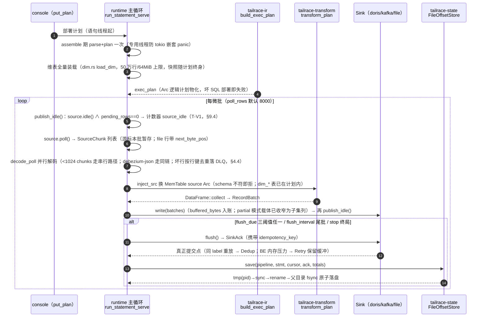
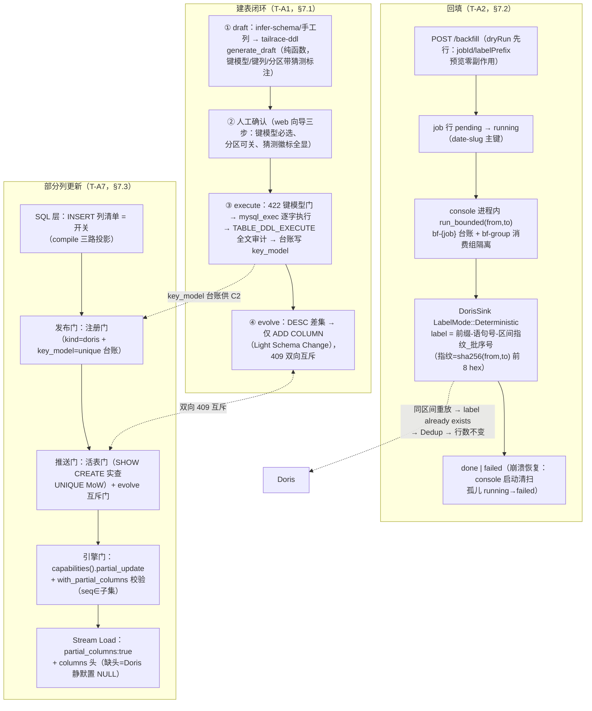
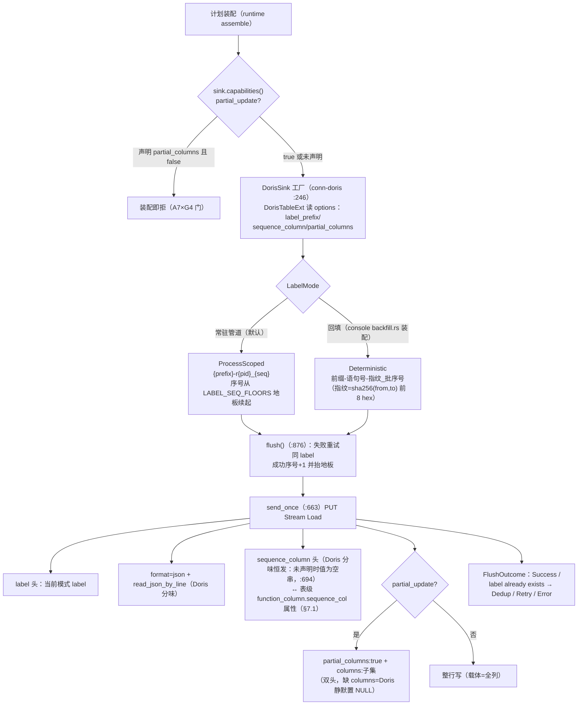
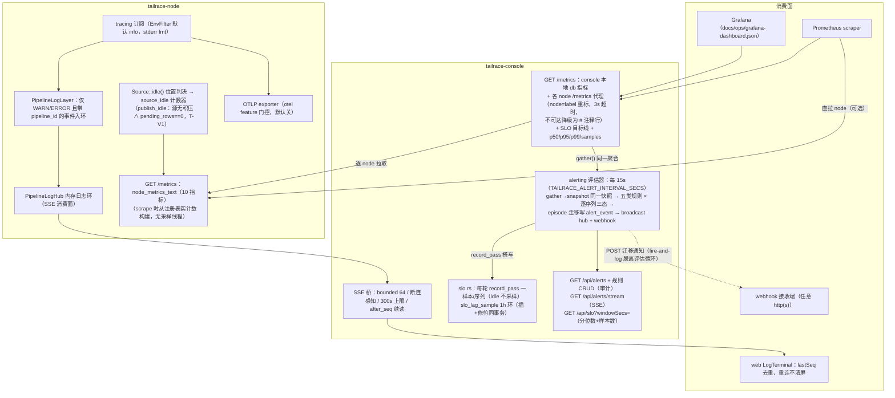
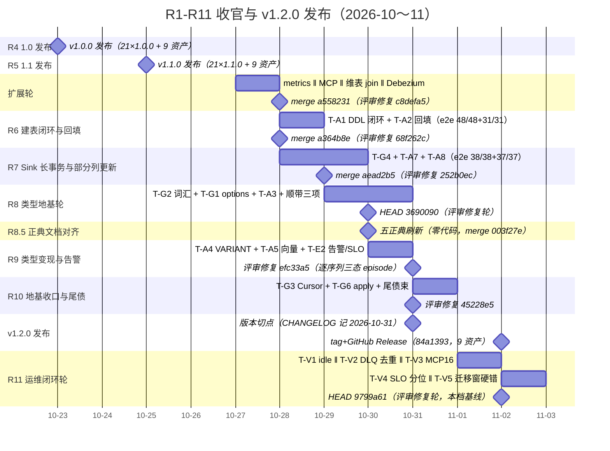
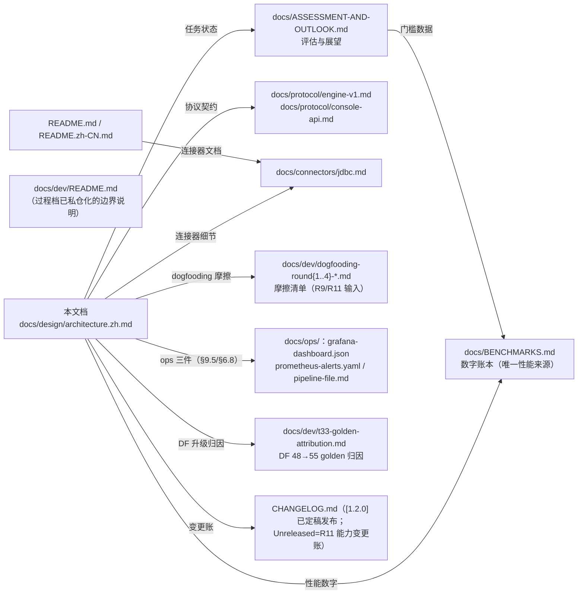

# tailrace 架构设计（post-R11 版）

> 读者：新贡献者与评审者。本文档描述**已落地**的系统形态：基线 = **v1.2.0**（CHANGELOG 版本切点 2026-10-31；tag 与 GitHub Release 打于 2026-11-02，指向 `main` 合并点 `84a1393`——其内容 = v1.1.0 + 扩展轮 / R6 / R7 / R8 / R8.5 + **R9**（T-A4 VARIANT / T-A5 向量列 / T-E2 告警与 SLO 目标线）+ **R10**（T-G3 Cursor 开放化 / T-G6 管道即代码 / 尾债束）），**加上其后 R11 一轮**（v1.3 开发线 `feature/v1.3-dev`：T-V1 idle 感知告警 / T-V2 DLQ 逐行去重 / T-V3 MCP apply 对 / T-V4 SLO 分位数 / T-V5 迁移窗硬错 + 评审修复），落稿工作树 HEAD `9799a61`，不是愿景稿。
> 版本诚实声明（2026-11-03 实查）：**GitHub Release v1.2.0 已发布**（`gh release view v1.2.0`：9 资产 = 8 tarball + checksums.txt，publishedAt 2026-11-02T12:00:16Z）；**crates.io 现值仍为 1.1.0**（`tailrace-ir` / `tailrace-console` / `tailrace-runtime` max_version 1.1.0，`tailrace-ddl` 404 从未上架）——工作区 `Cargo.toml:39` `version = "1.2.0"` 的 22 包 lockstep publish 尚未执行；R11 五项能力**未随任何 tag 发布**（CHANGELOG Unreleased 段，含 1.3.0 BREAKING：未知类型词硬错）。
> 三条引用纪律：性能数字一律引 `docs/BENCHMARKS.md` 现值（带行号锚点）；代码锚点 `路径:行号` 可直接点开核对（本文全部行号为 2026-11-03 落稿会话在上述 HEAD 实测；短路径按 crate 名省写——`conn-doris/src/lib.rs` = `engine/crates/tailrace-conn-doris/src/lib.rs`、`mcp.rs` / `pipelines.rs` 等 = `console/crates/tailrace-console/src/{,api/}` 下同名文件）；内部过程档已私仓化，本文只引用公开仓内文件。

## 目录

1. 项目定位与北极星
2. 总体架构
3. 数据面：SQL 管道与执行
4. 游标与容错语义
5. 连接器体系
6. 管理面 console
7. Doris 深度工程化：建表闭环·确定性回填·部分列更新
8. Web 控制台
9. 可观测性：/metrics · 告警引擎 · SLO · idle 感知
10. 性能账本摘要
11. 工程与质量
12. 路线图现状
13. 附录

## 一、项目定位与北极星

**v1.0：一条 SQL、两个二进制、零 JVM 的数据接入引擎，管理台内置，Doris/StarRocks 写入语义按档位交付（1.0=label 幂等档；事务接口 exactly-once 与 group commit 吞吐档=v1.x，触发条件见 T18 纪要）。**（ASSESSMENT-AND-OUTLOOK.md §一，北极星原文）**v1.0.0（2026-10-23）、v1.1.0（2026-10-25）与 v1.2.0（CHANGELOG 2026-10-31 / tag+Release 2026-11-02）均已发布**：前两版 crates.io 21 包 lockstep 发到 1.1.0、GitHub Release 各 9 资产；v1.2.0 的 GitHub Release 9 资产已发、**crates.io 22 包 lockstep publish 尚未执行**（本档头部版本诚实声明）。

三条差异化支柱（ASSESSMENT-AND-OUTLOOK.md §一；兑现列为 post-R11 工作线实况）：

| 支柱 | 承诺 | post-R11 兑现 |
|---|---|---|
| 单二进制轻量边缘 | 2-4GB 内存盒子可跑引擎+管理台，无 JVM/Temporal/多容器编排 | 裁剪档 node **55,788,080 B（−9.4%）**（BENCHMARKS.md:365）；file→doris 裁剪档 e2e 30/30（:368）；R9-R11 为功能轮，无新基准档（§十） |
| SQL-first + DataFusion | 管道即一条 `INSERT INTO 库.表 SELECT …`，不学私有 DSL | parser→IR→transform 全链落地（§三），SQL 计划每语句物化一次（T7 内存治理）；DataFusion 55.2.0（§10.3）；post-R8 起 SQL 语义面扩为「INSERT 列清单=部分列更新开关」+「`${ds:dim.…}` 维表引用」（§三/§七），仍是标准 SQL 无私有 DSL；R10 起「管道即代码」把 datasources / tables / pipelines 的声明文件经同一 `plan()` 做结构化 diff + 幂等 upsert（§6.8）——仍是 REST DTO 同源，无第二套模式语言 |
| Doris/StarRocks 深度工程化 | 写入语义谱系：label 幂等 → 事务接口 → group commit | label 幂等档已落地（同 label 重放 `FlushOutcome::Dedup`，conn-doris/src/lib.rs:362-368）；**确定性回填 label**（`LabelMode::Deterministic`，conn-doris/src/lib.rs:187，§7.2）与 **UNIQUE KEY 部分列更新**（`with_partial_columns`，conn-doris/src/lib.rs:589，§7.3）；建表闭环（§7.1）；R9 起 **VARIANT 直写 / `ARRAY<FLOAT>` 向量列**端到端（§3.3）；R10 起 BE 内存压力答复归入可重试（`is_memory_pressure` :401，§5.1）；事务接口/group commit 维持 v1.x 触发器制（T36 谱系裁决，结论留档于提交 d43fbdc） |

两条红线（ASSESSMENT-AND-OUTLOOK.md §四）：**不拼连接器数量；不做真正流式 join/水位线/状态后端**——post-R8 的维表 join 是**广播 join**（装配期全量装载静态快照，无 watermark/无状态后端/运行期不刷新，runtime/src/dim.rs:1-22 模块文档明示"Broadcast join, NOT a streaming join"），在红线之内而非之外；R9 的告警引擎同样**不是流处理**——console 侧周期性对聚合 `/metrics` 快照做阈值与窗口增量评估（§9.2），无事件流、无状态后端。

轮次结构（提交史实况）：R2 性能与基准（T1-T11 全 ✅）→ R3 亮点特性（T12-T18 必做全 ✅ + T20）→ R4 1.0 发布（2026-10-23 收官）→ R5 1.1 发布（2026-10-25 收官）→ **扩展轮**（T-A6 metrics ‖ T-E4 MCP ‖ T-D1 维表 join ‖ Debezium 解码，merge a558231）→ **R6 建表闭环与回填**（T-A1+T-A2，merge a364b8e）→ **R7 Sink 长事务与部分列更新**（T-G4+T-A7+T-A8，merge aead2b5）→ **R8 类型地基轮**（T-G1+T-G2+T-A3+顺带三项，merge 86c5289）→ **R8.5 正典文档对齐轮**（零代码，merge 003f27e）→ **R9 Doris 类型变现与告警**（T-A4+T-A5+T-E2，评审修复 efc33a5）→ **R10 地基收口与尾债**（T-G3+T-G6+badRowPolicy/MEM_LIMIT/DLQ 语义束，评审修复 45228e5）→ **v1.2.0 发布**（版本切点 db72994，merge 84a1393 打 tag）→ **R11 运维闭环轮**（T-V1~T-V5，评审修复 9799a61，本档 HEAD）。详见 §十二。

## 二、总体架构

一句话：Vue SPA 构建产物内嵌进 console 二进制；console 经 `/v1` 协议驱动 node（常驻管道），并自持 DDL 执行 / 回填 / MCP / **告警评估器** / **管道即代码 apply** 五条控制面链路；node 内 runtime 主循环驱动 source→decode→transform（含维表快照注入）→sink；游标台账本地原子落盘；Kafka/Doris/StarRocks/MySQL/PostgreSQL 为外部系统，SQLite 为 console 元数据库（含告警 episode 与 SLO 样本环）。

下图给出组件分层与数据流方向（实线=数据/调用主链，虚线=可选门控路径；行数为 2026-11-03 本档落稿会话实测）：

```mermaid
flowchart TB
  subgraph WEB["web/ — Vue 3 控制台 SPA（构建产物 rust-embed 内嵌，web/src 全部 .vue/.ts 共 11254 行：pages 含 parts 8140 + 其余 3114；R9-R11 未改）"]
    PAGES["9 条路由页面 + parts/ 子组件<br/>（TableDdlWizard 建表向导 763 行 / BackfillPanel 回填面板 523 行；<br/>告警 / SLO / apply 无 SPA 页面——API·SSE·CLI·MCP 面）"]
    APIW["api 层 7 模块：auth/http/sse/pipelines/nodes/datasources/artifacts"]
  end
  subgraph CONSOLE["tailrace-console（:8080）"]
    ROUTER["axum build_router：52 会话路由 + 2 m2m + /mcp + /metrics + openapi/swagger + SPA fallback"]
    AUTHC["console-auth：argon2id 登录 / 会话 / 锁定 / m2m token"]
    STOREC["console-store：SQLite data/console.db（18 表 7 迁移，WAL）"]
    PROXY["console-proxy：NodeEndpoint /v1 类型化封装 + TCP 连通探测"]
    DEPLOY["deploy.rs：SSH 部署链（russh 公钥认证，八步状态机 + 失败回滚，§6.5）"]
    MCP["mcp.rs：MCP Server（JSON-RPC /mcp，16 工具 9R+7W，写双门禁+审计脱敏，§6.7）"]
    DDLCP["api/datasources.rs DDL 三端点 + tailrace-ddl 纯函数生成器（§7.1）"]
    BF["backfill.rs：回填执行器（run_bounded + Deterministic label，§7.2）"]
    APPLY["api/apply.rs（1237 行）+ apply_cli.rs（419 行）：<br/>管道即代码 /api/apply[/dry-run]，同一 plan() 出 diff，§6.8"]
    ALERT["alerting.rs（1668 行）：告警评估器 15s 周期<br/>五类规则 × 逐序列三态 episode → alert_rule/alert_event，§9.2"]
    SLO["slo.rs（398 行）：SLO 样本环 1h + nearest-rank p50/p95/p99，§9.3"]
    METR["metrics.rs：console /metrics（本地 db 指标 + 各 node /metrics 代理聚合 + SLO 目标线/分位数行，§9）"]
  end
  subgraph NODE["tailrace-node（:18100）"]
    APIE["tailrace-api：/v1 + auth + heartbeat + /metrics（10 指标，含 source_idle）"]
    RT["tailrace-runtime：管道主循环 / 注册表 / DLQ（行键去重）/ 维表装载 dim.rs / run_bounded / idle 判决发布"]
    IR["tailrace-ir：计划物化 + Cursor 五型（含 Custom）+ SourceChunk + ColumnType 十六型词汇（迁移窗已关）"]
    TF["tailrace-transform：DataFusion 55.2.0 执行（物化计划 + dim_* MemTable）"]
    DC["tailrace-decode：json / ogg / csv / parquet / debezium-json（variant 透传 + 向量 dim 守卫）"]
    ST["tailrace-state：FileOffsetStore 游标台账（bf- 命名空间隔离；读旧写新）"]
    DDLX["（tailrace-ddl 不入 node —— 控制面专用纯函数 crate）"]
  end
  subgraph EXT["外部系统"]
    KAFKA["Kafka 3.9（含 Debezium CDC 主题）"]
    DORIS["Doris FE/BE 2.1.7（FE MySQL 协议承载 DDL/DESC/SHOW ALTER）"]
    SR["StarRocks（allin1 档）"]
    DB["MySQL 8 / PostgreSQL 15（keyset 增量批源 + 维表全量装载源）"]
    PROM["Prometheus scraper"]
    MCPCL["MCP 客户端（Claude/IDE 等）"]
    SSHD["SSH 目标机（部署 LAN，releases/current/prev 布局）"]
    HOOK["告警 webhook 接收端（任意 http(s) URL）"]
    GITOPS["GitOps / CI（tailrace-console apply -f 声明文件）"]
  end
  PAGES -->|"/api 会话（cookie/Bearer）"| ROUTER
  ROUTER --- AUTHC --- STOREC
  ROUTER --- STOREC
  MCPCL -->|"POST /mcp（免会话，限流 100 rps）"| MCP
  GITOPS -->|"POST /api/apply[/dry-run]（会话）"| APPLY
  PROM -->|"GET /metrics（开放）"| METR
  APIE -->|"register / heartbeat（m2m token；node 经 --control-plane 主动 POST，heartbeat.rs:719/:740）"| ROUTER
  PROXY -->|"/v1（Bearer/X-Node-Token 五级链）"| APIE
  DEPLOY -.->|"SSH 22（TAILRACE_SSH_KEY 公钥）"| SSHD
  DDLCP -->|"mysql_exec DDL/DESC/SHOW ALTER（FE 9030）"| DORIS
  BF -->|"Stream Load（Deterministic label）"| DORIS
  SSHD -.->|"nohup 拉起 node --control-plane 回连"| ROUTER
  METR -->|"gather() 同一快照"| ALERT
  ALERT -->|"record_pass 每轮一样本"| SLO
  ALERT -->|"episode 迁移写入"| STOREC
  ALERT -.->|"POST notice JSON（fire-and-log，脱离评估循环）"| HOOK
  ALERT -->|"broadcast hub → GET /api/alerts/stream（SSE）"| ROUTER
  APIE --- RT
  RT --- IR
  RT --- TF
  RT --- DC
  RT --- ST
  RT -->|"source / sink"| KAFKA
  RT -->|"Stream Load（label 幂等 / partial_columns / sequence_col 头）"| DORIS
  RT -->|"Stream Load（SinkFlavor 分味）"| SR
  RT -->|"keyset 增量批源 / 维表全量装载"| DB
  PROM -->|"GET /metrics（node 侧同开放）"| APIE
```

### 2.1 引擎 crate 全景（engine/crates/，17 个；行数为 2026-11-03 本档落稿会话实测，含测试括注 src 非测试行）

| crate | 职责 | 行数（含测试括注 src） |
|---|---|---|
| tailrace-runtime | 管道执行主循环 / 注册表 / 重启 / DLQ（**行键去重**）/ 管道日志 / 维表装载 / 有界回填 / **idle 判决发布**（T-V1） | 7335（src 3383） |
| tailrace-api | axum REST：console→node 唯一入口（/v1+auth+heartbeat+/metrics）；错误信封带 8 规范码 `code`（lib.rs:20-35）；/metrics **10 指标**（含 `tailrace_pipeline_source_idle`） | 2908（src 1909） |
| tailrace-decode | ColBatch + 5 Decoder（json/ogg/csv/parquet/**debezium-json**）；R9 起 **variant 整段透传** + **向量列 `check_vector_cells` 行前校验**（lib.rs:899） | 3043（src 1448） |
| tailrace-conn-doris | Doris/StarRocks Stream Load sink（同 crate feature 分味）：label 幂等/`LabelMode`、部分列更新、sequence_col 头；R10 起 **`is_memory_pressure` 可重试分类**（lib.rs:401） | 2068（src 945） |
| tailrace-catalog | CatalogProvider + TableObject（5 通用字段+options 化）+ option_keys 键名正典 + `ColumnType` / `arrow_*_or_utf8` re-export（lib.rs:30） | 1759（src 1070） |
| tailrace-ddl | **R6 新增**：Doris/StarRocks CREATE TABLE 草稿生成器（纯函数，零 IO/tokio；console 专用，node 不链接）；R9 起映射 `variant`→`VARIANT`、`list<float32[,dim]>`→`ARRAY<FLOAT>` | 1706（src 614） |
| tailrace-ir | PipelineIr / build_exec_plan / **Cursor 五型（含 `Custom{kind,payload}`，G3）** / SourceChunk（file 构造带 `next_byte_pos`，T-V2）/ **ColumnType 十六型词汇（迁移窗常量已置 false，T-V5）** | 1597（src 883） |
| tailrace-metadata | discover/infer-schema 元数据客户端 + `mysql_exec`/`doris_show_create`/`doris_alter_column_jobs` 控制面查询（lib.rs:233/:258/:278）；infer 对 `variant` / `array<float>` 回读折词（infer.rs:314-317） | 1679（src 1088） |
| tailrace-conn-kafka | Kafka source/sink（BaseConsumer/BaseProducer 同步数据面）；R11 起 **`IdleTracker` 位置判据**（end offset 差 3 次连零 = idle，lib.rs:100-111） | 1306（src 677） |
| tailrace-parser | SQL 编译（仅 INSERT + `${ds:…}` 表引用 + `${ds:dim.…}` 维表引用 + INSERT 列清单）+ 校验诊断（R8.5 后未改） | 1014（src 520） |
| tailrace-conn-jdbc | MySQL/PostgreSQL keyset 增量批源 + 维表全量装载路径（R8.5 后未改） | 1454（src 859） |
| tailrace-conn-file | file source/sink（jsonl/parquet）+ bench；R11 起 **EOF 即 idle**（lib.rs:344）、每行 chunk 带字节位（T-V2） | 1022（src 574） |
| tailrace-transform | DataFusion 55.2.0 执行层（thread_local session + 物化计划 + dim_* MemTable 注册）（R8.5 后未改） | 814（src 313） |
| tailrace-state | OffsetStore trait + FileOffsetStore（JSON 台账，bf- 命名空间）；R10 起 **读旧写新**（pre-G3 台账零迁移装载，lib.rs:34-41；两份 legacy fixture 钉住） | 710（src 330） |
| tailrace-connector | Source/Sink trait（含 G4 长事务钩子 + SinkCapabilities + **`Source::idle()` 默认 None**，source.rs:98）+ 显式 `ConnectorRegistry` | 436（src 391） |
| tailrace-conn-mqtt | **1 行占位**（T18⑥ 裁决：v1.x + 12 个月触发器） | 1 |
| tailrace-conn-s3 | **1 行占位**（T18⑦a 裁决：v1.x；CDC 走 debezium-json 已落地） | 1 |

DataFusion 依赖面：根 Cargo.toml `datafusion = "55.2.0"` / `datafusion-proto = "55.2.0"`（Cargo.toml:99-100，T33 七版本直跳），随动 arrow/parquet 59.3.1、sqlparser 0.62.0；MSRV 不变（55.2.0 声明 rust-version 1.94 ≤ 工作区 1.95）。

### 2.2 管理面 crate（console/crates/，4 个；行数为 2026-11-03 实测）

| crate | 职责 |
|---|---|
| console-auth | 认证平面：argon2id、暴力锁定、会话 token（cookie/bearer）、m2m bootstrap/per-node token（console-auth/src/lib.rs:1-28；R8.5 后未改） |
| console-store | SQLite 元数据库（4274 行）：WAL + busy_timeout + foreign_keys + synchronous=NORMAL（T8）；rusqlite_migration **7 迁移**自动前滚（00_init 14 表 → 01 `table_object.sequence_column` → 02 `backfill_job` 表 → 03 `table_object.key_model` → **04 `alert_rule` + `alert_event`** → **05 `alert_event.series_key`**（逐序列 episode）→ **06 `slo_lag_sample`**（1h 样本环），lib.rs:48-66）；启动 purge 过期会话与指标 + **孤儿回填 job 清扫**（main.rs:135）+ **SLO 样本环启动修剪**（main.rs:149，§9.3）；T35 起节点行携 SSH 托管与部署状态列 |
| console-proxy | console→engine HTTP 层：`NodeEndpoint` 类型化 /v1 封装 + `probe_datasource` TCP 探测（3s 超时 / ≤8 端点）（console-proxy/src/lib.rs:1-11、probe.rs:25-40；R8.5 后未改） |
| tailrace-console | lib+bin 装配（src 17925 行；含 tests/ 目录 27804 行）：build_router、**9 个 api 域**（auth/datasources/nodes/nodes_admin/artifacts/pipelines/**alerts**/**apply**/**slo**，api/mod.rs）、compile.rs（内嵌 parser 本地编译）、openapi.rs、spa.rs、state.rs + **mcp.rs（1548 行）/ backfill.rs（383 行）/ metrics.rs（612 行）/ deploy.rs（1104 行）/ alerting.rs（1668 行）/ slo.rs（398 行）/ apply_cli.rs（419 行）**（tailrace-console/src/lib.rs:7-18） |

## 三、数据面：SQL 管道与执行

管道即一条 SQL：`INSERT INTO ${ds:sink}[(列清单)] SELECT … FROM ${ds:source} [JOIN ${ds:dim.库.表} 别名 ON …]`（仅支持 INSERT；表引用用 `${ds:a.b}` 占位；**列清单=部分列更新开关**（T-A7，parser `insert_column_list`，lib.rs:281）；**`${ds:dim.}` 前缀=维表引用**（T-D1，lib.rs:322-347））。主链自部署到 flush 提交的全过程如下（serve 模式）：

### 3.1 主链函数锚点

| 环节 | 锚点 | 说明 |
|---|---|---|
| 编译 | `engine/crates/tailrace-parser/src/lib.rs:57`（`compile`） | 仅 INSERT、`${ds:a.b}` 表引用；`:281` `insert_column_list` 把 INSERT 列清单解析为 `partial_columns`（`:98` 装配进 StatementSpec）——**零新 DSL，开关即 SQL 本身**（parser 自 R8.5 后未改，锚点未漂） |
| 维表引用改写 | 同文件 `:303`（`rewrite_query`） | JOIN 里的 `${ds:dim.datasource.table}` 改写为静态 `dim_<alias>` MemTable 名并收集 `DimJoin`（`:347`）；非 dim 的 JOIN 引用与 `${ds:dim.…}` 出现在 FROM 位都拒绝；**RIGHT/FULL/CROSS JOIN 拒绝**（`:358-359` 诊断 + `:424-434` join_type 归类——静态快照下 RIGHT/FULL 每微批重发未命中维表行、CROSS 按批笛卡尔放大） |
| 校验 | 同文件 `:132`（`validate`） | source kind 白名单 `kafka\|file\|jdbc`；sink `kafka\|file\|doris\|starrocks`（`:159`）；dim 引用须 kind=dim 表对象 |
| kind 归一 | `engine/crates/tailrace-catalog/src/lib.rs` | `JDBC_TABLE`→doris、`starrocks` canonical；PlanCatalog 表元数据随 plan 推送 |
| 计划物化 | `engine/crates/tailrace-ir/src/lib.rs:49`（`build_exec_plan`） | 组装期 parse+plan 一次（T7）；`:93` `plan_to_b64` proto 序列化；`:106` `b64_to_plan` **仍 gated**（CustomScan qualifier 边界——DF55 下未变，JSON 载体为正典；T33 复核：proto 序列化 golden 跨 48→55 **零字节 diff**，归因见 docs/dev/t33-golden-attribution.md） |
| 组装 | `engine/crates/tailrace-runtime/src/lib.rs:584`（`PipelineRunner::assemble`） | `:617-621` **partial 能力门**：声明了 partial_columns 的 sink 若 `capabilities().partial_update=false` 装配即拒（A7×G4，§7.3）；`:657` **维表装载**（dim::load_dim 全量拉取+上限检查）；`:126` `exec_plan: Arc<LogicalPlan>` |
| 执行 | `engine/crates/tailrace-transform/src/lib.rs:226`（`transform_plan`） | 每微批仅 `inject_src()`（:132）换 source Arc + collect；thread_local SESSION（:88）+ GreedyMemoryPool 默认 256MiB（:53-66 域）（transform 自 R8.5 后未改） |
| 解码派发 | `engine/crates/tailrace-runtime/src/lib.rs:1636`（`build_decoder`） | format→Decoder 五臂：ogg/None、json/jsonl、csv、parquet、**debezium-json（:1642）**；未知 format 显式报错不折叠 |
| 列类型映射 | 同文件 `:1633`（`arrow_field_or_utf8` 调用） | 委托 `tailrace_catalog::arrow_field_or_utf8`（G2 词汇入口，§3.3）——**R11 起未知词硬错**（迁移窗常量已置 false） |
| Sink 契约 | `engine/crates/tailrace-connector/src/sink.rs:83`（`Sink` trait） | write/flush 两点 + G4 长事务钩子（:107-121）+ 能力声明（:126，§5.4）；flush=真正提交点，SinkAck 携 idempotency_key（:6-10）（sink.rs 自 R8.5 后未改） |
| Source 契约 | `engine/crates/tailrace-connector/src/source.rs:66`（`Source` trait） | open/poll/cursor/pause/resume/keepalive + **R11 `idle() -> Option<bool>`**（:98，默认 None；位置判据非时钟，§9.4） |
| 主循环 | `engine/crates/tailrace-runtime/src/lib.rs:895`（`run_statement_serve`） | standalone `run_statement()`（:1180）、有界回填 `run_statement_bounded()`（:1441）三态同构（§4.2）；serve 循环每次 poll 前 `publish_idle()`（:211 定义）、写后再发 |

### 3.2 三项热路径机制（R2 交付，锚点为 post-R11 现值）

- **T5 分区并行 a（并行 decode）**：`decode_poll()`（runtime/src/lib.rs:404）把同 poll 的 chunks 连续切片分组，scoped 线程并行解码到各自 ColBatch（`PARALLEL_DECODE_MIN_CHUNKS=512`，:350；<1024 chunks 串行，:356），`concat_batches` 按 chunk 序合并=字节级等价（等价性测试钉住）；worker panic 即 bail，游标不跨。R11 起坏 chunk 连同 `partition`/`next_offset` 穿过串行与并行两路（`PollDecode.bad_raws: Vec<SourceChunk>`，T-V2 行键依据）。验收：kafka(P=6)→file 21396→24658 rows/s（**+15.2%**，BENCHMARKS.md:115）。
- **T6 攒批三阈值**：`RunOptions::flush_due()`（runtime/src/lib.rs:106）单一谓词——行/时间/字节任一满足即 flush，默认 10k 行 / 10s / 8MiB（:60-88 域），参数语义对齐 Doris Flink connector 的 `sink.buffer-flush.max-rows/max-bytes/interval`；三类 sink 的 `buffered_bytes()` 均为真实测量（file=arrow 内存、doris=carrier 字节、kafka=投递回调在途账）。批分布见 BENCHMARKS.md:310-313。
- **T7 内存治理（计划物化）**：session batch_size 固定为 poll_rows（组装一次定型）；SQL 每微批不再 parse+plan。验收：transform 微基准 identity **+58%** / filter **+20%** / groupby **+30%**（BENCHMARKS.md:110-112）。

### 3.3 列类型词汇：十六型（G2/R8）→ Doris 变现（A4/A5，R9）→ 迁移窗关闭（T-V5，R11）

`TableObject.columns` 的类型串是一份 **16 词 wire 契约**（`engine/crates/tailrace-ir/src/column_type.rs:31` `ColumnType` 枚举逐词对应）：4 个 legacy 词字节兼容（`utf8`/`int64`/`float64`/`bool`）+ 12 个新词（`string`/`int8`/`int16`/`int32`/`float32`/`decimal(p,s)`/`timestamp(unit)`/`date`/`binary`/`list<float32>`/`variant`/`null`）。参数化词带结构参数（`Decimal{precision,scale}`、`Timestamp(TimeUnit)`、`ListFloat32{dim}`），parse→Display 往返即正典拼写（`parse` :96 严格小写、未知即错）。

- **正典落点在 tailrace-ir**（wire 契约 crate），tailrace-catalog re-export 为稳定公共路径 `tailrace_catalog::{ColumnType, arrow_type_or_utf8, arrow_field_or_utf8}`（catalog/src/lib.rs:30）——反向放置会成环（catalog 已依赖 ir），这是 R8 实施时记录在案的必要偏差。
- **arrow 映射与迁移窗（已关闭，1.3.0 BREAKING）**：`ColumnType::to_arrow()`（column_type.rs:101）；两个 legacy `arrow_type` 调用点（runtime 装配 lib.rs:1633、dim 装载）走 `arrow_field_or_utf8`（:229）/ `arrow_type_or_utf8`（:182）。**`UNKNOWN_TYPE_UTF8_MIGRATION_WINDOW = false`（:173）**：1.2.x 为迁移窗（未知词 warn 列名+已知词表后折叠 Utf8，与 pre-G2 逐字节同）；**R11 翻 false，未知词在装配期硬错**（错误携列名 + 原词 + `KNOWN_VOCABULARY` :202）——常量保留不删，`migration_window_folds_unknown_to_utf8` 测试两相钉住（翻转即 else 臂成为硬错守卫，零改动），1.2.x 的 warn 日志捕获测试改为错误诊断守卫。**升级影响**：1.2.0 用户若有手工登记的词表外类型串（REST / apply 文件 / MCP 登记），1.3.0 装配拒绝——DDL 生成器与 `ColumnType::parse` 早就严格、`infer-schema` 只产词表词，暴露面仅手工登记。
- **DDL 侧映射（A3/A4/A5）**：`tailrace-ddl::doris_type`（ddl/src/lib.rs:438）映射 15 个词形态——13 个标量词（含 `decimal(p,s)`/`timestamp(unit)`）+ **A4 `variant`→`VARIANT`**（:451 域；FE 拒 variant 作键列，生成器的键列启发式跳过它、显式指定报错 :237-249）+ **A5 `list<float32[,dim]>`→`ARRAY<FLOAT>`**（:482；dim 以列 COMMENT `'vector dim=N'` 附注 :495，上限 65536 `MAX_VECTOR_DIM` column_type.rs:267）——2.1.7/3.1.4 探针先行再开放（`scripts/e2e/evidence/{variant,vector}-probe-2026-10-30/`，R7 实证教训：写断言前先探真库）；`null` 仍是唯一未映射词、显式报错不折叠。
- **解码侧（A4/A5）**：variant 列**整段原始 JSON 子文档透传为字符串**不解析叶子（json/ogg/debezium-json 三 walk；Field 以 `VARIANT_FIELD_METADATA` column_type.rs:216 标记——variant 与 utf8 同走 arrow Utf8，故两处 schema 构造统一经 `arrow_field_or_utf8` 保微批 schema 相等）；向量列构 `List(Float32)` 并在**任何 append 之前**整行预校验（`check_vector_cells` decode/src/lib.rs:899）：长度不符 / 非数值·null·嵌套元素 / 非数组单元 → 整行 Bad、builder 零触碰——探针发现 Doris 会静默降级（`["a",2,3]`→`[null,2,3]`、`42`→`NULL`、`NumberFilteredRows 0`），引擎选择拒绝而非置 NULL；元素须有限、整数拓宽 f32、null/缺省落 NULL；CSV 对向量单元降级 NULL（v1）。
- **infer-schema 收窄**：A3 起 Doris DESC 回读的 `text` 映射 `string`（2.1.7 实测 DESC 把 STRING 列打回 `text`，metadata/src/infer.rs:316）、`datetime`/`date` 落 `timestamp(us)`/`date`（:314）；R9 起 `variant` 回读 `variant`（:317）、`array<float>` 折回**裸** `list<float32>`（dim 对 DESC 不可见，故 console evolve 的 `diff_columns`（datasources.rs:1753）把带 dim 与裸拼写视为同列——R9 评审修复，带 dim 向量表不再每次 evolve 409）；kafka 采样推断接受 debezium-json 格式（infer.rs:158）、嵌套 JSON 样本推为 `variant`（:79）。
- **读回语义如实入档**（探针实测，`docs/book/src/connectors-matrix.md` §3.1）：variant **根级字符串值不保真**（服务端把内容再当 JSON 解析一遍——为 Debezium 把 MySQL JSON 列编码为字符串的场景让路的显式取舍）；向量列的 dim 只是登记侧守卫（Doris 自身不持有数组维度，5 元素能装进 dim=3 列——契约由引擎入口执行）。3.1.4 把点键 `"a.b"` 并入子列路径、2.1.7 不并——e2e 只断言子列。e2e：`variant.sh` 41/41（3.1.4）+ 42/42（2.1.7）、`variant_vector.sh` 46/46（3.1.4）+ **47/47（compose 2.1.7，R11 复验 2026-11-02）**。

### 3.4 解码格式族：五 Decoder 与 Debezium CDC 窄口

decode crate 五个 Decoder（lib.rs:1000 JsonDecoder / :1071 OggDecoder / :1204 **DebeziumJsonDecoder** / :1323 CsvDecoder / :1413 ParquetDecoder），runtime `build_decoder`（:1636-1642）按表对象 format 派发。**debezium-json 是 CDC 的廉价路径**（T18⑦a 评估落地）：消费 Kafka 上的 Debezium CDC 事件，`after.*` 即行数据，语义边界：

| 事件形态 | 处置 | 锚点 |
|---|---|---|
| 删除（op=d）/ 墓碑（null 载荷、空 buffer）/ 退化 wrapper | **Skip**（v1 丢弃删除——目标表键模型去重叙事下，删除需显式投影，留待后续） | walk 内 `WalkFail::Skip` 分支（:1307） |
| `schema`+`payload` 双键 wrapper | 解包取 payload（裸信封两者皆不带） | |
| c/r/u 事件缺 `after` 键 / after 非对象 | **Bad**（走 BadRowPolicy：真事件必带 after，缺键=错投递的生产者，必须可见而非静默消失） | `WalkFail::Bad`（:1308） |
| i64 溢出数值 | 解码为 null（Json/Ogg 同族行为） | |

metadata 侧同步：engine 元数据客户端的 format 白名单接受 `debezium-json`（metadata/src/lib.rs:163-165），infer-schema 走 `after.*` 推断（infer.rs:125-158 域）。Debezium v1 信封不携 op_type 键，Pushdown 下推对其不生效（与 OGG 的差异，模块文档注明）。

### 3.5 维表广播 join（T-D1/扩展轮）

**广播 join，不是流式 join**（红线内实现）：维表在**管道装配期**（编译时）经 JDBC 全量装载为静态 `dim_<别名>` MemTable 注册进语句计划——无 watermark、无状态后端、运行期不刷新；快照随计划终身，重启重装（runtime/src/dim.rs:1-22 模块文档）。

三道装配期护栏（fail-fast，绝不 OOM）：

| 护栏 | 默认 | 锚点 |
|---|---|---|
| 行数上限 | 500,000 行（`RunOptions::dim_max_rows` / plan tuning `dimMaxRows`） | dim.rs:36、runtime/lib.rs:77 |
| 内存上限 | 64 MiB（按解码后 Arrow 数据实测，`get_array_memory_size`） | dim.rs:39、runtime/lib.rs:81 |
| 唯一键必检 | 维表必须声明 `sequence_column`（PK/单列 UNIQUE），复用 JDBC 源 keyset 唯一性探针——无唯一键的维表**拒绝编译**（笛卡尔放大护栏） | dim.rs:85-93 |

装载路径（dim.rs:72 `load_dim`）：kind=dim 表对象改写 kind=jdbc 桥接连接器注册表（:103-109，未编译 JDBC feature 的二进制在此失败）→ `SELECT * FROM t ORDER BY key ASC LIMIT page`（每页 10k 行 `DIM_PAGE_ROWS` :43，页大小受行上限钳制 :118）逐页 drain、页间查上限（:145/:152）→ 声明 schema 逐行 JsonDecoder 解码（坏行拒载，:132）→ concat 为单一快照批。SQL 面：`${ds:dim.datasource.table}` 引用只允许出现在 JOIN 位（FROM 位拒绝，parser lib.rs:322-326），JOIN 类型限 INNER/LEFT（RIGHT/FULL/CROSS 拒绝，:358-359）。回填执行器不支持带 dim 的语句（BACKFILL_DIM_UNSUPPORTED，§7.2）。

## 四、游标与容错语义

**核心承诺：at-least-once，游标只在 flush 成功后整图提交。**

### 4.1 Cursor 五型与 SourceChunk（G3 开放化，R10）

`engine/crates/tailrace-ir/src/cursor_sourcechunk_impl.rs:43`（`Cursor` 枚举，外部标签序列化）：

| Cursor 型 | 载荷 | 适用 |
|---|---|---|
| `Kafka` | topic + group + `offsets: BTreeMap<i32,i64>`（分区→next offset） | kafka 源 |
| `File` | path + byte_pos | file 源 |
| `JdbcKey` | key + value | jdbc keyset 批源（游标列须 PK/单列 UNIQUE，fail-fast 探针把关） |
| **`Custom`**（:64，T-G3） | `kind: String` + `payload: serde_json::Value` | **连接器自定义位点语义**（CDC LSN / Iceberg 快照 id / ETag…）：`kind` 命名语义使连接器能拒收不是自己写的游标，`payload` 对引擎不透明——引擎只为毒数据判据取其指纹；**尚无在树连接器写 `Custom`**，这是 WAL/LSN 源或湖快照游标的门，不是它们本身 |
| `None` | — | 无位点语义的源 |

**读旧写新**（tailrace-state/src/lib.rs:34-41）：四个既有变体的 wire 形态与 pre-G3 逐字节相同，旧台账零迁移装载（两份 legacy fixture `engine/crates/tailrace-state/tests/fixtures/offsets-pre-g3-{bare,withack}.json` 钉住）；未知标签仍大声失败——开放性只经 `Custom` 一条路，绝不静默接受。

`SourceChunk`（:92）：`raw: Vec<u8>` + `partition: Option<i32>` + `next_offset: Option<i64>`；三构造——`kafka(raw, partition, next_offset)` :100、**`file(raw, next_byte_pos)` :111（R11 T-V2：file 源逐行盖上行尾字节位，DLQ 行键依据）**、`plain(raw)` :119（parquet 整文件 / jdbc 行，无逐行位点）。

### 4.2 flush 点整图提交（at-least-once 锚）

三种语句体同构（serve / standalone / **有界回填 bounded**），全部先 `sink.flush()?` 再 `state.lock()…save(…)`（行号为 post-R11 现值）：

| flush 点 | serve 锚点 | standalone 锚点 | bounded 锚点 |
|---|---|---|---|
| flush_interval 尾批（空 poll 且 pending>0 且超 flush_interval） | lib.rs:1009-1018 | lib.rs:1214-1223 | lib.rs:1487-1496 |
| 三阈值触发 | lib.rs:1102-1126 | lib.rs:1298-1322 | lib.rs:1579-1588 |
| 终局 | lib.rs:1141-1160 | lib.rs:1336-1355 | lib.rs:1603-1611 |

> 本档勘误（R8.5 稿自身错误）：旧稿把 bounded 一行写成「—（bounded 无 idle）」；实测 bounded 自 R6（提交 03677699，2026-10-28）起就有同样的 flush_interval 尾批（`// the flush_interval still drains a trailing batch (same as the serve/standalone loops)`，lib.rs:1479-1480）。三态的尾批语义一致：空 poll 不是提交点，**超过 `flush_interval` 且有 pending 行**才 flush。bounded 没有的是 T-V1 的 idle 判决发布（只有 serve 循环 `publish_idle`，§9.4）。

**锁中毒防御（T39 ④）**：全部 `state.lock()` 站点统一 `unwrap_or_else(|e| e.into_inner())`（lib.rs:1173-1179 文档注释 + 各调用点）——兄弟语句线程 panic 不再把毒锁级联进游标提交路径。

**回填的台账隔离（T-A2 验收锚）**：`backfill_state_dir()`（lib.rs:1676）把回填游标落进 `bf-{jobId}` 独立命名空间——回填无论成败**永不读写主管道台账**（§7.2）。

台账耐久性（tailrace-state/src/lib.rs:1-14）：tmp(pid)→sync_data→rename→父目录 fsync；损坏文件 `.corrupt-{ts}` 隔离 + `.bak` 回退（:207-241），仍不可读则 **fail closed**。

### 4.3 语句生命周期与 NO_PROGRESS 判决

语句生命周期（RUNNING/PAUSED/RETRY/FAILED/STOPPED 状态机、指纹判进、poll 指数退避 1s→300s）自 v1.1.0 未变，锚点现值：`NO_PROGRESS_LIMIT=3` 写死（registry.rs:30）、`cursor_progress()`（registry.rs:57）、判决比对（registry.rs:458-463 `progressed` 判定）。回填语句体走同一重启契约的有界变体（`run_bounded` 入口 lib.rs:849：drain statements 后每语句一线程 `run_statement_bounded`（:1441），`to` 对齐粒度=一 poll，跨界 poll 整批处理）。R11 起语句循环以任何路径退出（`?` 错误 / panic / stop）时 `IdleResetGuard`（lib.rs:226-234）把共享计数器的 idle 判决复位为 unknown——退避期与 FAILED 终态下 console 的 lag 规则按 1.2.0 口径照常评估（§9.4）。

### 4.4 DLQ / BadRowPolicy：行键去重（T-V2，R11）

坏行在**整 poll decode 完成、游标跨批之前**统一处理（`handle_bad_rows()`，engine/crates/tailrace-runtime/src/lib.rs:272）——debezium-json 的 Bad 行（缺 after 键的信封）与向量列 dim 不符的行同样走此链：

| 策略 | 定义锚点 | 行为 |
|---|---|---|
| Dlq（默认） | dlq.rs:121 `BadRowDlq` / `:150` `write` | 落 `state_dir/bad_rows/p{p}-s{s}.jsonl`，记录含 tsMs/pipeline/statement/**poll 时游标**/**行位点 `nextOffset`(+`partition`)**/rawB64（手工恢复锚） |
| Fail | runtime/src/lib.rs 语句体 bail | 即停（毒数据停管道而非丢弃） |
| Skip | — | 仅计数 |

**side 文件是坏行的集合，不是隔离尝试的日志**（dlq.rs:19-40 模块文档）：`write` 按行键 `(statement, 行位点, rawB64)` 去重（`record_key` :208），行位点 = chunk **自己的**游标推进——Kafka `(partition, next offset)`、file `next byte position`——**不是** poll 末游标（R11 评审：poll 末游标随重放切出的批边界漂移，用它作键既让重放行再落一次、又让同 poll 内两条字节相同的坏行折叠为一）；无逐行位点的载体（parquet 整文件 chunk、jdbc）回落 poll 游标键（带其固有局限）。去重索引在内存、首写时从 side 文件回种（`seed_index` :254），语句重启（新 `BadRowDlq`）与进程重启仍去重；坏行损坏不阻断隔离。pre-1.3 写入的无位点行以游标键回种——升级跨期一次性重复、绝不丢失。**尝试计数器不变**：`StatementCounters::bad` / stats `bad` / `tailrace_dlq_rows_total` 仍计每次隔离尝试（重放风暴在审计面可见；`dlq_window` 规则也按尝试计）——只有表唯一化。契约测试 `tests/contract/tests/executor_loop.rs` `dlq_replay_storm_dedups_rows_but_counts_attempts`（:246，目标为目录的 sink 每次 flush 失败 → 注册表每次自动重启重放该批：side 文件 3 行、计数器 = 3 × 尝试次数）+ `dlq_dedup_survives_a_tail_appended_during_the_storm`（:481，风暴中尾部追加 2 好 1 坏、重放一 poll 读全 8 行：side 4 行、≥7 次尝试、4 好行各落一次）。

**R10 尾债束的两项 DLQ 相关修复**：① `badRowPolicy` 曾被 console 静默丢弃（`PipelineConfig` 无此字段，请求说 `fail` 引擎仍跑 `dlq`）——DTO 补 `bad_row_policy`（pipelines.rs:56），契约测试钉住 console 键集 = 引擎 `PlanOptions` 键集；e2e `alert_flow.sh` B 节以引擎自身 `bad_row_policy=<v>` 启动行断言 skip/fail/非法值。② Doris BE 内存压力答复（`MEM_LIMIT_EXCEEDED` / "Cannot alloc" / 低水位）曾落入泛化模式判为致命 → 重启循环 → 健康管道在 20-40 分钟 BE 内存窗内被判毒数据：`is_memory_pressure`（conn-doris/src/lib.rs:401）先于泛化模式识别 3.1.4 与 2.x 两种拼写，返回 `FlushError::retry` 并保留缓冲（同缓冲重发、窗过即成功；预算耗尽报「retries exhausted」而非「not retryable」）；严格模式 / 质量 / schema 拒绝仍致命，毒数据判据本身不变。

## 五、连接器体系

**注册模型**：显式 `register()` 调用（node `build_registry()`，engine/bin/tailrace-node/src/main.rs:25-51）——≤10 个连接器保持一眼可读，不引入 inventory/linkme 类注册宏。未知 kind 报「源类型未支持：{kind}（本二进制未编译该连接器 feature）」（tailrace-connector/src/registry.rs:122）——裁剪是注册表级语义，不只是字节（负向探针见 BENCHMARKS.md:530）。

**feature 门控**（node Cargo.toml）：default=connector-kafka/file/doris；`connector-jdbc`、`connector-mqtt`、`connector-s3` 为门控 feature（jdbc 已真实现；mqtt/s3 仍占位）；`otel` 与 `jemalloc` 默认关。T16 后 node 的三个默认 connector-* feature 透传 runtime 同名 feature；`connector-jdbc` 仅在 node 侧（runtime Cargo.toml 无同名 feature），`run`/`serve` 两子命令均经 node `build_registry()` 装配（main.rs:71/:148），故两子命令注册面一致。

### 5.1 现状矩阵（五个真连接器：kafka/file/doris/starrocks/jdbc；mqtt/s3 占位）

| kind | 方向 | 注册点 | 能力要点 | 状态 |
|---|---|---|---|---|
| kafka | source+sink | conn-kafka lib.rs:46 | BaseConsumer 手管位点（assign-only 恢复）；30s 动态分区发现（lib.rs:286-294）；半批 seek 回滚；sink JSON-lines 载体 + 真实在途 buffered_bytes（T6）；**debezium-json CDC 消费**（§3.4）；**R11 `IdleTracker` 位置判据**（lib.rs:100-111：空 poll 时每秒至多一次 `fetch_watermarks`，Σmax(end−next,0) 连续 `IDLE_STREAK=3` 次为零 → idle；有数据或正差 → 重置；查询失败**保持**上一判决不闪断；`idle()` :422，§9.4） | ✅ |
| file | source+sink | conn-file lib.rs:19 | jsonl/parquet；buffered_bytes=arrow 内存估；R6 修复 cwd 错位（引用按登记目录绝对化）；**R11 EOF 即 idle**（`idle()` :344：poll 读到 EOF 即 `Some(true)`，被 max_rows/deadline 截断而盘上仍有字节不算 idle，文件尚未创建算 idle）；每行 chunk 带 `next_byte_pos`（T-V2） | ✅ |
| doris | sink | conn-doris lib.rs:246 | Stream Load BE 直连，JSON-lines 载体；**`LabelMode` 双模**（ProcessScoped 默认=进程内唯一；Deterministic=回填确定性，§7.2）+ `LABEL_SEQ_FLOORS` 同进程重建防撞（lib.rs:219）；`sequence_column` 头（send_once :663 内 :694，乱序去重基）；**部分列更新**（`with_partial_columns` :589 + `partial_columns`/`columns` 双头 :714-715，§7.3）；`SinkCapabilities{idempotent_label:true,…}`（:854-856）；重试退避 2s→8s→30s；**R10 `is_memory_pressure`**（:401——BE 内存压力答复归入 `FlushError::retry` 保留缓冲，不再判致命） | ✅ |
| starrocks | sink | conn-doris lib.rs:246（feature 默认开） | `SinkFlavor`（:142）同工厂按 kind 分味：8030 端口 / 无 read_json_by_line / **无 sequence_column 头** / FE 307 redirect 跟随；**partial_columns 显式拒绝**（工厂 :342——StarRocks 部分列更新是另一套主键+`partial_update` 头契约，未接线）；console 一等 datasource 类型（v1.1.0 起） | ✅ |
| jdbc | source | conn-jdbc lib.rs:73 域 | sqlx 双方言（MySQL/PostgreSQL）；keyset `WHERE col>? LIMIT n` 增量；游标列唯一性 fail-fast 探针；**维表全量装载路径**（§3.5）；无 idle 判决（`Source::idle()` 默认 None——lag 规则按旧口径评估）；DLQ 行键回落 poll 游标（§4.4）（R8.5 后未改） | ✅ |
| mqtt | — | 不注册（占位） | 1 行 crate | 占位（T18⑥） |
| s3 | — | 不注册（占位） | 1 行 crate；CDC 需求已由 debezium-json 覆盖 | 占位（T18⑦a） |

配套：`tailrace-metadata`（discover/infer-schema + 控制面查询族——`mysql_exec` lib.rs:233 顺序执行带逐条计时、`doris_alter_column_jobs` :258、`doris_show_create` :278，§7 的执行底座）。已知边界：doris 型 discover 的 9030 文本协议未在真 Doris FE 实测（docs/connectors/jdbc.md §七）。

### 5.2 动态分区发现（自 v0.1.0 已在，T15 补三层测试）

每 30s `fetch_metadata`（5s 超时）差异对比（conn-kafka/src/lib.rs:286-294）；新分区按语句起始位入 offsets map；assign 模式显式 TPL 重建 + paused 重暂停（:337-342）。发现延迟实测 subscribe 26.8s / assign 30.7s（BENCHMARKS.md:370）。已知单向限制（只增不减）排 v1.x。

### 5.3 表对象目录与 options 化（G1/R8）

`TableObject`（catalog/src/lib.rs:83）收敛为「**5 个通用字段 + options 映射**」：datasource / name / kind / format / columns 保持类型化，其余连接器专属配置全部进 `options: TableOptions`（BTreeMap<String, Value>，:110）。

- **键名正典 `option_keys`**（:38 起）：`bootstrap`（kafka broker/file 目录/jdbc URL）/ `stream_load_url` / `auth_env` / `label_prefix` / `sequence_column`（一键三义：dim=全量装载分页键、jdbc=增量游标列、doris=UNIQUE KEY 乱序去重基）/ `partial_columns`——**拼写单点**，三处消费方不会漂移。
- **typed accessor**：语义归各连接器的 `*TableExt`——`KafkaTableExt`（conn-kafka :31）、`DorisTableExt`（conn-doris :256，含 `sequence_column()` :292 / `partial_columns()` :295）、`JdbcTableExt`（conn-jdbc :80）、`FileTableExt`（conn-file :49）。
- **单一构造点**：`TableObject::new`（catalog :118）+ `with_*` builders——原 17+ 处 struct literal 收敛为一（grep "TableObject {" 只剩工厂体与定义）。
- **serde 迁移窗**：序列化对 6 个 legacy 键**双写**（options + 旧顶层拼写，`option_keys::LEGACY` :57），读取时 legacy 拼写折叠进 options（`fold_legacy` :234，显式 options 键优先）——一个 minor 版本窗口后收窄为 options 单轨（**本窗与 G2 类型迁移窗不同步**：G2 窗在 R11 已关，G1 的 options 双写窗仍开）；跨窗口行为由「旧字段名+新词汇」交叉测试钉住（commit 3690090）。

### 5.4 Sink 长事务钩子与能力声明（G4/R7）

`Sink` trait（connector/src/sink.rs:83）新增两组默认成员（sink.rs 自 R8.5 后未改）：

- **长事务钩子** `prepare/commit/abort`（:107-121）——默认全 no-op：flush 仍是唯一提交点，存量 sink 零改动行为不变。真具备暂存能力的 sink（Doris 2PC stream load、湖格式提交，T36③ 谱系）落地时覆写并声明 `transactional`，引擎只在能力声明为真时驱动钩子。
- **`SinkCapabilities`**（:18-43）：静态能力面 `idempotent_label / transactional / overwrite / partial_update / partition_aware`。**旗标是真分支点而非装饰**：runtime 装配对「声明 partial_columns 但 `partial_update=false` 的 sink」直接拒绝（runtime/lib.rs:617-621）——file/kafka 写子集行会被静默当成整行写。现值：doris `idempotent_label=true`（conn-doris :854-856，partial_update 随实例翻转），其余 sink 全默认 false（契约锁定 tests/contract/tests/sink_capabilities.rs，5 测试）。

## 六、管理面 console

### 6.1 API 面（tailrace-console/src/lib.rs:38-222）

| 域 | 路由数 | 内容 |
|---|---|---|
| 开放 | 5 | `/healthz`、**`GET /metrics`**（lib.rs:208 → metrics.rs:160 `scrape`，Prometheus 惯例无会话，§9）、`POST /api/auth/login`(:209)、swagger-ui + openapi.json(:218)、SPA fallback(:220) |
| 会话域（require_session；上传限 512MB） | **52** 路径模式 / **62** 方法处理器 | auth 2；datasources **13 路径 / 17 处理器**（含 datasource-types 1；CRUD/test/discover/infer-schema/登记 + `{id}/tables/{db}/{table}/ddl/{draft,execute,evolve}` 三端点 :88-99 + `PUT /api/datasources/tables/{id}` 键模型登记（T-A7 门禁基，lib.rs:60-63——与 DELETE 同路径、不在 `{id}/tables` 嵌套下）;`GET /api/datasources/tables` 行携 `columnsJson`（datasources.rs:338-347，§6.6））；nodes admin **12 路径 / 13 处理器**（deploy/action/deploy-log 真实现，§6.5）；artifacts **2 路径 / 3 处理器**；pipelines **16 路径 / 19 处理器**（CRUD/compile/templates/publish/deploy/pause/resume/stop/recover/stats/offsets/logs(SSE)/metrics-trend + **`POST {id}/backfill` / `GET {id}/backfill/jobs`** :159-166，§7.2）；**apply 2 路径 / 2 处理器**（`POST /api/apply` / `POST /api/apply/dry-run` :137-138，T-G6，§6.8）；**alerts 4 路径 / 5 处理器**（`GET /api/alerts` / `POST /api/alerts/rules` / `PUT·DELETE /api/alerts/rules/{id}` / `GET /api/alerts/stream`(SSE) :169-175，T-E2，§9.3）；**slo 1 路径 / 1 处理器**（`GET /api/slo` :178，T-V4，§9.4）——两口径均为 2026-11-03 实测（路径=`.route(` 调用数，处理器=`get/post/put/delete(api::…)` 数） |
| m2m 免会话 | 2 | `POST /api/nodes/register`、`POST /api/nodes/heartbeat` |
| MCP 免会话 | 1 | `POST /mcp`（mcp::router :191，§6.7） |

openapi（utoipa 6）：**66 path 条目 + 100 DTO** 全登记（openapi.rs:48-128 paths 清单 / :129-175 schemas 与全仓 `derive(ToSchema)` 互证——R8.5 的 58+86 之上，R9 alerts +5 路径 +5 DTO、R10 apply +2 路径 +7 DTO、R11 slo +1 路径 +2 DTO），`$ref` 走查测试在树（openapi.rs:189 `every_schema_ref_resolves`）。

### 6.2 认证链路

浏览器登录（argon2id / 5 连败锁 60s / `tr_s_` 会话双通道）、node 注册轮换（bootstrap 准入 → `tr_b_` per-node token）、心跳收编、计划下发四链自 v1.1.0 未变。锚点：argon2id（console-store/src/password.rs）、会话 TTL 86400s（console-auth/src/session.rs）、bootstrap 仅首注（console-auth/src/bootstrap.rs）、数据源凭据 AES-256-GCM（console-store/src/secretbox.rs）。MCP 是**独立于该链路的免会话面**（§6.7），写操作靠进程开关+confirm 双门；告警 SSE 流 `GET /api/alerts/stream` 走会话 cookie（EventSource 无法带 Bearer）；`tailrace-console apply` CLI 以 `--token`（Bearer）或 `--user/--password` 先登录再调会话端点（apply_cli.rs:7-12）。

### 6.3 SQLite 元数据（18 表 / 7 迁移）

`console-store/migrations/`：`00_init.sql` 14 表（user/session/datasource/datasource_credential/table_object/node/artifact/deploy_log/node_event/pipeline/pipeline_version/pipeline_metrics/node_metrics/audit_log）→ `01_table_sequence_column.sql`（table_object 加 `sequence_column`）→ `02_backfill_job.sql`（**backfill_job 表**：date-slug TEXT 主键 / pipeline_id / statement_index / from_json / to_json / state `pending|running|done|failed` / rows_written / error / finished_at）→ `03_table_key_model.sql`（table_object 加 `key_model`——T-A7 注册门禁的台账基）→ **`04_alert.sql`（R9 T-E2）**：`alert_rule`（name UNIQUE / rule_type / params_json / enabled / webhook_url 可空=仅 SSE·API 面 / `state` inactive|firing 评估器独占）+ `alert_event`（每行一个 **episode**，只在状态迁移时写：inactive→firing 插入、firing→inactive 把同一行置 resolved；持续 firing 的 tick 只 bump last_seen_at/sample_json——反洪泛）→ **`05_alert_series.sql`（R9 评审修复）**：`alert_event.series_key`（episode **逐序列**：无过滤的规则命中三条管道即三个独立 episode；`(rule_id, state, series_key)` 索引保证每 (规则, 序列) 至多一个开放行；04 期写入的 `''` 行由评估器首次见到 firing 的序列认领 `adopt_alert_episode` console-store/src/alerts.rs:237，或规则评估 clear 时关闭——绝不静默丢）→ **`06_slo_lag_sample.sql`（R11 T-V4）**：`slo_lag_sample`（pipeline / statement / node 仅溯源 / lag_secs / ts_ms；1h 环，每轮评估同事务插入+修剪，启动清扫尾巴；`(pipeline,statement,ts_ms)` 与 `(ts_ms)` 两索引）。迁移清单 console-store/src/lib.rs:48-66；pragmas 与 OFFLINE 判定沿旧（WAL + busy_timeout + foreign_keys + synchronous=NORMAL；90s 读时计算）；跨迁移降级数据目录不支持。

**数据源类型注册表**（`GET /api/datasource-types`，datasources.rs:213 静态注册）：kafka / doris / starrocks / file / mysql / postgresql；`table_kind_for` 派生表对象 kind（:204——doris 与 starrocks 各自独立 kind，折叠会让引擎把 Doris 专属头发给 StarRocks FE）；cursor_semantics 派生 kafka→KAFKA_OFFSET、file→FILE_POINTER、jdbc→JDBC_KEY、doris/starrocks→NONE。

### 6.4 /v1 引擎协议（docs/protocol/engine-v1.md ↔ 代码一致）

| 面 | 内容 | 锚点 |
|---|---|---|
| 路由 | POST /v1/compile；GET /v1/pipelines；PUT /v1/pipelines/{id}/plan；GET stats/logs/offsets；POST {action}；/healthz 与 **/metrics** 唯二开放 | tailrace-api/src/lib.rs:121 域、:392-400（tailrace-api lib.rs/auth.rs/heartbeat.rs 自 R8.5 后未改） |
| 鉴权 | 整面 Bearer/X-Node-Token，缺/错 401 统一错误信封（8 规范码）；token 五级优先链 | auth.rs:143-174 |
| 轮换 | register 回声轮换 current，启动凭据终生为辅助集 | auth.rs:17-18 |
| 心跳 | 事件环 64、默认 30s、身份三层、回声收编 | heartbeat.rs:1-19 |
| stats JSON | R11 起每语句附加 `sourceIdle: true\|false\|null`（管道级保守折叠：任一 backlog→false、全 idle→true、否则 null，runtime/src/pipeline_log.rs:461-477） | pipeline_log.rs:404 |
| 契约测试 | v1_protocol 4 + **executor_loop 6**（R10 +`bad_row_policy_branches`，R11 +`dlq_replay_storm_dedups_rows_but_counts_attempts` / `idle_verdict_never_holds_a_broken_sink_under_default_tuning` / `dlq_dedup_survives_a_tail_appended_during_the_storm`）+ sink_capabilities 5 | tests/contract/tests/（15 项） |

### 6.5 SSH 部署链（T35，v1.1.0）

八步状态机 `PENDING→PREFLIGHT→UPLOAD→UNPACK→CONFIGURE→START→HEALTH_WAIT→REGISTER→REGISTERED`（console/src/deploy.rs:424 `run_deploy_chain`；编排入口 `POST /api/nodes/deploy`）自 v1.1.0 未变（deploy.rs 自 R8.5 后未改）：russh 纯 Rust 传输仅公钥认证（`TAILRACE_SSH_KEY`，deploy.rs:37-39）、host key 首连即信、远端 releases/current/prev 布局、任一步失败回滚（prev→current 恢复+旧二进制重启+健康再确认）、REGISTER 核对 engine_version（:351 `wait_registered`）；进程动作 start/stop/restart/rollback/uninstall 同步、upgrade 异步走全链；`migrate`/`ticket` 留 501。测试：状态机单测 + docker 目标机 e2e（live-gate `#[ignore]` 形态）。

### 6.6 i18n message_key 通道与 columnsJson DTO

- **engine 侧**：`tailrace-api` 错误响应携 `code` 字段（8 个规范码常量单点，engine/crates/tailrace-api/src/lib.rs:20-35）。
- **console 侧**：zh 单轨字典 `api/messages.rs`——现值 **93 key**（字典规模测试钉住 messages.rs:400 `assert_eq!(keys.len(), 93)`；T34 交付时 36，T35 +3，R6 DDL 三端点、R7/R8 partial/backfill/词汇门禁、**R9 告警规则 CRUD 门、R10 `err.apply.*` 整文件拒绝**递增至 93，R11 未增），信封 `{"error":{code,message,message_key[,refs]}}`；字典完整性由源码扫描测试钉住、ApiError 字面量站点清单制钉住（豁免可查不可悄悄扩大）。
- **columnsJson**：`GET /api/datasources/tables` 行 DTO 携 `[name,type]` 对（手工登记或 infer-schema 产出）——web SQL 编辑器 `db.table.` 列补全由它喂数（datasources.rs:338-347）；**类型串即 §3.3 十六型词汇**，A3 起 web 向导下拉同源；**R11 起词表外串在装配期硬错**（§3.3），审计存量登记用此端点。

### 6.7 MCP Server（T-E4/扩展轮，R8 扩至 14，R11 扩至 16 工具——≤16 预算用满）

`POST /mcp`（mcp.rs:191 `router` 挂载）：JSON-RPC 2.0、Streamable HTTP 请求/响应形态（无服务端→客户端 SSE 流；单消息单 POST，batch 拒收——MCP 2025-06-18 移除）；`initialize` 发 `Mcp-Session-Id`，后续调用归因到 `clientInfo.name`（回退 `X-MCP-Client`/`User-Agent`）。协议版本 2025-06-18（旧版 2025-03-26/2024-11-05 回显，mcp.rs:70-71 `PROTOCOL_VERSION`/`SUPPORTED_PROTOCOL_VERSIONS`）。

**十六工具表**（`TOOLS` :104-121，`tools/list` 序；9 读 + 7 写；路由映射 `tool_route` :786-815）：

| 工具 | 读写 | 映射（method, path） |
|---|---|---|
| list_datasources / list_pipelines / get_pipeline / get_pipeline_stats / get_pipeline_logs | 读 | 对应 GET 端点 |
| compile_sql | 读 | POST /api/pipelines/compile |
| create_pipeline / deploy_pipeline / pause_resume_pipeline（action 选择，共用 pause 路由） | **写** | 对应写端点 |
| trigger_backfill | **写** | POST /api/pipelines/{id}/backfill，**dryRun 默认 TRUE**（MCP 调用者零副作用预览，mcp.rs:37-39 模块文档 / :972 入参 schema `"default": true` / :591-606 handler 取参） |
| ddl_draft | 读 | POST …/ddl/draft（纯文本组合，无副作用） |
| ddl_execute / ddl_evolve | **写** | POST …/ddl/execute、/ddl/evolve（真跑 DDL） |
| backfill_status | 读 | GET /api/pipelines/{id}/backfill/jobs |
| **apply**（R11 T-V3） | **写** | POST /api/apply——T-G6 幂等 upsert；声明文件原样随调用参数（去掉 `confirm`），同一 `plan()` 出 diff（:643） |
| **apply_dry_run**（R11 T-V3） | 读 | POST /api/apply/dry-run——零副作用（不写、除本调用 `MCP_TOOL_CALL` 信封行外不审计）；**拒收携凭据的声明**（`datasources[]` 带非空 `username`/`password` → `INVALID_PARAMS` + `code: CREDENTIALS_NOT_ALLOWED` :648-668，R11 评审：免会话读工具 + `plan()` 的凭据 diff 行 = 无锁定的 100 rps 密码 oracle；会话制 REST dry-run 仍可预览凭据变更） |

- **写双门禁**（七个写工具）：进程级开关（`--mcp-allow-write` / `MCP_ALLOW_WRITE=1`，`McpState::from_env` :152；`--help` 文案已改"seven"，main.rs:32）**且**调用参数 `"confirm": true`——只过一门即 `WRITE_DISABLED`(-32001)。
- **审计全覆盖 + 脱敏**（R11 评审）：每次调用（成功/失败/被拒）落 `audit_log` 为 `MCP_TOOL_CALL`、`actor = mcp:<client>`；未到达工具层的尝试（UNKNOWN_TOOL / INVALID_PARAMS）也审计；过门禁的写调用另产生 REST handler 自身的域审计行（PIPELINE_CREATE 等、apply 的 `"via":"apply"` 域行 + APPLY 汇总行）同一 actor。审计渲染 `abbreviate_args`（:1281）**递归**遍历数组/对象，任意深度、不分大小写的 `password`/`username` 非 null 值替换为 `<redacted>`（:1272），嵌套长串同样截断，非对象回退 `brief_value`（:1256）先脱敏再序列化——此前顶层截断、嵌套原样克隆，apply 对的明文凭据曾落 `audit_log.detail_json`（含被拒调用）。
- **描述 OpenAPI 同源**（R8）：每工具描述由 `(method, path)` 从 OpenAPI 文档生成（`openapi_tool_description` :828，`tool_route` :786）——utoipa 注解单源服务 swagger-ui 与 MCP 两面，无第二份手写描述可漂移；单测钉住每个工具的路由在文档中可解析（apply 路由 T-G6 时已登记，T-V3 零 OpenAPI 改动）。
- 每工具是 REST handler 的**进程内薄适配**（同 DTO、同错误信封、零 HTTP 跳）；`/mcp` 免会话按 MCP 惯例，仅有全局固定窗限流 100 rps（`RATE_LIMIT_PER_SEC` :79，超限 -32002/429）。
- **预算已满**：模块文档明示"Sixteen of the ≤16 budget — the surface is full; a new tool needs a budget ruling first"（:102-103）；dogfooding round4 发现**纯 MCP GitOps 止于 publish**——`deploy_pipeline` 对 DRAFT 答 400、预算内无 publish 工具（docs/dev/dogfooding-round4-2026-10-31.md，§12.2）。

### 6.8 管道即代码（T-G6/R10；CLI 薄壳 + MCP 对）

一份声明 JSON（`datasources` / `tables` / `pipelines` 任意子集）经**同一服务端对**：`POST /api/apply/dry-run`（api/apply.rs:148）对 store 算**结构化字段级 diff**（只读、不审计），`POST /api/apply`（:183）做**幂等 upsert**；两者共用 `plan()`（:347）——人审的 diff 就是机器落的 diff，GitOps / CI / CLI / MCP 全走同一入口（路由 lib.rs:137-138）。

- **身份 = 业务键**（datasource `name` / table `(datasource name, dbName, tableName)` / pipeline `name`），绝不用数字 id——同一文件对任何 console 原样适用；`table.datasource` 与 `dsMapping` 取数据源**名**（数字 id 仍接受并解析）。
- **条目体就是 REST 创建/更新 DTO**（`DatasourceUpsertBody` / `TableRegisterBody`+`datasource` / `PipelineUpsertBody`，`ApplyFile` :58）——serde 单一事实源，文件 schema 不可能漂离端点；内嵌体的 `generation` CAS 字段被忽略，apply 在服务端解析当前 generation、中途竞态 409 `CONFLICT`（:997/:1229）绝不盲写。
- **绝对/存在语义，如实声明**：顶层键**缺席** = 对该类不表态（不碰、不 diff、不报孤儿）；**存在**（哪怕空数组）= 该类的声明全集，console 中文件未命名的对象报为 **orphan，永不删除**（`ApplyOrphan` :101，:838/:854；v1 无 prune）。已匹配对象零触碰（不 bump generation、不翻 `PENDING_CHANGES`、不写审计行；同文件再 apply 为零变更 no-op）；整文件校验先于任何写；执行序 datasources → tables → pipelines（`execute` :939），跨对象非事务、重跑收敛。
- **凭据**：按存在性比较、绝不回显（两侧 `<redacted>`，`ApplyChange` :79）；MCP `apply_dry_run` 另拒收凭据（§6.7）。
- **格式**：JSON only（serde_yaml 无人维护未引入；YAML 用户一行 `yq` 转换，字段表与示例 `docs/ops/pipeline-file.md`）。
- **CLI 薄壳** `tailrace-console apply -f <file> [--dry-run] [--server URL] [--token | --user --password]`（apply_cli.rs，main.rs:114-115 子命令分派；退出码 0/1/2，**客户端零 diff 逻辑**——只渲染服务端结果，两端不可能分歧）。
- 审计：apply 写入的每个对象产生域行（DATASOURCE/TABLE/PIPELINE_CREATE… 携 `"via":"apply"`）+ 一条 APPLY 汇总行（:1195）；dry-run 不审计。契约 `console/crates/tailrace-console/tests/apply_flow.rs`（6 例，含真 CLI 对 served router 与 API 逐字节一致）；dogfooding round4（36/36）全程经 MCP 面驱动：dry-run diff → apply（无 confirm 被拒）→ 幂等重 apply（汇总全零、对象字节不动）→ v2 字段级 diff（`checkpointMs 2000 → 5000`）→ orphan / 省略 config 探针 → 审计回读。

## 七、Doris 深度工程化：建表闭环·确定性回填·部分列更新

本章三项能力（R6 的 T-A1/T-A2、R7 的 T-A7）共享一个设计立场：**把 Doris 的键模型/标签语义做成控制面可声明的契约**，而不是让管道在 3am 用 stream load 报错来发现。控制面数据流全景：

### 7.1 建表闭环（T-A1/R6）

**分工**：`tailrace-ddl` crate 只组合文本（schema+hints 进，draft DDL+标注出；零 IO/tokio/集群探测——纯度让 9 组快照测试有意义，ddl/src/lib.rs:1-35）；console 持有推断、BE 数探测、人工确认步；执行走 `tailrace-metadata::mysql_exec`（lib.rs:233：单连接顺序执行，首错中止带 1-based 位置与服务器原文，MySQL DDL 自动提交无回滚——错误即部分态如实上抛）。

四步闭环（端点 `POST /api/datasources/{id}/tables/{db}/{table}/ddl/{draft,execute,evolve}`，datasources.rs:1930/:2047/:2206）：

1. **draft**（①+②）：`generate_draft`（ddl/src/lib.rs:180）产 `DraftDdl`（:154——完整 DDL 文本、键模型+推荐理由、键列+猜测徽标、分区候选+跳过原因 notes）。规则面：CDC 证据（声明 sequence_column 或含 op_type 列）推荐 UNIQUE KEY（:210-220）；键列 id/`*_id` 启发式猜测（未确认即标注）；**A4 起 variant 列不能作键列**（FE 拒绝——启发式跳过、显式指定报错，:237-249）；分区候选**只给实测可建形态**（R6 评审教训：VARCHAR 分区列/UNIQUE 非键列在真 Doris 必败——int64 候选带 yyyyMMdd 整数区间 caveat :284-300，时间类型 A3 起直取 RANGE 键）；`doris_type`（:438）映射 13 标量词 + A4/A5 两复合词（§3.3）、未映射显式报错不折叠（:182-206 bail 域）；属性序固定保快照稳定：MoW → sequence_col → 动态分区 → replication（:352 域）。
2. **人工确认**（web 向导，§8）：键模型三选一必选、分区可确认可关（`KeyHints.partition=Some(false)` 即无子句无属性）、猜测徽标全显。
3. **execute**（③）：**422 三门先于任何连接**——keyModel 缺失/未知（KEY_MODEL_REQUIRED）、ddl 缺失（DDL_REQUIRED）、回显文本的键子句与确认模型不符（KEY_MODEL_MISMATCH——过期草稿/错配客户端不许审计谎言，datasources.rs:2072-2107）；过门后 `mysql_exec` 逐字执行（不改写、无 allowlist——确认的文本即门），成败均审计 `TABLE_DDL_EXECUTE`（:2130/:2154：全文+耗时 / Doris 原文），成功后台账补写 key_model。
4. **evolve**（④）：DESC 差集**仅执行 ADD COLUMN**（Light Schema Change；改类型/删列只报告不执行）；与 partial 双向互斥（:1571-1576 PARTIAL_UPDATE_NOTICE：该表有已部署 partial 管道 → 409 PARTIAL_UPDATE_ACTIVE；反之 partial 部署查 SHOW ALTER TABLE COLUMN 未完结 → 409 SCHEMA_CHANGE_IN_PROGRESS）；审计 `TABLE_DDL_EVOLVE`（:2320/:2346）。

**sequence_col 属性（R8 顺带，dogfooding #3 清偿）**：UNIQUE KEY + 声明 sequence_column 时，生成器附表级属性 `"function_column.sequence_col" = "<col>"`（ddl/src/lib.rs:370 域）——没有它 Doris 静默忽略引擎的 `sequence_column` stream load 头（Status Success 但低序写覆盖高序行，2.1.7/3.1.4 双栈 live 探针实证）；列本身保持普通声明列，DUPLICATE KEY 下只留 notes 提示无去重语义（:271-272）。

### 7.2 回填与确定性 label（T-A2/R6）

**问题（finding F1）**：常驻管道的 label 是进程作用域（`{prefix}-r{pid}_{seq}`）——重启重放拿新 label，Doris 不去重，靠表键模型吸收，这对常驻管道成立；但**回填**要求同一区间跨进程映射同一 label，否则重放双提交。

**解法三件**：

- **`LabelMode::Deterministic`**（conn-doris/src/lib.rs:187）：label = `{prefix}-{statement_index}-{fingerprint}_{seq}`，fingerprint = `range_fingerprint(from,to)` = **sha256(from,to) 前 8 hex**；`_` 批序号是 label 公式的必要扩展（一区间一 label 会让区间第二次 flush Dedup 静默丢数据；重放的第 k 批仍得序号 k——此模式豁免序号地板）。幂等窗口 = Doris label 保留期（默认 3 天），更旧重放回落表键模型（随回填 API 文档化）。
- **`ProcessScoped` 的地板修复**（同进程 stop→deploy 重建场景，R6 计划外真 bug）：`LABEL_SEQ_FLOORS`（:219）进程级记录每前缀已成功 flush 的最高序号，新实例从地板续起——否则新实例 `_0` 复用旧 label → Dedup 静默丢批而台账推进。
- **执行面**：console 进程内 `PipelineRunner::run_bounded(from,to)`（runtime/lib.rs:849）——控制面自持已发布 spec/plan 表解析/密封凭据，是对「console 经 /v1 驱动 node」的一次性例外（常驻管道路径不动，backfill.rs:1-16 架构注记）。游标落 `bf-{jobId}` 命名空间（`backfill_state_dir` :1676）、消费组 `bf-{job}.s{n}`（backfill.rs:58）——**回填永不触碰常驻消费组与主管道台账**；Deterministic 前缀**不含 jobId**（`tr-p{id}-s{n}-bf`，:50）——同区间新 job 复现同 label 才收敛。

**job 面与崩溃恢复**：`POST /api/pipelines/{id}/backfill`（pipelines.rs:2341）——`dryRun:true` 零副作用预览（jobId/estimatedRows=null 诚实降级/labelPrefix）；`false` 建 pending job 行（02_backfill_job.sql：date-slug 主键命名台账目录/审计/label）。语句约束：doris/starrocks 汇（BACKFILL_SINK_UNSUPPORTED :2265）、**不支持带 dim 的语句**（:2206——广播快照对有界重放的语义未定义，先拒）、partial 声明重过门（:2281）。状态机 pending→running→done|failed 为**比较交换更新**（终态不可变，console-store/src/backfill.rs:1-5）；**崩溃恢复**：console 启动期把上一进程遗留的 pending/running 孤儿 job 标 failed（main.rs:135 `fail_orphaned_backfill_jobs`；同槽 R11 增 SLO 样本环启动修剪 :149）——jobs 列表永不显示幻影 running。验收：DUPLICATE KEY 表同区间重放两次行数不变（e2e 31/31，§11）。

### 7.3 部分列更新（T-A7/R7）

**开关即 SQL**：`INSERT INTO t(k, a, b) SELECT …` 的列清单从「被静默忽略」重定义为部分列更新声明（parser `insert_column_list` lib.rs:281 → `StatementSpec.partial_columns`）——零新 DSL；裸 INSERT（无列清单）=整行写，行为不变。语义：Doris UNIQUE KEY merge-on-write 行合并——未列出列**保留旧值**，载体收窄为子集列（SELECT 须恰好投影子集、按声明序）。

**四道门（fail-fast 层层前移）**：

| 门 | 层 | 内容 | 锚点 |
|---|---|---|---|
| 注册门 | 发布 | sink kind=doris（starrocks 拒）+ 台账 `key_model=unique` + 声明列都在登记列内 | `partial_declarations_gate`（pipelines.rs:369，诊断生成 :299）；**发布后每次 plan 推送（deploy/recover）与回填 accept 重跑**——存量快照防「升级前无门、升级后首推静默入 partial」语义反转（R7 评审 MEDIUM 修复） |
| 活表门 | 推送 | 台账说 unique 还不够：`SHOW CREATE TABLE` 实查活表须为 UNIQUE MoW（表可能被带外重建）；FE 查询失败 fail-closed 502（部署要答案不要猜） | `live_key_model_gate`（pipelines.rs:462，R8 顺带交付；MoW/MoR/fail-closed 三态由 MockFe 讲 MySQL 线协议测试锁定） |
| evolve 互斥门 | 推送 | 声明 partial 的 sink 若有未完结 ADD COLUMN job → 409 SCHEMA_CHANGE_IN_PROGRESS（Doris 会拒 partial 载入，先拒推送） | `schema_change_gate`（pipelines.rs:632，查 `doris_alter_column_jobs`） |
| 引擎门 | 装配 | sink `capabilities().partial_update`（§5.4）+ `with_partial_columns` 校验：子集非空/无重复/都在声明列内/**sequence 列必须在子集**（服务端接受缺 seq 的 partial 但行失去自有序证据，引擎侧从严——探针实证后立的规则） | conn-doris/src/lib.rs:589-620、runtime/lib.rs:617-621 |

**wire 形态（columns 头必带）**：`send_once` 在 partial 模式加 `partial_columns: true` **加** `columns: 子集`双头（conn-doris/src/lib.rs:714-715）——live 探针证伪「JSON 键即子集」假设：format=json 无 columns 头时 Doris 把写入集解析为全表列，缺键置 NULL 且 Status Success（R7 活探针实证；mock 契约钉住错误形状并通过的第三例——探针先行已固化为 e2e 工序）。验收：partial 只写 2 列、其余 3 列逐行保留旧值、行数不增；非 UNIQUE 双层拒绝；sequence 定序（e2e compose 38/38 + 外部 37/37，§11）。

**写路径全景图**（DorisSink 三类声明如何落到同一条 Stream Load）：

## 八、Web 控制台

### 8.1 页面矩阵（路由 9 条未变，web/src/router/index.ts:12-30；2026-10-30 实测 pages 含 parts 8140 行（页面 5936 + parts 2204）+ pages 之外（api/components/layouts/router/stores/theme 等）3114 行，合计 11254）

| 路由 | 行数 | 职责 |
|---|---|---|
| /login | 244 | 独立布局登录页 |
| /overview | 616 | 总览 |
| /datasources、/datasources/:id | 604 / 501 | 数据源管理 + discover/infer-schema 动线 + **建表向导入口** |
| /nodes | 1053 | 引擎节点 + SSH 部署动线 |
| /pipelines、/pipelines/edit | 394 / 968 | 管道列表 / 编排 |
| /pipelines/:id/publish、/pipelines/:id/monitor | 450 / 758 | 发布 / 监控（SSE 日志）+ **回填面板** |

**R6 起新增 parts 子组件**：`datasources/parts/TableDdlWizard.vue`（**763 行**，建表三步向导：键模型必选单选/键列高亮/猜测徽标/分区确认开关/evolve 冲突 409 refs 呈现/类型下拉=R8 十六型词汇）；`pipelines/parts/BackfillPanel.vue`（**523 行**，回填面板：dryRun 预览/job 列表轮询/labelPrefix 展示）。全局守卫、sanitizeRedirect、侧边栏四项沿旧。

**R9-R11 未改 web**（`git diff 1326eef..HEAD -- web/` 为空；`grep -rl "api/alerts\|/api/slo" web/src/` 零命中）：告警规则 CRUD / SSE 事件流 / SLO 分位数 / 管道即代码**没有 SPA 页面**，面为 REST + `GET /api/alerts/stream`（SSE）+ webhook + `tailrace-console apply` CLI + MCP 两工具 + Grafana dashboard（`docs/ops/grafana-dashboard.json`）。这是如实边界，不是遗漏登记。

### 8.2 SqlMonaco：CodeMirror6 现状

CM6 自 v1.0.0 落地（编辑器异步 chunk gzip 883.22 kB → 138,962 B，−84.3%）；能力面：SQL 关键字补全 + FROM 别名感知 + `库名.` 表补全 + compile diagnostics；列补全链端到端（console columnsJson → SQLNamespace children 槽 → `db.table.` 成员补全，SqlMonaco.vue，现 348 行）——**类型词即十六型词汇**，与向导下拉同源（R8 A3）。

### 8.3 构建口径

vite ^8.3.4（rolldown 内核）+ vue-tsc；`/api` 代理 → localhost:8080；`scripts/build.sh`：pnpm build → cargo build --release --locked 双 bin → package.sh。Makefile 六目标沿旧。

## 九、可观测性：/metrics · 告警引擎 · SLO · idle 感知

通道自 v1.1.0 的三条（emit 结构化事件→SSE / tracing 工程日志 / OTLP 可选外送）之上，扩展轮新增第四条 **Prometheus /metrics**（T-A6），R9 新增第五条**console 侧告警引擎 + SLO 面**（T-E2），R11 补上 idle 感知（T-V1）与 SLO 分位数（T-V4）：

### 9.1 /metrics（T-A6，手写 text format，零依赖）

指标注册表是 `Mutex<HashMap>` 的 gauge/counter 存储（`MetricsRegistry`，engine/crates/tailrace-api/src/metrics.rs:71；类型冲突拒绝而非双 TYPE 行，:85/:102）；node 侧 `/metrics` **在 scrape 时**从活注册表计数现建现渲（无全局态、无采样线程、无过期问题——flush 循环仍是唯一写点，:246 `node_metrics_text`；开放无 token，Prometheus 惯例，api/lib.rs:392-400）。

**node 侧 10 指标 + console 侧渲染**（metrics.rs 模块文档逐条；v1.2.0 为 9 项，R11 T-V1 增 idle gauge）：

| 指标 | 型/标签 | 口径注记 |
|---|---|---|
| `tailrace_pipeline_lag_seconds` | gauge（pipeline/statement） | v1 基=last_data_ms（最近含数 flush 墙钟），非事件时间 |
| `tailrace_pipeline_source_idle` | gauge（pipeline/statement） | **T-V1（R11）源空闲裁决，位置判据非时间**：1=源无积压∧pending==0（文件源 EOF / kafka 消费位连续 3 次检查等于各分区 end-offset，§9.4），0=有积压；源不可判（未 poll/poll 失败/暂停/循环退出/连接器无裁决）时**不出序列**（metrics.rs:300-303，`source_idle_code` 三态编码 pipeline_log.rs:340-352）。console `lag_seconds` 规则对同标签 idle=1 的序列 **hold**（三态 Unknown，§9.2）——「运行中但无数据的管道 lag 反复触发」的根修 |
| `tailrace_pipeline_rows_total` | counter（+result=ok\|dlq） | ok=flushed 行，dlq=解码坏行 |
| `tailrace_pipeline_bytes_total` | — | **已声明未喂数**：sink 只报在途 buffered_bytes，累计字节待 ack 口径 |
| `tailrace_flush_total` | counter（+result=success） | Dedup/Retry 拆分随 Deterministic label 落地面预留 |
| `tailrace_flush_duration_seconds` | gauge | §7.4 直方图简化为 gauge+counter |
| `tailrace_dlq_rows_total` | counter | 隔离**尝试次数**（T-V2 后 side 文件按行键去重、本计数器不变——重放风暴下计数 > 文件行数属预期） |
| `tailrace_pipeline_state` | gauge | ControlFlags u8：0=RUNNING 1=PAUSED 2=STOPPED 3=FAILED |
| `tailrace_node_heartbeat_age_seconds` | gauge（node_id） | scrape 时从心跳便签计算 age |
| `tailrace_console_db_write_seconds` | gauge（op） | **console 侧渲染**（见下） |

console 侧 `console/src/metrics.rs`（612 行）**刻意不共享** engine 模块（console 不长出对 engine 节点 crate 的依赖——重叠仅几十行，metrics.rs:1-8）：本地 `tailrace_console_db_write_seconds{op}`（SQLite 写路径时延，取自 `with_tx` 收敛点统计，直方图简化为 gauge）+ 逐 node `/metrics` 代理聚合（重标 `node="<name>"` 防同名 series 相撞、去重 TYPE/HELP 声明；不可达降级为 `#` 注释行——单 node 挂不炸整页 scrape）+ **SLO 四族渲染**：`tailrace_slo_lag_target_seconds`（R9，`slo_target_lines` :214）与 `tailrace_slo_lag_p50/p95/p99_seconds` + `tailrace_slo_lag_samples`（R11，`slo_quantile_lines` :270，§9.3）——目标线与 lag 序列同标签集，实线穿过虚线孪生即告警引擎即将/正在 firing 的那个条件。`gather()`（:61）→`snapshot()`（:124）是 scrape 与告警评估器**共用的同一步**——评估器看到的就是 scrape 服务的内容（alerting.rs 模块文档）。

SSE 断线重连不重放（after_seq）、OTLP 门控（默认关）沿旧。

### 9.2 E2 告警引擎（T-E2/R9，评审轮 efc33a5 重塑语义；R11 T-V1 idle 融入）

**规则引擎在 console，node 无告警面**——console 本就代理并重标每个注册 node 的 `/metrics`（A6），评估器住在这里一次看全墙。`alerting.rs`（1668 行）的周期任务（默认 15s，`TAILRACE_ALERT_INTERVAL_SECS`，min 1；`spawn_evaluator` :1026 在启动副作用槽 spawn——与回填孤儿清扫同位，main.rs:208-209）每轮 `gather()` 拉聚合快照评估五类 v1 规则（`RULE_TYPES` :78；`RuleKind` :272）并驱动 `alert_rule` / `alert_event` 的 episode 状态机（§6.3 迁移 04/05）：

| 规则类型 | 条件 | 语义注记 |
|---|---|---|
| `lag_seconds` | `tailrace_pipeline_lag_seconds > threshold` | 严格 `>`（等于阈值不触发）；**idle=1 的序列不评估**（Unknown hold，T-V1，§9.4）；阈值即该规则的 SLO target（`lag_target()` :320） |
| `state_failed` | `tailrace_pipeline_state == 3` | 等值条件无 threshold；序列只带 pipeline/node 标签——**statement 过滤在 API 边界即 400**（`validate_filters` :330：不可能匹配的过滤器拒绝而非静默接受） |
| `heartbeat_age` | console 侧心跳 age > threshold（秒） | **console 时钟派生**（node.last_heartbeat 是 console 观测的）：挂掉的 node 停止心跳、age 持续上涨直至 firing——node 自报序列只覆盖「/metrics 还活着但心跳循环卡死」；pipeline/statement 过滤同样 400 |
| `dlq_window` | `tailrace_dlq_rows_total` 在 `windowSecs` 内增量 > threshold | **计尝试次数**（T-V2 语义，§4.4）；window 上限 3600s（`MAX_WINDOW_SECS` :90，即内存计数器历史保留期）；threshold 接受 `>=0`（整数计数器下 0 = 窗内任何一行即触发） |
| `flush_errors_window` | `tailrace_flush_total{result="error"}` 窗内增量 > threshold | 引擎现只发 `result="success"`（Dedup/Retry 拆分待 A2）——序列缺席、规则蛰伏，评估契约由 mock 快照测试钉住（模块文档 :20-24） |

窗口基线诚实性（`BASE_SLACK_SECS=60`，:99）：基样本必须落在 cutoff 前 60s 内——console 重启或更大间隙（node 不可达、评估器卡顿）使增量跨过整个间隙、不再是 `windowSecs` 的窗口增量，该序列本轮 Unknown 不评估（R9 评审修复）；计数器重置（latest < base）按重置后值记入——窗内实际发生的下界。过滤匹配（`series_matches` :424）：pipeline/statement/node 三过滤器可组合，缺席=匹配所有。

**逐序列三态判决**（`evaluate_rule` :559，R9 评审核心重塑）：每条匹配序列独立判 **Firing / Clear / Unknown**（`Outcome` :538）。**Unknown 保持现状**——它既不 resolve 开放的 episode、也不开放新的：

| Unknown 来源 | 语义 |
|---|---|
| 窗口规则无窗内可用基样本 | 重启/间隙（上文 `BASE_SLACK_SECS`） |
| 该序列所属 node 本轮不可达（`Snapshot.unreachable_nodes` :113） | **node 挂掉 ≠ 条件清除**——其开放 episode 保持到 node 恢复应答或被删；「node 挂了把 firing 告警翻成已解决」的假 resolved 被结构性排除；`heartbeat_age`（console 时钟）才是替 node 挂掉 firing 的那条规则 |
| `lag_seconds` 序列 idle=1（同 node/pipeline/statement 标签） | T-V1：静默之上的 lag 不是迟到行——hold，等真 Clear 或真 backlog（§9.4） |

**episode 反洪泛**（迁移 04 注释原文语义）：事件行只在**状态迁移**时落——inactive→firing 插一行，firing 持续的 tick 只 bump `last_seen_at`/`sample_json`，firing→inactive 把同一行置 `resolved`。**resolved 必达**：条件清除、序列消失（node 仍应答时，`reason:"series_absent"`——不再暴露 lag 的管道不再 lag）、规则禁用中途（`reason:"disabled"`——先 resolve 开放 episode 再停）、规则删除（`reason:"deleted"`，删除前送达）。episode **逐序列**（迁移 05 `series_key` = `metric{label="value",…}` 标签排序渲染，`series_key` :457）：无过滤规则命中三条管道=三个独立 episode——第一条管道 firing 中第二条变坏仍会通知，resolved 通知永远携带与 firing 相同的序列。`alert_rule.state` 是规则级聚合（任一 episode 开放即 firing）。

**投递面**：webhook POST（`AlertNotice` JSON :696，携 `x-tailrace-event` 头；v1 fire-and-log 失败不重试只 warn，`deliver_webhook` :1001）+ broadcast hub → `GET /api/alerts/stream` SSE（cookie 会话，`api/alerts.rs:435` `stream`，KeepAlive）。**webhook 脱离评估循环**：投递 spawn 出去，黑洞 webhook 拖不垮评估/持久化/SSE；每次投递先 await 上一次——单一接收端仍按迁移顺序看到通知（`Evaluator.delivery` :744）。规则面 `GET /api/alerts`（规则+现态+`open_events` 全体+最近 50 事件）/ 审计化 `POST·PUT·DELETE /api/alerts/rules`（api/alerts.rs :196/:244/:312/:383）。

**每轮顺带写 SLO 样本**（`run_pass_snapshot` :772→`crate::slo::record_pass` :781，best-effort 失败不阻塞评估，§9.3）。契约套件 `console/crates/tailrace-console/tests/alerts_flow.rs`（1584 行，含三态/暂停逐判/独立 nearest-rank 复算）；e2e `scripts/e2e/alert_flow.sh`（R11 重写后 **69/69**：真 lag/真 FAILED/webhook 恰收迁移事件/idle 静默期 hold（含暂停）/积压修复后同 episode resolve/EOF 再静默不 re-fire/重放风暴 3×尝试 vs 表 4 行）。

### 9.3 SLO：目标线（R9）+ 样本环与分位数（T-V4/R11）

- **目标侧（R9，v1.2.0 已发）**：每条启用的 lag 规则阈值暴露为 `tailrace_slo_lag_target_seconds`，标签集与其监视的 lag 序列**相同**（`slo_target_lines` metrics.rs:214）——R9 刻意止步于此（「no history, no p95」：无样本存储，v1.3 候选）。
- **达成侧（R11 T-V4）**：`slo.rs`（398 行）+ 迁移 06 `slo_lag_sample`。评估器每轮把它正在评估的**同一快照**交给 `record_pass`（:118）——**无第二条采样路径**；每 (pipeline, statement) 每轮恰一样本。**SLO 身份 = (pipeline, statement)**，`node` 仅溯源（逐样本存、报最新上报者）——跨 node 迁移的管道保留历史；同一轮两 node 报同一对（迁移期旧 node 未停）取更差（max lag）——保守读法。**idle 序列不采样**（与 T-V1 一致）：idle=1 的 lag 序列测的是静默上的墙钟不是迟到行——规则 hold 它、SLO 也不计它（否则一个安静夜把所有 p95 拖成小时级）；node 不可达的序列缺席快照、自然无样本。
- **1h 环**（`RETENTION_SECS=3600` :48）：每轮插+修剪 `ts_ms <= now−1h` 于同一事务（空轮也修剪），启动清扫（`startup_prune` :127，main.rs:149 回填孤儿清扫槽）扫掉宕机尾巴——默认 15s 间隔下每语句约 240 行，表有界。
- **nearest-rank 分位数、零插值**（`nearest_rank` :133）：n 个升序样本的 q 分位 = 1-based 秩 ⌈n·q⌉ 钳到 [1,n] 的样本值，**整数千分算术无浮点**——每个报出的分位数都是一条存储样本，可从环行复算（契约测试以独立实现复算钉住）。
- **面**：console `/metrics` 加 `tailrace_slo_lag_p50/p95/p99_seconds` + `tailrace_slo_lag_samples`（标签 {pipeline,statement}，全环口径，空环不出序列，metrics.rs:270）；`GET /api/slo?windowSecs=&pipeline=&statement=`（api/slo.rs:93 `summary`）答 `{windowSecs,fromMs,toMs,retentionSecs,intervalSecs,series[{pipeline,statement,node,samples,p50,p95,p99,oldestMs,newestMs}]}`，半开窗 `(fromMs, toMs]`、windowSecs 钳到 1..=3600——每个数字带样本支撑可判。语义裁决见 docs/protocol/console-api.md 裁决 14。

### 9.4 idle 感知（T-V1/R11 + 评审修复 9799a61）

**问题**（dogfooding round3 #5）：lag gauge 的 v1 基是「最近含数 flush 的墙钟」——运行中但无数据的管道 lag 永远上涨、lag 规则永远触发，直到下一个数据到达。这是语义债不是配置问题。

**解法的三方**：

1. **源侧位置判决**（`Source::idle() -> Option<bool>`，source.rs:98，默认 None）：**位置比较、绝不看时钟**——慢消费者前面还有行=lag 不是 idle，console 继续评估它；追平的静默 topic 才 idle。file 源：poll 读到 EOF 即 `Some(true)`（被 max_rows/deadline 截断而盘上仍有字节不算、文件尚未创建算，conn-file lib.rs:344）；kafka 源：`IdleTracker`（conn-kafka lib.rs:100-111）在空 poll 上至多每秒一次 `fetch_watermarks`，Σmax(end−next,0) 连续 `IDLE_STREAK=3` 次为零才 idle，有数据或正差重置；**查询失败保持上一判决**——长 idle 管理线上的瞬时 watermark 超时不得让 idle 序列闪断一个评估 tick、放旧 lag 触发（broker 真挂了 poll 自己会失败，runtime 那层复位为 unknown）。
2. **语句级合成**（runtime lib.rs:211 `publish_idle`，R11 评审把发布点从「poll 后」移到这里——评审发现的 high：原实现把 EOF 判决发在 decode/write/flush 之前，读满 EOF 且在 sink 缓冲里等 flush 的行（默认 flushRows 10k/间隔 10s）读作 idle，随后 flush 失败、这个 `1` 冻结在注册表跨重启共享的计数器里，PAUSED/退避/FAILED 都不碰它——sink 故障的真 lag 被 hold 数分钟直至 FAILED，恰在最该告警的时刻）：**idle = 源无积压 ∧ `pending_rows == 0`**——已读未 flush 的行也是积压，慢/坏 sink 压着行时 lag 规则照常评估。发布在**每次 poll 前**（上一迭代留下的状态）与**每次 write 后**（刚缓冲的行）——线程可能长阻塞的两个点（poll 与 flush）上值都诚实。复位为 unknown 的三处：poll 错误（lib.rs:962）、暂停进入（:939——冻结的 idle 会 hold 整个暂停期）、语句循环以任何路径退出（`IdleResetGuard` :226-234，RAII 在 `?`/panic/stop 上都触发——退避期与 FAILED 终态按 1.2.0 口径评估 lag）。
3. **console 侧消费**（§9.1 表 idle 行）：lag 规则对 idle=1 的同标签序列判 Unknown hold，样本 `reason:"source_idle"`；缺席或 0 的序列规则行为与 1.2.0 逐字节同——无判决连接器零影响。PromQL 孪生：`docs/ops/prometheus-alerts.yaml` 的 lag 规则带 `unless on (node, pipeline, statement) tailrace_pipeline_source_idle == 1`。

stats JSON 逐语句附加 `sourceIdle: true|false|null`（管道级保守折叠：任一 backlog→false、全 idle→true、否则 null，pipeline_log.rs:461-477）。已知边界（dogfooding round4 发现，§12.2）：积压在一个评估 tick 内排干时 idle hold 会遮蔽 Clear（episode 多烧到下一数据或 stop——R12 候选）；file 源管道只在排干期喂 SLO 环（EOF=idle=不采样）。

### 9.5 ops bundles（R9 T-E2 随附）

给跑 Prometheus 栈的用户两件现成品：`docs/ops/grafana-dashboard.json`（9 指标面板 + lag/SLO target 叠加 + **R11 SLO row（panel 10-12**：p50/p95/p99 对最紧 lag target `min by (pipeline, statement)` 折叠、p95/p99/target/samples 表）；抓 console 不抓 node——console 已代理全部 node 并注 `node` 标签）与 `docs/ops/prometheus-alerts.yaml`（**7 条**等价规则——五类 v1 的 PromQL 形态，lag 规则含 idle `unless`）。R11 起 panel 6 改题「DLQ isolation attempts」（T-V2 语义）。第三件 `docs/ops/pipeline-file.md` 是 §6.8 的字段表与示例（apply 声明文件）。

## 十、性能账本摘要

**机器口径**：R2 数字采自 Intel i7-9750H / 32GB（BENCHMARKS.md:9-20）；R3 起第二机 Apple M4 / 16GB（:347-357）——**跨机器不可比**；宏基准默认 debug 档，优化对比一律同机同日复测。R2/R3/R5 三档数字（T3 零拷贝、T5/T6/T7、T20 jemalloc、T16 裁剪、T32 sink 宏基准、T33 DF55 首档——file→doris 大批 33852 rows/s 与 file→file 锚点 +0.8%、sink 零可测开销等）见 BENCHMARKS.md §四/§六与本文 v1.1.0 版叙述，锚点未变。**扩展轮至 R8、R9-R11 均为功能轮，无新基准档**；既有性能面（热路径三机制、DF55 树）未被这些轮改动触及，行数守恒类验收由各轮 e2e 承担（§11）。

## 十一、工程与质量

### 11.1 测试层（现值为 2026-11-03 本档落稿会话核对的结构盘点；全量实跑数以 CI/门禁为准）

| 层 | 内容 | 现值 |
|---|---|---|
| L0 静态门 | fmt/clippy `-D warnings`/deny 四门 | CI rust job（§11.2）；R8 收口期新 RUSTSEC 已清偿（libz-sys 1.1.29→1.1.31 等，commit 3f4c7d8） |
| L1 单元+契约 | `cargo test --workspace`；契约套件 tests/contract | 契约 **15**：**executor_loop 6**（R10 +bad_row_policy 透传，R11 +DLQ 重放风暴去重/默认调优下 sink 故障不被 idle hold/风暴中尾部追加三例）+ v1_protocol 4 + sink_capabilities 5；console 侧契约 **tests/ 16 套**（alerts_flow 1584 行、apply_flow 6 例、mcp_server 扩至 16 工具面 + 凭据泄漏/oracle 扫描、datasources_ddl、partial_update_flow、pipelines_backfill、dim_join_flow、nodes_* 等，tailrace-console/tests/） |
| L2 冒烟 | file→file 全链真进程 | smoke 三档沿旧（25/44/30 步） |
| L3 docker 链路 | compose 栈 + chaos | 沿旧；**SSH 部署 e2e 未入 CI**（登记后续项） |
| L3.5 控制面 e2e | scripts/e2e/ 八脚本（live-gate，对真 Doris 2.1.7/3.1.4） | **ddl_create 48/48** + **backfill_replay 31/31** + **partial_update 38/38（compose）+37/37（外部栈）** + **type_precision**（decimal(18,2) 精度守恒、sequence_col 定序对照失效形态）+ **variant.sh 41/41（3.1.4）+42/42（2.1.7）** + **variant_vector.sh 46/46（3.1.4）+47/47（compose 2.1.7，R11 复验 2026-11-02）** + **alert_flow.sh 69/69**（R11 W5 重写后：idle hold/风暴去重/badRowPolicy 三态）+ starrocks.sh；证据 `scripts/e2e/evidence/*-r11w5/`、`*2.1.7-2026-11-02/` |
| L4 基准 | 微基准+宏基准 | BENCHMARKS.md（§十） |
| dogfooding | scripts/dogfood/ round1-4 | 全链自用四轮：22/22（新类型）、24/24（MCP 14 工具）、27/27（round3 R10 复认证）、**36/36（round4：纯 MCP 面驱动管道即代码）**；摩擦清单入 docs/dev/dogfooding-*.md（round3/4 的开放项是 R11 的直接输入） |

### 11.2 CI 与 release

CI 8 job 沿 v1.1.0（rust / msrv / no-default-features / slim-features / macos / web / chaos / smoke；`.github/workflows/ci.yml`）。release：4 目标矩阵（linux/macOS × x64/arm64）→ 8 tarball + checksums（release.yml:33-38）。**v1.2.0 发布事实（2026-11-02）**：GitHub Release 9 资产已发（本档头部实查）；**crates.io 仍 1.1.0**——22 包 1.2.0 lockstep publish 未执行（`tailrace-ddl` 从未上架，22 为 `scripts/release-crates.sh` 的完整性检查值：脚本改读 `[workspace.package] version`，`--list` 与 `cargo metadata` publishable 集精确一致）；R11 五项在 Unreleased（§〇）。

### 11.3 工程治理（post-R8 立面；R11 顺带清偿公开面残债）

- **`forbid(unsafe_code)` 全 workspace**（Cargo.toml [workspace.lints.rust] `unsafe_code = "forbid"`，:56；成员经 `[lints] workspace = true` 继承）——G4 波交付时 grep 证实零 `unsafe` 词（含注释），栅栏为未来而设。
- **debug=line-tables-only**：`[profile.dev.package."*"]`（依赖 thin 化，保 workspace crate 全调试信息）+ `[profile.test]`（测试扇出 thin 化）——R6 磁盘三连事故（链接期 ENOSPC，dev/test 双指纹 ~30+GiB）的机器门修复，单套产物收敛 16GiB 级；backtrace 保留 file:line，需要全变量信息时 `CARGO_PROFILE_TEST_DEBUG=2` 局部覆盖（Cargo.toml 注释原文）。
- **deny 卫生**：`yanked="deny"` 等（deny.toml）；R8 收口期新 advisory 顺带清偿为流程惯例（3f4c7d8）。
- **公开面残债清偿（R11 T-V3 顺带，W0 清扫漏网三件）**：`tailrace-console --help` 的「four MCP write tools」改实数 seven（main.rs:32）；SECURITY.md「pre-1.0（0.1.x）」改 post-1.0（1.x 线）；issue 模板 `config.yml` 的安全报告 TODO URL 改真实仓库私密 advisory 通道。

## 十二、路线图现状

时间线（仅标有档案日期的里程碑；v0.1.0 取 2026-10-16 首次公开口径）：

### 12.1 完成实况（v1.1.0 后：四轮 + 文档轮 + 两轮 + 发布 + R11）

- **扩展轮（merge a558231）**：T-A6 `/metrics`（bbe8aee，9 指标手写 text format，node+console）；Debezium 解码（7390396+c3a4f04+de7198d——真墓碑跳过/wrapper 解包/缺 after 走 Bad，方案 A 派发臂+元数据注册）；T-E4 MCP Server（be60911，初版 10 工具 6R+4W 写门禁+审计）；T-D1 维表广播 join（7882722，全量装载+双上限+唯一键必检）；评审修复（c8defa5——console push_plan 补 dim refs 传冠 HIGH、拒 RIGHT/FULL/CROSS MEDIUM、MCP 早拒审计、sequence_column 管道打通+dim_join_flow e2e）。
- **R6（merge a364b8e，e2e ddl_create 48/48 + backfill_replay 31/31）**：T-A1 建表闭环（tailrace-ddl 生成器 9 组快照 + mysql_exec + 三端点 + 422 键模型门 + 全文审计 + web 三步向导）；T-A2 回填（label_mode + run_bounded + bf- 台账隔离 + job 表 + dryRun + 崩溃恢复）；评审修复（68f262c——分区候选可执行性重构为实测可建形态、file 源 cwd 错位、LABEL_SEQ_FLOORS 同进程重建防撞=计划外真 bug）。
- **R7（merge aead2b5，e2e partial 38/38+37/37、dogfooding round1 22/22）**：T-G4 Sink 长事务钩子+SinkCapabilities（6f95d79）；T-A7 部分列更新引擎（8245b9c）+控制面（85525f8——开关=INSERT 列清单、evolve 互斥真双向、key_model 台账迁移 03）+ columns 头必带修复（5471782，活探针证伪注释假设）；T-A8 dogfooding 第一轮（51acaff，8 条摩擦入档）；评审修复（252b0ec——存量快照语义反转 MEDIUM：push_plan/backfill 补 partial 重门）。
- **R8（HEAD 3690090，e2e type_precision + dogfooding round2）**：T-G2 十六型词汇（3af832d——正典落 ir+catalog re-export 的必要偏差、两处 arrow_type 迁移、迁移窗）；T-G1 TableObject options 化（1dc63f6——17 构造点→1 工厂、serde 双写双读、typed accessor、option_keys 正典）；T-A3 类型面变现（2a86534——ddl 13 词映射、infer-schema 收 debezium-json+text→string 收窄、web 下拉）；顺带三项（24b936b——sequence_col 属性 probe2 对照实证、活表 key_model 门、MCP 10→14）；评审修复（3690090——交叉窗口测试+warn 日志捕获+catalog format 注释去漂移）；deny 清偿（3f4c7d8）。
- **R8.5 正典文档对齐轮（merge 003f27e，零代码）**：五正典（本文档/双 README/ASSESSMENT/mdBook 八章）对齐 post-R8；CHANGELOG 增 Unreleased；核查报告 docs/dev/doc-audit-2026-10-30.md。
- **R9（评审修复 efc33a5，e2e variant 41/41+42/42、variant_vector 46/46、alert_flow 38/38→50/50、dogfooding round3 27/27）**：T-A4 VARIANT 直写（ce67dca——DDL 映射+decoder 整段透传+探针证「JSON 字符串字面量服务端即析构」使 sink 零改动）；T-A5 向量列（f9c56bd——`ARRAY<FLOAT>`+dim COMMENT+`check_vector_cells` 行前拒绝）；T-E2 告警/SLO/ops bundles（00b9af6——规则引擎+webhook/SSE+SLO 目标线+grafana/prometheus 两件）；评审修复（efc33a5——逐序列三态 episode/不可达 hold/console 时钟 heartbeat_age/窗口基线 60s 松弛/阈值≥0/删除必达 resolved/webhook 脱离评估循环/不可能过滤器 400/dim 向量 evolve 不再 409/MAX_VECTOR_DIM 与 f32 有限守卫）；e2e 证明与复认证（dedd179）。
- **R10（评审修复 45228e5，e2e alert_flow 50/50、dogfooding round3 复认证）**：T-G3 Cursor 开放化（53de510——`Custom{kind,payload}`+台账读旧写新+双 fixture）；T-G6 管道即代码（df8353b——/api/apply+dry-run 同一 plan()+CLI 薄壳+pipeline-file.md）；尾债束（a435afe——badRowPolicy 透传+键集契约测试、MEM_LIMIT 可重试、DLQ at-least-once 语义如实披露、round3 open-item 游标/flush 短一行证据链结案 docs/dev/open-item-cursor-flush.md）；评审修复（45228e5——badRowPolicy 非默认 e2e 50/50、open-item 证据诚实、文档时态漂移）。
- **v1.2.0 发布（版本切点 db72994+dab86ad preflight，merge 84a1393 打 tag）**：工作区 23 成员锁版 1.2.0（22 publishable）；CHANGELOG [1.2.0] 定稿（版本日期 2026-10-31）；release-crates.sh 改动态读版本+发布拓扑补 tailrace-ddl（完整性检查 21→22）；tag 与 GitHub Release 9 资产于 2026-11-02 上线（R5 先例：先定版后发布）。**crates.io 22 包 publish 截至本档未执行**（§〇 版本诚实声明）。
- **R11（HEAD 9799a61，e2e alert_flow 69/69、variant_vector compose 2.1.7 47/47、dogfooding round4 36/36）**：T-V1 idle 感知告警（73341a3——`Source::idle()` 位置判据+语句级 `publish_idle`+lag 规则 hold+stats sourceIdle）；T-V3 MCP 14→16（29f02ce——apply/apply_dry_run 对+公开面债三件）；T-V4 SLO 分位数（f4ec700——1h 样本环迁移 06+nearest-rank p50/p95/p99+/api/slo+grafana SLO row）；T-V5 迁移窗硬错（cf69dc8——BREAKING，1.3.0；compose 2.1.7 向量复验）；T-V2 与评审修复（73341a3/9799a61——DLQ 行键改行位点（指标仍计次）、idle 判决计 sink 积压并在退出/暂停复位、MCP 审计脱敏任意深度、apply_dry_run 拒凭据 oracle）；e2e 再认证（1658d36——alert_flow 重写 50→69 步含 idle/风暴两景）。

### 12.2 未清债务（按域，2026-11-03 盘点）

1. **T33 L3 `smoke.sh --full` 未跑**（DF55 树 Doris 全链；磁盘红线拦截，随 1.1.0 显式裁决延后）：引擎覆盖以 L1 契约+宏基准行数守恒为限；R6-R8 各轮的 Doris 全链验收由控制面 e2e（§11.1 L3.5）在真 2.1.7/3.1.4 栈承担。
2. **分区发现单向**：死分区项永不清理——v1.x。
3. **T21/T37 fuzz**：挂起（选做不占关键路径）。
4. **jdbc 流式批源动线缺 console 侧 e2e**：原「`build_plan_table` 的 mysql/pg 源 connJson 键位问题」已由扩展轮 T-D1 清偿（pipelines.rs:1497-1498 对 dim/jdbc kind 由 connJson `jdbcUrl` 去 `jdbc:` 前缀填 plan `bootstrap`、`sequence_column` 由登记键列下发；维表动线有 console e2e 钉住）——剩余缺口仅 jdbc 流式批源无 console 侧 e2e 覆盖（docs/connectors/jdbc.md §七）。
5. **SSH 部署 e2e 未入 CI**：host.docker.internal 回连 + 制品版本 fixture 两处适配未在 Linux docker 主机验证。
6. **`tailrace_pipeline_bytes_total` 未喂数**（§9）：待 sink ack 携带字节计数。
7. **~~G2 迁移窗~~ 已关（R11 T-V5）**：`UNKNOWN_TYPE_UTF8_MIGRATION_WINDOW=false`（column_type.rs:173），未知词装配期硬错——1.2.0→1.3.0 的唯一 BREAKING；升级面=手工登记的词表外类型串（§3.3）。
8. **variant 与向量列读回语义**（A4/A5 已端到端落地，§3.3）：仍开放/显式取舍——variant 根级字符串值不保真（为 Debezium 字符串编码 JSON 让路）；点键 raw 回显 3.1.4 与 2.1.7 有版本差（e2e 只断言子列）；向量 dim 只是登记侧守卫（Doris 不持有数组维度）；`estimatedRows` 诚实降级 null（回填 dryRun）。~~compose 2.1.7 向量复跑~~ 已由 R11 补做（`scripts/e2e/evidence/vector-probe-2.1.7-2026-11-02/`、`variant-vector-e2e-2.1.7-2026-11-02/` 47/47）。
9. 开放问题沿旧：OTLP 默认开未决；proto plan 解码 gated 维持（CustomScan qualifier 边界）；`migrate` 留 501（nodes_admin.rs:1193）；`ticket` 端点尚未开路由（凭据加密静态半边已落地，票据链为 v1.x 结构性修复，console-api.md「已知差异」）。
10. **crates.io 1.2.0 publish 未执行**（§〇）：GitHub Release 已发而 crates.io 停在 1.1.0——22 包 lockstep（含首上 `tailrace-ddl`）待发布窗。
11. **idle hold 的 Clear 遮蔽窗**（dogfooding round4，R12 候选）：积压在一个评估 tick（15s）内排干时，idle=1 使 episode 维持 firing 到下一数据或 stop——hold 语义的正确代价，但可细化。
12. **纯 MCP GitOps 止于 publish**（dogfooding round4）：≤16 预算无 publish 工具、`deploy_pipeline` 对 DRAFT 答 400——MCP 面管道即代码闭环差一环，预算裁决先行。
13. **告警/SLO/apply 无 web 页面**（§八）：REST+SSE+CLI+MCP+Grafana 面可用，SPA 侧未接。

## 十三、附录

### 13.1 端口与本地环境配方（docker-compose.yml）

| 服务 | 端口（宿主默认） | 说明 |
|---|---|---|
| console | 8080 | Web/API/MCP/metrics；dev 模式 vite :5173 带 /api 代理 |
| node | 18100（示例 --addr） | /v1 + /metrics；可按节点自定 |
| compose kafka | `${TAILRACE_KAFKA_PORT:-9092}`→容器 9094 | 双监听器（宿主 EXTERNAL 通告映射端口） |
| compose Doris | FE http 38030 / FE MySQL 39030 / BE http 38040 | 避让本机常驻栈；DDL/DESC/SHOW ALTER 控制面查询走 FE MySQL 口 |
| compose StarRocks（--profile starrocks） | feproxy 48080 / FE MySQL 49030 | allin1 单容器 |
| otel（--profile otel） | otel-collector | 默认栈不含 |

### 13.2 术语表

| 术语 | 含义 |
|---|---|
| 微批（micro-batch） | 一次 poll 拉取的批，默认 `poll_rows`=8000 行 |
| flush 点 | 真正提交点：`sink.flush()` 成功后游标才整图提交（at-least-once 锚） |
| 台账（offset ledger） | FileOffsetStore 落盘的游标+totals JSON（tmp→rename→fsync 原子写） |
| 指纹（cursor fingerprint） | 游标折叠 u64，重启循环据此判「有无进步」（NO_PROGRESS 判据） |
| SinkAck / idempotency_key | flush 成功回执；Doris/StarRocks 下为 Stream Load label（重放→Dedup） |
| SinkFlavor | conn-doris 内 Doris/StarRocks 同工厂按 kind 分味的差异枚举 |
| **LabelMode** | Doris sink 标签幂等模式（conn-doris/src/lib.rs:187）：`ProcessScoped`（默认，进程内唯一+序号地板）↔ `Deterministic`（回填，sha256 区间指纹跨进程稳定） |
| **partial_columns** | 部分列更新：INSERT 列清单即开关（T-A7）；UNIQUE KEY MoW 行合并，未列列保旧值，须带 columns 头 |
| **维表广播 join** | `${ds:dim.…}` 引用在装配期全量装载为静态 MemTable 的 join（50 万行/64MiB 上限、唯一键必检、拒 RIGHT/FULL/CROSS）——非流式 join |
| **MCP** | Model Context Protocol 服务面（console `POST /mcp`，JSON-RPC，16 工具 9R+7W，写双门禁+全量审计（凭据脱敏），≤16 预算已满） |
| **建表闭环** | draft（纯函数生成+猜测标注）→ 人工确认 → execute（422 键模型门+全文审计）→ evolve（仅 ADD COLUMN）四步 |
| **确定性回填** | `run_bounded` 有界重放 + `LabelMode::Deterministic` + `bf-` 台账/消费组隔离：同区间跨进程重放收敛零新行 |
| **十六型词汇** | TableObject.columns 的 16 词类型契约（tailrace-ir ColumnType；4 legacy 字节兼容 + 12 新词，参数化 parse） |
| **options 化** | TableObject 5 通用字段 + options 映射（键名正典 option_keys，typed accessor 在各连接器 *TableExt） |
| **sequence_column** | 一键三义（dim 分页键 / jdbc 游标列 / doris 乱序去重基）；UNIQUE 表配 `function_column.sequence_col` 表级属性方生效 |
| DLQ / BadRowPolicy | 坏行处置（Dlq 落盘 / Fail 停管道 / Skip 计数），游标跨批前统一处理；T-V2 起 side 文件按行键 `(statement, 行位点, rawB64)` 去重、尝试计数照计 |
| **episode（告警事件）** | alert_event 的一行：仅在状态迁移时写（inactive→firing 插入、firing→inactive 置 resolved），逐序列独立（series_key），持续 firing 只更新样本 |
| **三态判决** | 告警序列的 Firing / Clear / Unknown——Unknown 保持现状（不 resolve 不新开）：窗口无基线、node 不可达、idle=1 三源 |
| **idle 判决（T-V1）** | 源位置判决（file EOF / kafka 端位差 3 次连零）∧ 语句 `pending_rows==0` 的语句级合成——「静默不是迟到」的根修；poll 错/暂停/循环退出复位 unknown |
| **SLO 样本环（T-V4）** | slo_lag_sample 的 1h 环：评估器每轮同快照一样本/序列，nearest-rank p50/p95/p99 零插值、idle 不采样 |
| **Cursor::Custom（G3）** | 连接器自定义位点（kind+不透明 payload）；台账读旧写新，四个内置变体 wire 形态字节不变 |
| **管道即代码（T-G6）** | 声明文件（datasources/tables/pipelines）→ /api/apply[/dry-run] 同一 plan()：结构化 diff + 幂等 upsert，绝不删除（孤儿只报告） |
| **apply / apply_dry_run（T-V3）** | MCP 第 15/16 号工具：管道即代码对；dry-run 拒收凭据声明（防 oracle），apply 过双写门 |
| serve / standalone / bounded | serve=console 下发常驻；standalone=本地 run 单次；bounded=回填有界重放（三态 flush 点同构） |
| live-gate | 无外部栈时测试跳过的门控惯例——`#[ignore]` + CI `--include-ignored`，跳过计数可见 |
| 八步部署链 | console 经 SSH 驱动节点部署的状态机（PENDING→…→REGISTERED，任一步失败回滚） |
| message_key | 错误信封的可选键：zh 字典键随 wire 携带，为翻译轨预留 |

### 13.3 文档间引用图

> 维护约定：本文档随能力落地更新（v1.0.0 / v1.1.0 / v1.2.0 随发布对齐；post-R11 版随 R9-R11 与 v1.2.0 发布事实对齐，2026-11-03）；性能/状态数字改动只改来源文件（BENCHMARKS/ASSESSMENT），本文档同步锚点即可。轮次任务卡与评审过程档属私仓（docs/dev/README.md），公开仓文档以提交史（`git log v1.1.0..HEAD`）为过程事实来源。
