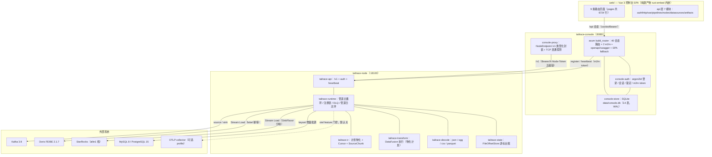
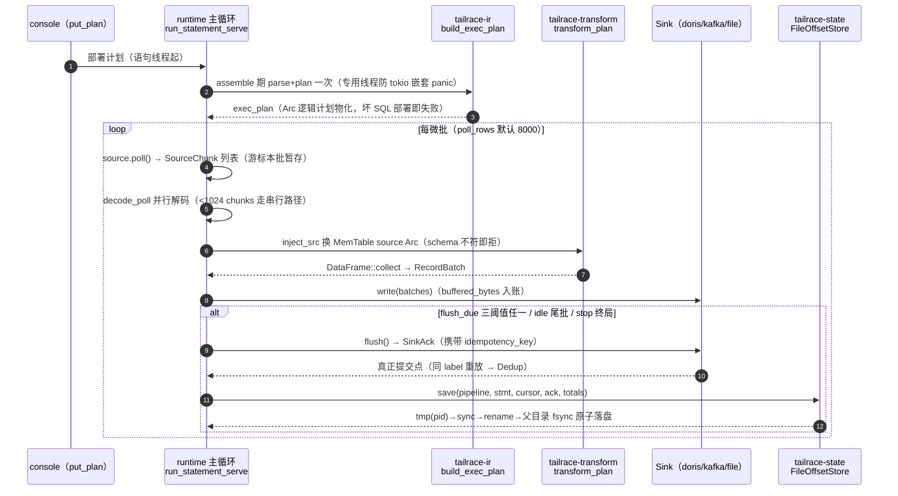
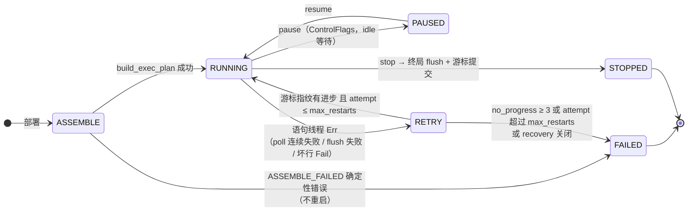
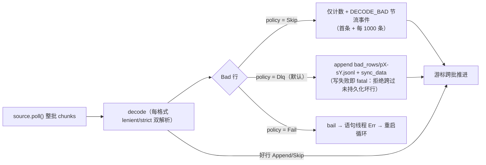
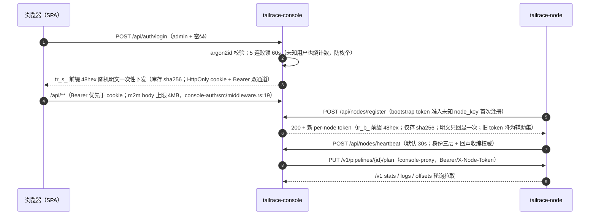
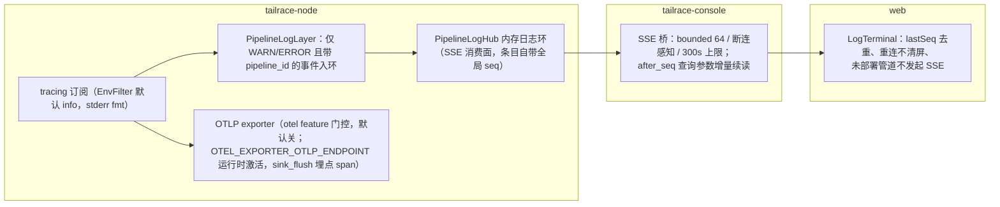
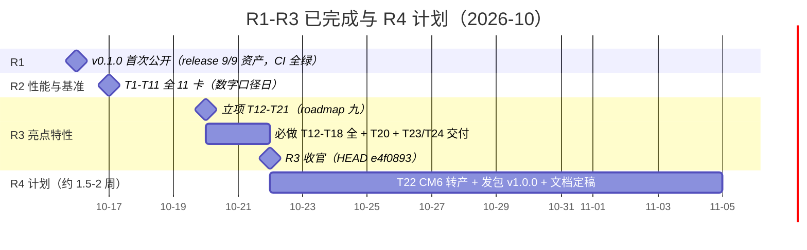
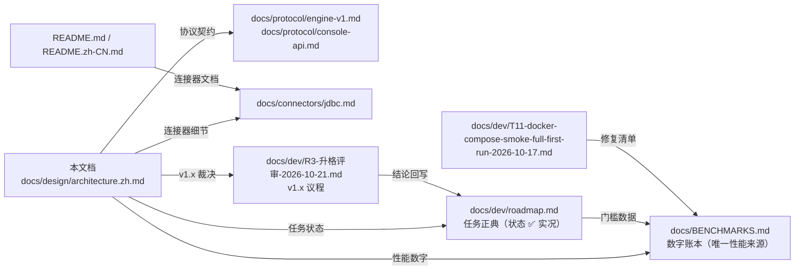

# tailrace 架构设计（R3 收官版）

> 读者：新贡献者与评审者。本文档描述**已落地**的系统形态（R3 收官基线，HEAD `e4f0893`，2026-10-22），不是愿景稿。
> 三条引用纪律：性能数字一律引 `docs/BENCHMARKS.md` 现值（带行号锚点）；任务状态一律引 `docs/dev/roadmap.md` ✅ 实况；代码锚点 `路径:行号` 可直接点开核对。
> 定位：R4 计划中「设计文档以脱敏干净版重新入仓」（roadmap.md:194）的落点即本目录；2026-10-11 内部设计档为本文档前身，差异见 §十一。

## 目录

1. 项目定位与北极星
2. 总体架构
3. 数据面：SQL 管道与执行
4. 游标与容错语义
5. 连接器体系
6. 管理面 console
7. Web 控制台
8. 可观测性
9. 性能账本摘要
10. 工程与质量
11. 路线图现状
12. 附录

## 一、项目定位与北极星

**v1.0：一条 SQL、两个二进制、零 JVM 的数据接入引擎，管理台内置，Doris/StarRocks 写入语义完整。**（roadmap.md:9）

三条差异化支柱（roadmap.md:13-15）：

| 支柱 | 承诺 | R3 收官兑现 |
|---|---|---|
| 单二进制轻量边缘 | 2-4GB 内存盒子可跑引擎+管理台，无 JVM/Temporal/多容器编排 | 裁剪档 node **55,788,080 B（−9.4%）**（BENCHMARKS.md:358）；file→doris 裁剪档 e2e 30/30（:361） |
| SQL-first + DataFusion | 管道即一条 `INSERT INTO 库.表 SELECT …`，不学私有 DSL | parser→IR→transform 全链落地（§三），SQL 计划每语句物化一次（T7 内存治理） |
| Doris/StarRocks 深度工程化 | 写入语义谱系：label 幂等 → 事务接口 → group commit | label 幂等档已落地（同 label 重放 `FlushOutcome::Dedup`，conn-doris/src/lib.rs:196-205）；事务接口/group commit 排 v1.x（T18 ③④，见 §十一） |

两条红线（roadmap.md:17）：**不拼连接器数量；不做真正流式 join/水位线/状态后端。**

轮次结构（roadmap.md:19）：R2 性能与基准（T1-T11 全 ✅，:49-150）→ R3 亮点特性（必做 T12-T18 全 ✅ + 选做 T20 ✅，:209-279）→ R4 1.0 发布（进行中）。

## 二、总体架构

一句话：Vue SPA 构建产物内嵌进 console 二进制；console 经 `/v1` 协议驱动 node；node 内 runtime 主循环驱动 source→decode→transform→sink；游标台账本地原子落盘；Kafka/Doris/StarRocks/MySQL/PostgreSQL 为外部系统，SQLite 为 console 元数据库。

下图给出组件分层与数据流方向（实线=数据/调用主链，虚线=可选门控路径）：

### 2.1 引擎 crate 全景（engine/crates/，15 个）

| crate | 职责 | 行数（含测试括注 src） |
|---|---|---|
| tailrace-runtime | 管道执行主循环 / 注册表 / 重启 / DLQ / 管道日志 | 4691（src 3199） |
| tailrace-api | axum REST：console→node 唯一入口（/v1+auth+heartbeat） | 2098 |
| tailrace-conn-doris | Doris/StarRocks Stream Load sink（同 crate feature 分味） | 1173 |
| tailrace-conn-kafka | Kafka source/sink（BaseConsumer/BaseProducer 同步数据面） | 1116 |
| tailrace-conn-jdbc | MySQL/PostgreSQL keyset 增量批源（T13 新增） | 1429（src 982） |
| tailrace-decode | ColBatch + 4 Decoder（json/ogg/csv/parquet） | 1168（src 1026） |
| tailrace-metadata | discover/infer-schema 元数据客户端（T14 新增） | 1185（src 892） |
| tailrace-catalog | CatalogProvider：FileCatalog/PlanCatalog/ControlPlane | 834 |
| tailrace-conn-file | file source/sink（jsonl/parquet）+ bench | 818（src 722） |
| tailrace-parser | SQL 编译（仅 INSERT + `${ds:…}` 表引用）+ 校验诊断 | 581 |
| tailrace-transform | DataFusion 执行层（thread_local session + 物化计划） | 540（src 448） |
| tailrace-ir | PipelineIr / build_exec_plan / Cursor / SourceChunk | 442 |
| tailrace-state | OffsetStore trait + FileOffsetStore（JSON 台账） | 441 |
| tailrace-conn-mqtt | **1 行占位**（T18⑥ 裁决：v1.x + 12 个月触发器） | 1 |
| tailrace-conn-s3 | **1 行占位**（T18⑦a 裁决：v1.x） | 1 |

### 2.2 管理面 crate（console/crates/，4 个）

| crate | 职责 |
|---|---|
| console-auth | 认证平面：argon2id、暴力锁定、会话 token（cookie/bearer）、m2m bootstrap/per-node token（console-auth/src/lib.rs:1-28） |
| console-store | SQLite 元数据库：WAL + busy_timeout + foreign_keys + synchronous=NORMAL（T8，pragma_update）；rusqlite_migration 单迁移自动前滚；启动 purge 过期会话与指标（console-store/src/lib.rs:1-9、:51-56、:70-77、:108） |
| console-proxy | console→engine HTTP 层：`NodeEndpoint` 类型化 /v1 封装 + `probe_datasource` TCP 探测（3s 超时 / ≤8 端点）（console-proxy/src/lib.rs:1-11、probe.rs:25-40） |
| tailrace-console | lib+bin 装配：build_router、7 个 api 域、compile.rs（内嵌 parser 本地编译）、openapi.rs、spa.rs、state.rs（tailrace-console/src/lib.rs:1-5） |

## 三、数据面：SQL 管道与执行

管道即一条 SQL：`INSERT INTO ${ds:sink} SELECT … FROM ${ds:source}`（仅支持 INSERT；表引用用 `${ds:a.b}` 占位）。主链自部署到 flush 提交的全过程如下（serve 模式）：

### 3.1 主链函数锚点

| 环节 | 锚点 | 说明 |
|---|---|---|
| 编译 | `engine/crates/tailrace-parser/src/lib.rs:53`（`compile`） | 仅 INSERT、`${ds:a.b}` 表引用 |
| 校验 | 同文件 `:120`（`validate`） | source kind 白名单 `kafka\|file\|jdbc`（:124）；sink `kafka\|file\|doris\|starrocks`（:147）；JDBC（源）/JDBC_TABLE（Doris 汇）交叉误用各有定向诊断（:134-135、:155-156，T23 low#2 清偿） |
| kind 归一 | `engine/crates/tailrace-catalog/src/lib.rs` | `JDBC_TABLE`→doris、`starrocks` canonical；PlanCatalog 表元数据随 plan 推送 |
| 计划物化 | `engine/crates/tailrace-ir/src/lib.rs:43`（`build_exec_plan`） | 组装期 parse+plan 一次（T7）；`:84` `plan_to_b64` proto 序列化；`:97` `b64_to_plan` **gated**（DF48 CustomScan qualifier 边界，JSON 载体为正典） |
| 组装 | `engine/crates/tailrace-runtime/src/lib.rs:482`（`PipelineRunner::assemble`） | `:516` 调 build_exec_plan 存 `exec_plan: Arc<LogicalPlan>`（字段 :114） |
| 执行 | `engine/crates/tailrace-transform/src/lib.rs:153`（`transform_plan`） | 每微批仅 `inject_src()`（:110）换 source Arc + collect；thread_local SESSION（:66）+ GreedyMemoryPool 默认 256MiB（:35、:75） |
| Sink 契约 | `engine/crates/tailrace-connector/src/sink.rs:14`（`Sink` trait） | write/flush 两点；`buffered_bytes()`（:24）为字节阈值输入；flush=真正提交点，SinkAck 携 idempotency_key（:6-10） |
| 主循环 | `engine/crates/tailrace-runtime/src/lib.rs:666`（`run_statement_serve`） | standalone `run_statement()`（:924）同构 |

### 3.2 三项热路径机制（R2 交付）

- **T5 分区并行 a（并行 decode）**：`decode_poll()`（runtime/src/lib.rs:320）把同 poll 的 chunks 连续切片分组，scoped 线程并行解码到各自 ColBatch（`PARALLEL_DECODE_MIN_CHUNKS=512`，:270；<1024 chunks 串行，:275），`concat_batches` 按 chunk 序合并（:456-462）=字节级等价（等价性测试钉住）；worker panic 即 bail，游标不跨（:433-435）。验收：kafka(P=6)→file 21396→24658 rows/s（**+15.2%**，BENCHMARKS.md:115）。
- **T6 攒批三阈值**：`RunOptions::flush_due()`（runtime/src/lib.rs:94）单一谓词——行/时间/字节任一满足即 flush，默认 10k 行 / 10s / 8MiB（:74-85），参数语义对齐 Doris Flink connector 的 `sink.buffer-flush.max-rows/max-bytes/interval`；三类 sink 的 `buffered_bytes()` 均为真实测量（file=arrow 内存、doris=carrier 字节、kafka=投递回调在途账）。批分布见 BENCHMARKS.md:303-306。
- **T7 内存治理（计划物化）**：session batch_size 固定为 poll_rows（组装一次定型，runtime/src/lib.rs:688-691）；SQL 每微批不再 parse+plan。验收：transform 微基准 identity **+58%** / filter **+20%** / groupby **+30%**（BENCHMARKS.md:110-112）。

## 四、游标与容错语义

**核心承诺：at-least-once，游标只在 flush 成功后整图提交。**

### 4.1 Cursor 四型与 SourceChunk

`engine/crates/tailrace-ir/src/cursor_sourcechunk_impl.rs:4`：

| Cursor 型 | 载荷 | 适用 |
|---|---|---|
| `Kafka` | topic + group + `offsets: BTreeMap<i32,i64>`（分区→next offset） | kafka 源 |
| `File` | path + byte_pos | file 源 |
| `JdbcKey` | key + value（T13 新增第三型） | jdbc keyset 批源（游标列须 PK/单列 UNIQUE，fail-fast 探针把关） |
| `None` | — | 无位点语义的源 |

`SourceChunk`（:25）：`raw: Vec<u8>` + `partition: Option<i32>` + `next_offset: Option<i64>`（kafka/plain 两构造）。

### 4.2 flush 点整图提交（at-least-once 锚）

serve 主循环（runtime/src/lib.rs:666）共三处 flush 点，全部先 `sink.flush()?` 再 `state.lock().save(…)`；其中 idle 尾批与三阈值两处的 save 携 `Some(&ack.idempotency_key)`，stop 终局因无新 ack 语义传 `None`（serve 与 standalone 终局同）：

| flush 点 | serve 锚点 | standalone 同构锚点 |
|---|---|---|
| idle 尾批 | lib.rs:767-781 | lib.rs:958-972 |
| 三阈值触发 | lib.rs:856-885 | lib.rs:1055 附近 |
| stop 终局 | lib.rs:894-918 | lib.rs:1096 |

台账耐久性（tailrace-state/src/lib.rs:1-14）：tmp(pid)→sync_data→rename→父目录 fsync；损坏文件 `.corrupt` 隔离 + `.bak` 回退，仍不可读则 **fail closed**（拒绝带着未知位点继续）。

### 4.3 语句生命周期与 NO_PROGRESS 判决

下图是单条语句自部署起的生命周期（含重启循环与终态；NO_PROGRESS_LIMIT 写死 3 次不配置化——防毒数据死循环后门，registry.rs:28-30）：

- **指纹**：`cursor_progress()`（registry.rs:57）把每语句游标折叠为 u64——Kafka 逐分区 fold（部分分区推进=进步，:65-69）；JdbcKey fold key+value（:74-77；R3-W1 修复 488efcc：常量会让 3 次瞬断误判毒数据）。
- **判决**：每次重启循环比对指纹（registry.rs:443-461）；判死即 `thread_flags.fail()`（STATE_FAILED=3，:99/:131）+ STATEMENT_FAILED 事件，快照/心跳如实带 FAILED（治僵尸 RUNNING）。
- **poll 退避**：指数 1s→…→300s 封顶（runtime/lib.rs:724），连续 ≥10 次（≈5min）才 Err 交重启循环（:747-748）；任何 poll Ok（含空批）复位（:753）。

### 4.4 DLQ / BadRowPolicy

坏行在**整 poll decode 完成、游标跨批之前**统一处理（`handle_bad_rows()`，engine/crates/tailrace-runtime/src/lib.rs:192）——保证台账位点永远对应「已处置完坏行」的边界：

| 策略 | 定义锚点 | 行为 |
|---|---|---|
| Dlq（默认） | engine/crates/tailrace-runtime/src/dlq.rs:40、:86 | 落 `state_dir/bad_rows/p{p}-s{s}.jsonl`，记录含 tsMs/pipeline/statement/**poll 时游标**/rawB64（:25-36，手工恢复锚） |
| Fail | engine/crates/tailrace-runtime/src/dlq.rs:40、engine/crates/tailrace-runtime/src/lib.rs:208 | 即 bail（毒数据停管道而非丢弃） |
| Skip | engine/crates/tailrace-runtime/src/dlq.rs:40 | 仅计数 |

## 五、连接器体系

**注册模型**：显式 `register()` 调用（node `build_registry()`，engine/bin/tailrace-node/src/main.rs:25-40）——≤10 个连接器保持一眼可读，不引入 inventory/linkme 类注册宏（main.rs:23-24 注释）。未知 kind 报「源类型未支持：{kind}（本二进制未编译该连接器 feature）」（tailrace-connector/src/registry.rs:55-59）——裁剪是注册表级语义，不只是字节（负向探针见 BENCHMARKS.md:512）。

**feature 门控**（node Cargo.toml:12-31）：default=connector-kafka/file/doris；`connector-jdbc`、`connector-mqtt`、`connector-s3` 为门控 feature（jdbc 已真实现；mqtt/s3 仍占位）；`otel`（T2）与 `jemalloc`（T20）默认关。注意 `connector-jdbc` **仅 node bin 注册**，runtime 的 `default_registry()` 不含此 feature（runtime/Cargo.toml:12）。

### 5.1 现状矩阵

| kind | 方向 | 注册点 | 能力要点 | 状态 |
|---|---|---|---|---|
| kafka | source+sink | conn-kafka lib.rs:29-32 | BaseConsumer 手管位点（assign-only 恢复 :180-192）；30s 动态分区发现（§5.2）；半批 seek 回滚（:296-309）；sink JSON-lines 载体 + 真实在途 buffered_bytes（:498-499，T6） | ✅ |
| file | source+sink | conn-file lib.rs:20-21 | jsonl/parquet；buffered_bytes=arrow 内存估（:338-345） | ✅ |
| doris | sink | conn-doris lib.rs:151 | Stream Load BE 直连，**JSON-lines 载体**（T11：CSV 载体在 be-2.1.7 实测毁毒行）；label 幂等（进程 run 前缀 :294-296）；`FlushOutcome::{Success,Dedup}`（:196-205）；重试退避 2s→8s→30s | ✅ |
| starrocks | sink | conn-doris lib.rs:153（feature 默认开，Cargo.toml:18） | T12 完整化：`SinkFlavor`（:142）同工厂按 kind 分味；差异=8030 端口 / 无 read_json_by_line / 无 sequence_column / FE 307 redirect 跟随（:420-425）；ack kind=STARROCKS_STREAM_LOAD（:349-350） | ✅ |
| jdbc | source | conn-jdbc lib.rs:74 | T13 新增：sqlx 子 crate 双方言（MySQL/PostgreSQL）；keyset `WHERE col>? LIMIT n` 增量；游标列唯一性 fail-fast 探针（:362-397，R3-W1 medium②）；游标仅在整批转换后推进（:487）；testcontainers mysql:8/postgres:15 双方言测试（tests/jdbc_sources.rs:108/:290） | ✅ |
| mqtt | — | 不注册（占位） | 1 行 crate | 占位（T18⑥：v1.x + 12 个月触发器，否则从 P2 移除） |
| s3 | — | 不注册（占位） | 1 行 crate | 占位（T18⑦a：v1.x；CDC 走 debezium JSON 廉价路径评估） |

配套：T14 新增 `tailrace-metadata`（discover/infer-schema）——rdkafka fetch_metadata 采样 / Doris 9030 文本协议 SHOW/DESC / PG information_schema / decode 链同款类型推断（metadata/src/lib.rs:84、:143）。已知边界：doris 型 discover 的 9030 文本协议未在真 Doris FE 实测（roadmap.md:231）。

### 5.2 动态分区发现（自 v0.1.0 已在，T15 补三层测试）

每 30s `fetch_metadata`（5s 超时）差异对比（conn-kafka/src/lib.rs:209-274）；新分区按语句起始位（earliest=0 / latest=高水位，失败 fallback 0，:227-239）入 offsets map；assign 模式显式 TPL 重建（:259-264）+ paused 重暂停（:268-270）。发现延迟口径 ≤~35s，实测 subscribe 26.8s / assign 30.7s（BENCHMARKS.md:363）。已知单向限制（只增不减，分区消失后死项不清理）排 v1.x（roadmap.md:328）。

## 六、管理面 console

### 6.1 API 面（tailrace-console/src/lib.rs:24-161）

| 域 | 路由数 | 内容 |
|---|---|---|
| 开放 | 4 | `/healthz`(:151)、`POST /api/auth/login`(:152)、swagger-ui + openapi.json(:157)、SPA fallback(:159) |
| 会话域（require_session :126-129；上传限 512MB :132） | 40 模式 | auth 2（:30-31）；datasources 10（含 T14 的 `{id}/discover`、`{id}/infer-schema` :61-67，:33-71）；nodes admin 12（含 **501×3**：deploy/action/migrate，nodes_admin.rs:759/:777/:798——T19 选做未做，:73-93）；artifacts 2（:95-99）；pipelines 14（CRUD/compile/templates/publish/deploy/pause/resume/stop/recover/stats/offsets/logs(SSE)/metrics-trend，:100-125） |
| m2m 免会话 | 2 | `POST /api/nodes/register`(:138)、`POST /api/nodes/heartbeat`(:144) |

openapi（utoipa 6）：52 path 条目 + 66 DTO 全登记（openapi.rs:37-127；paths() 函数引用 52、schemas() 66，与全仓 `derive(ToSchema)` 66 互证），`$ref` 走查测试实跑通过（2026-10-22 勘察复跑 `cargo test -p tailrace-console --lib every_schema_ref_resolves --locked` → 1 passed）。

### 6.2 认证链路

下图覆盖浏览器登录、node 注册轮换、心跳与计划下发四条链：

要点：argon2id（console-store/src/password.rs:14-33）；会话 TTL 86400s（session.rs:12）；全局 bootstrap token 仅准入**首次** register，已注册节点持全局 token 一律 401（bootstrap.rs:61-66）；bootstrap 来源 `TAILRACE_BOOTSTRAP_TOKEN` 或启动生成打印一次（main.rs:119-129），首启 admin 密码一次性打印（:109-117）；数据源凭据 AES-256-GCM 密文存储，master key 解析 fail-closed 拒启动（secretbox.rs:1-17、main.rs:98-107）。

### 6.3 SQLite 元数据（14 表）

`console-store/migrations/00_init.sql` 单迁移：user(:3)、session(:12)、datasource(:20)、datasource_credential(:30)、table_object(:36)、node(:52)、artifact(:70)、deploy_log(:81)、node_event(:92)、pipeline(:104)、pipeline_version(:121)、pipeline_metrics(:133)、node_metrics(:139)、audit_log(:147)，另 5 索引。pragmas：WAL + busy_timeout + foreign_keys + synchronous=NORMAL（T8，事务化后 4 并发×500 事件批最差 31.7ms，roadmap.md:120）。node 的 OFFLINE 判定为 90s 读时计算，无后台回写（console-api.md:62）。

### 6.4 /v1 引擎协议（docs/protocol/engine-v1.md ↔ 代码一致）

| 面 | 内容 | 锚点 |
|---|---|---|
| 路由 | POST /v1/compile；GET /v1/pipelines；PUT /v1/pipelines/{id}/plan；GET stats/logs/offsets；POST {action}；/healthz 唯一开放 | tailrace-api/src/lib.rs:95-361 |
| 鉴权 | 整面 Bearer/X-Node-Token，缺/错 401 统一错误信封；token 五级优先链（--api-token > env > 领养 node_token > --bootstrap-token > 自生成） | auth.rs:250-272、:1-16、:139-174 |
| 轮换 | register 回声轮换 current，启动凭据终生为辅助集 | auth.rs:73-108 |
| 心跳 | 事件环 64、默认 30s、身份三层（旗标>identity.json>自生成）、回声收编 | heartbeat.rs:7-8、:21-73 |
| 契约测试 | v1_protocol 4 + executor_loop 3 | tests/contract/tests/（manifest 显式 connector-file，Cargo.toml:24，6f855f7） |

## 七、Web 控制台

### 7.1 页面矩阵（路由 9 条，web/src/router/index.ts:11-31；守卫 :40-64）

| 路由 | 行数（2026-10-22 实测） | 职责 |
|---|---|---|
| /login | 244 | 独立布局登录页 |
| /overview | 616 | 总览 |
| /datasources、/datasources/:id | 604 / 454 | 数据源管理 + discover/infer-schema 动线（DiscoverModal.vue 363 行，index.vue:39,499 挂载） |
| /nodes | 966 | 引擎节点 |
| /pipelines、/pipelines/edit | 394 / 961 | 管道列表 / 编排（edit 为静态段防与 :id 冲突） |
| /pipelines/:id/publish、/pipelines/:id/monitor | 450 / 752 | 发布 / 监控（SSE 日志，未部署不挂载） |

全局守卫首跳探 `GET /api/auth/me`（401→/login?redirect&expired），sanitizeRedirect 只放行站内相对路径防开放重定向。侧边栏四项：总览/数据源/引擎节点/数据管道（ConsoleLayout.vue:44-48）。

### 7.2 SqlMonaco 现状与 T22 计划

现状（T9 形态仍在 main）：入口裁剪到 editor.api + sql 词法 + 25 个编辑侧 contrib（SqlMonaco.vue:11-41），单 editor worker；`库名.` 触发表补全（max 50，接受后自动插 `-- @tag:ds`，:101-152）；compile diagnostics→markers（:298-312）；异步加载（edit.vue:49-50 + vite advancedChunks minShareCount=2，vite.config.ts:41）。dist 实测首屏零 monaco（`grep -c monaco dist/index.html`=0）；编辑器 chunk gzip 883.22 kB（T9 记录，roadmap.md:129）。

T22（R4 承接，roadmap.md:287-292）：以 PoC 分支 `poc/codemirror6@7f32c26` 为基线替换 monaco——编辑器 chunk gzip **883.22→140.45 kB（−84.1%）**，CM6 零 worker/字体/外部 CSS；验收含 CI web job 绿、chunk gzip ≤300kB、真页 e2e、monaco 依赖从 package.json 移除（现仍为 ^0.57.0）。

### 7.3 构建口径

vite ^8.3.4（rolldown 内核，object-form manualChunks 不支持、advancedChunks.groups 为原生等价，vite.config.ts:32-34）+ vue-tsc ^3.3.13；`/api` 代理 → localhost:8080（:17-24）。`scripts/build.sh`：pnpm build → cargo build --release --locked 双 bin → package.sh（每 target 2 tarball + checksums，8 tarball 总 checksums 由 release aggregate 重生成）。`scripts/dev.sh`：console debug（rust-embed 磁盘读 dist）+ vite dev :5173。Makefile 六目标：fmt/lint/test/web/build/release。

## 八、可观测性

下图给出日志/事件/指标三条通道（emit 结构化事件为 SSE 消费正典，tracing 为工程日志，OTLP 为可选外送）：

- **T2 交付**：engine/crates 37 处 eprintln 全部转 tracing 结构化宏（当时 grep=0 验收；现值 grep=8，全部位于测试侧——T13/T14/T15 新增的 live-gate skip 提示，conn-kafka 两处在 :549 起的 `#[cfg(test)]` 模块内——生产路径仍为 0，本会话实测）；PipelineLogLayer 让 Hub 成为 tracing layer sink——SSE 链路与 emit 三件套零改动（R1 审计红线）。
- **T10 交付**：SSE 断线重连不重放（`after_seq` 种子化引擎游标）、未部署管道零重连死循环；集成测试钉住两行为。
- **OTLP 门控**：opentelemetry 0.33 + tracing-opentelemetry 0.34，默认关；是否升默认开启未决（roadmap.md:199）。

## 九、性能账本摘要

**机器口径**：R2 数字采自 Intel i7-9750H / 32GB（BENCHMARKS.md:9-20）；R3 起第二机 Apple M4 / 16GB（:345-350）——**跨机器不可比**；宏基准默认 debug 档（不代表 release 性能），优化对比一律同机同日复测。

### 9.1 R2 四组优化（同机同日，BENCHMARKS §四）

| 任务 | 口径 | 前 → 后 | 变化 | 锚点 |
|---|---|---|---|---|
| 基线 | decode json / ogg / csv | 301.7K / 288.9K / 652.4K rows/s | — | :41-43 |
| 基线 | transform identity / filter / groupby | 19.12M / 7.34M / 6.14M rows/s | — | :55-57 |
| 基线 | sink encode / flush | 8.43M / 205.7K rows/s | — | :68-69 |
| 基线 | 宏 file→file（debug） | 21739 rows/s | — | :93 |
| T3 零拷贝 | decode json / ogg / csv | 328.9→534.9K / 319.4→463.2K / 45.0→50.0K | **+33%（保守）** / +45% / +11% | :133-135 |
| T3 零拷贝 | sink flush | 234.4→458.2K | **+95%** | :136 |
| T3 零拷贝 | 宏 file→file | 21739→24649/25246 | **+13.4~16.1%** | :148-149 |
| T7 内存治理 | transform identity / filter / groupby | 19.3→30.6M 等 | **+58% / +20% / +30%** | :110-112 |
| T7 内存治理 | 宏吞吐 / 峰值 RSS | 25138→25094 持平；46888→49124 KiB | 持平 / +2.2MiB | :113-114 |
| T5 分区并行 a | kafka(P=6)→file | 21396→24658 | **+15.2%**（交错 A/B） | :115 |
| T6 攒批三阈值 | 批大小分布（非吞吐口径） | 默认 6 批全 16000+终局 4000；128KiB 档 13 批 p50=8000 | —（粒度=微批边界，如实登记，:308-314） | :109、:303-306 |

### 9.2 R3 账本（M4 机，BENCHMARKS §六）

| 任务 | 口径 | 数字 | 锚点 |
|---|---|---|---|
| T20 jemalloc | 宏吞吐（3 轮中位） | 33670 vs 33738 rows/s，**+0.2% 持平**（±17% 量化界，debug 档短跑无检出力） | :354、:365 |
| T20 jemalloc | 峰值 RSS | 53616 vs 57808 KiB，**jemalloc 反高 +7.8%**（区间不重叠）；碎片未测（显式占位行）；feature 默认 OFF | :355-357 |
| T16 裁剪档 | node release 体积 | 61,571,936 → **55,788,080 B（−9.4%）**；依赖图 435→413 包；file→doris e2e **30/30（11.9s，12==12 守恒）**；默认档回归 25/25 | :358-361 |
| T15 分区 | kafka(P=6)→file（M4 首档） | 中位 **27861 rows/s**（跨机器不可比已登记；比值旁证 0.83 一致） | :362 |
| T15 分区 | 动态发现延迟 | subscribe 26.8s / assign 30.7s（口径 ≤~35s） | :363 |

CI 侧 T11 首跑档：`smoke --full` **44/44 步、11m20s**；毒浸泡 1700 行四点守恒；容器峰值 kafka 371.7MiB / doris-fe 867.4MiB / doris-be 1.082GiB（BENCHMARKS.md:329-332）；chaos kill-9 60.56s 幂等对账（BENCHMARKS.md:333-335）。**缺口（如实）**：无 Doris/StarRocks sink 吞吐基线——升格 group commit 前必须补（T18④门槛）。

## 十、工程与质量

### 10.1 测试五层（roadmap §三；现值为 2026-10-22 勘察实测）

| 层 | 内容 | 命令 | 现值 |
|---|---|---|---|
| L0 静态门 | 格式/lint/供应链 | `cargo fmt --all --check`；clippy `-D warnings`；`cargo deny check` 四门 | fmt/deny 本机实跑绿；clippy 由 CI rust job 保证（v0.1.0 基线 124 passed，roadmap.md:35） |
| L1 单元+契约 | 全 workspace + 契约套件 | `CARGO_PROFILE_DEV_DEBUG=0 cargo test --workspace --locked` | **176 passed / 0 failed / 2 ignored**（本机实测，与 roadmap.md:326 登记一致）；contract **7/7**（executor_loop 3 + v1_protocol 4） |
| L2 端到端冒烟 | file→file 全链真进程 | `./scripts/smoke.sh` | 25 步口径；最近 25/25 @ T16 回归（BENCHMARKS.md:513） |
| L3 docker 链路 | kafka→doris + 毒数据 + 位点不丢不重；chaos | `docker compose up -d` → `smoke.sh --full`；chaos job | CI 最新 run（39627334972，HEAD e4f0893）**八 job 全绿**：smoke 44/44；chaos 含 jdbc 真库（170.45s + 活性 10.94s + jdbc 19.37s） |
| L4 基准 | 微基准 + 宏基准，优化必须前后对比 | `cargo bench -p`；`scripts/bench/macro.sh` | 全部数字入 BENCHMARKS.md（§九摘要） |

smoke 三档步数：默认 25 / `--full` 44（+毒浸泡，SOAK 本地默认 600s、CI 180s）/ `--slim` 30（T16 裁剪档）。

### 10.2 CI 与 release

| CI job（.github/workflows/ci.yml，实况 **8 job**） | 锚点 | 内容 |
|---|---|---|
| rust | :16 | fmt + clippy + test + deny（advisories/bans/licenses/sources，deny 2.1.1） |
| msrv | :35 | 1.95 真实编译验证（ADR-001，roadmap.md:21-26） |
| no-default-features | :45 | 空 feature 组合编译契约 |
| slim-features | :55 | T16 新增：可售裁剪组合（file+doris）check + cargo tree 防泄漏链接图 |
| macos | :76 | `-p tailrace-api -p console-store` 核心测试 |
| web | :85 | typecheck + build |
| chaos | :102 | testcontainers 真栈 + swapoff + vm.max_map_count，含 jdbc 真库（:125-130，暂无 `--include-ignored`，见 §11.3 债务 1） |
| smoke | :132 | build.sh + `--full` SOAK=180 |

> 口径注记：roadmap §三写「六 job」（:42）、§十一写「七 job」（:352），均为 T16 增 slim-features 前的滞后口径；本文以 ci.yml 实况 8 为准。

release（release.yml）：preflight（红提交不发，:16）→ build 4 目标矩阵（x86_64/aarch64-linux 走 cross；双 apple-darwin 原生，:35-38）→ aggregate **8 tarballs + 1 checksums.txt = 9 资产**（:76-96）。crates.io 三名 `tailrace` / `tailrace-node` / `tailrace-console` 已以 0.0.0 占位注册（2026-10-21，提交 8ebc4f1；roadmap.md:194）——R4 发包以真实现版本号覆盖。

## 十一、路线图现状

时间线（仅标有档案日期的里程碑；R4 为计划时长。v0.1.0 里程碑取 roadmap.md:5「2026-10-16 首次公开」口径——CHANGELOG [0.1.0] 记的 2026-10-13 为初始基线日，旧 README 沿用该滞后口径，本图不采）：

### 11.1 完成实况

- **R2（全 ✅，roadmap.md:49-150）**：T1 基准套件、T2 tracing+OTLP、T3 零拷贝、T4 毒数据 JSON-lines 载体、T5 分区并行 a、T6 攒批三阈值、T7 内存治理、T8 console 心跳写、T9 monaco 首屏、T10 SSE 续读、T11 docker 链路首跑+CI 深化。
- **R3（必做全 ✅，:209-264）**：T12 StarRocks 完整化（1cd38d0）、T13 JDBC 批源（caa842e）、T14 discover/infer-schema（1c5dcf6）、T15 分区评估——**split 化按写死回退门降级 v1.x**（288c3cf）、T16 裁剪验证（33cf61e）、T17 CM6 评估→升级 R4 落地卡（PoC 7f32c26）、T18 升格评审（5b44c76）。选做：T20 ✅（9a9f8a2）；**T19 SSH 部署链、T21 fuzz 未做**（:266-285）。评审债：T23 ✅（d9f51bd）、T24 ✅（4881c39）。

### 11.2 T18 升格评审七项结论（docs/dev/R3-升格评审-2026-10-21.md 总表 :109-122）

| # | 议题 | 结论 |
|---|---|---|
| ① | deltalake sink | v1.x（硬耦合：deltalake-core 1.1.2 要 arrow ^59 vs 本仓 55.2.0） |
| ② | DataFusion 48→55 | v1.x + RUSTSEC 硬触发器（命中即升） |
| ③ | StarRocks 事务接口 | v1.x（v1.0 按「label 幂等档 + 语义文档化」收口） |
| ④ | group commit | v1.x，**先补 Doris sink 宏基准**（现无门槛数据） |
| ⑤ | 本地两步 WAL | v1.x（与③合并谱系卡） |
| ⑥ | MQTT 源 | 不升格 R4；v1.x 带 12 个月触发器否则从 P2 移除 |
| ⑦a | S3/CDC | v1.x（CDC 走 debezium JSON 格式廉价路径 ~1.5 人日评估） |
| ⑦b | live-gate 形态 | **唯一立即整改**：改 `#[ignore]` + CI `--include-ignored`（~0.5 人日，排 R4-W0） |

附议：split 化排 v1.x（触发=kafka(P=6)/file→file 比值显著低于 0.83-0.84 旁证且归因单 consumer 边界）；latest+subscribe 首跑发现窄窗排 v1.x。共同事实：外部需求信号 0（stars/forks/issues=0）。

### 11.3 R4 计划与未清债务

R4（roadmap.md:194，~1.5-2 周）：T22 CM6 转产落地；README 双语定稿（徽章矩阵+三命令 quickstart+FAQ）；mdBook 文档站骨架（本文档所在 design/ 目录即其素材）；crate 元数据补齐 + doc-test；crates.io 发包（真实现版本覆盖 0.0.0 占位）；tag v1.0.0 → release（9 资产）；基准报告入 README；错误码字典化接口预留（中文单轨明示）。

未清债务（按域）：

1. **live-gate 形态**（R3-W1 low#7 → T18⑦b）：5 个门控测试以 `return Ok` 计 passed——裁决已立，实施排 R4-W0（ci.yml:125-130 追加 `--include-ignored`）。
2. **分区发现单向**（R3-W3 low，roadmap.md:328）：死分区项永不清理、cursor 携带死项——v1.x 与窄窗/split 化同批。
3. **T19 SSH 部署链**（501×3 的本体）、**T21 fuzz**：R3 选做未排。
4. **jdbc 管道 console 端到端未通**：`build_plan_table` 取 connJson `bootstrap` 键而 mysql/pg 源只有 jdbcUrl、`sequence_column` 恒 null——部署期才炸（docs/connectors/jdbc.md §七:116-121）。
5. **BENCHMARKS 无 Doris/StarRocks sink 吞吐基线**（T18④门槛）；**CHANGELOG Unreleased 缺 T12/T14/T15/T16/T24 与 6f855f7 入账**（最后一次触碰是 T23）。
6. 文档口径漂移：roadmap CI job 数（六/七 vs 实况 8）；console-api.md:46 的 ticket 501 行失实（路由不存在，实际落 SPA fallback）。
7. 开放问题沿旧：zip 8.6 yanked + RUSTSEC 三条 ignore 待 zip 9 回收（roadmap.md:198）；OTLP 是否默认开未决（:199）；DF48 两条限制（memory pool 非全算子强制 / output_batches 指标缺）与 proto plan 解码 gated 均 v1.x 触发器制。

## 十二、附录

### 12.1 端口与本地环境配方（docker-compose.yml）

| 服务 | 端口（宿主默认） | 说明 |
|---|---|---|
| console | 8080 | Web/API；dev 模式 vite :5173 带 /api 代理 |
| node | 18100（示例 --addr） | /v1；可按节点自定 |
| compose kafka | `${TAILRACE_KAFKA_PORT:-9092}`→容器 9094 | 双监听器：容器内 PLAINTEXT :9092（healthcheck/smoke exec）、宿主 EXTERNAL 通告映射端口（:49-57，R3-W2 修复 68636d9 钉住两个实证失效模式） |
| compose Doris | FE http 38030 / FE MySQL 39030 / BE http 38040 | 默认避让本机常驻 doris-2.1（:28-38）；可 `TAILRACE_FE_*`/`TAILRACE_BE_*` 覆盖；smoke --slim 可用 `SMOKE_DORIS_MYSQL` 指常驻 Doris（FE 9030/BE 8040，BENCHMARKS.md:510） |
| compose StarRocks（--profile starrocks） | feproxy 48080（stream load 入口）/ FE MySQL 49030 | allin1 单容器；feproxy 拦截 FE→BE 307，引擎侧 redirect 跟随由 mock 契约测试覆盖（compose 注释，:150-166） |
| otel（--profile otel） | otel-collector:0.163.1 | 默认栈不含 |

测试环境：OrbStack（docker 29.4.0 / compose v5.1.2）；testcontainers（kafka/mysql/postgres modules，`TAILRACE_TESTCONTAINERS=1`）。chaos testcontainers 端口段 20000-34999（compose 注释）。

### 12.2 术语表

| 术语 | 含义 |
|---|---|
| 微批（micro-batch） | 一次 poll 拉取的批，默认 `poll_rows`=8000 行 |
| flush 点 | 真正提交点：`sink.flush()` 成功后游标才整图提交（at-least-once 锚） |
| 台账（offset ledger） | FileOffsetStore 落盘的游标+totals JSON（tmp→rename→fsync 原子写） |
| 指纹（cursor fingerprint） | 游标折叠 u64，重启循环据此判「有无进步」（NO_PROGRESS 判据） |
| SinkAck / idempotency_key | flush 成功回执；Doris/StarRocks 下为 Stream Load label（重放→Dedup） |
| SinkFlavor | conn-doris 内 Doris/StarRocks 同工厂按 kind 分味的差异枚举 |
| DLQ / BadRowPolicy | 坏行处置（Dlq 落盘 / Fail 停管道 / Skip 计数），游标跨批前统一处理 |
| serve / standalone | serve=console 下发计划常驻；standalone=本地 run 单次执行（同构三 flush 点） |
| live-gate | 无外部栈时测试以 `return Ok` 空过的门控惯例（T18⑦b 裁决改 `#[ignore]`） |
| 波次（wave） | roadmap 按文件域冲突分析的并行任务编排单元（§五） |

### 12.3 文档间引用图

下图给出 docs/ 内正典文档与本文档的引用关系（箭头=被引用为事实来源）：

> 维护约定：本文档随轮次收口更新（R4 起每轮）；性能/状态数字改动只改来源文件（BENCHMARKS/roadmap），本文档同步锚点即可。
